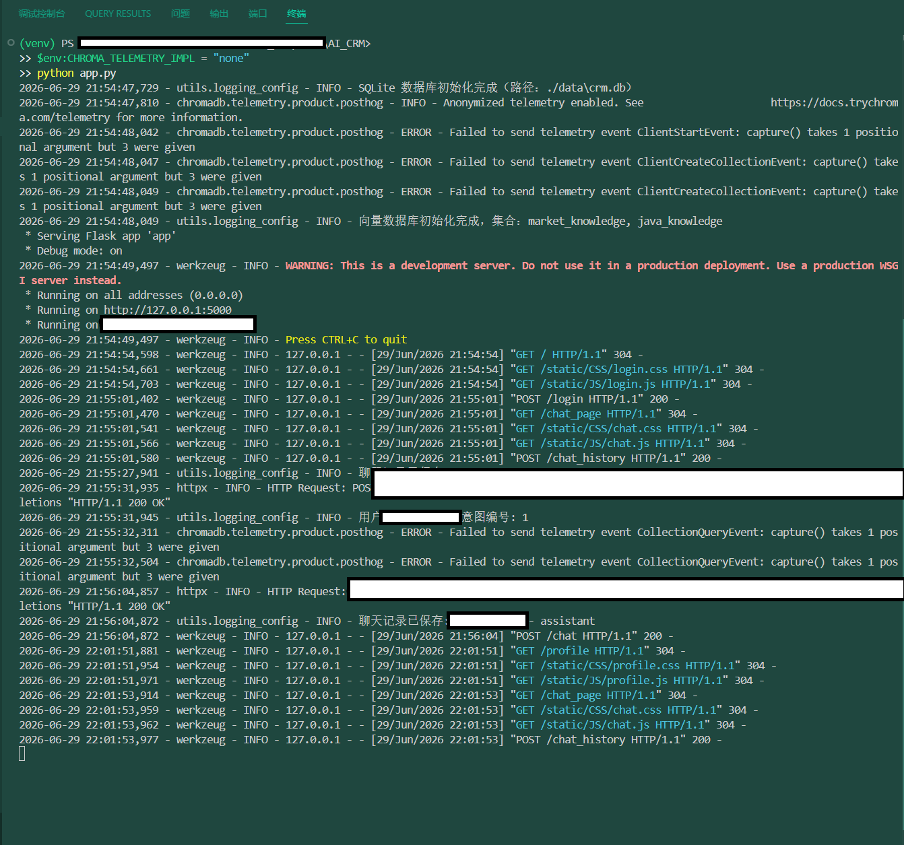
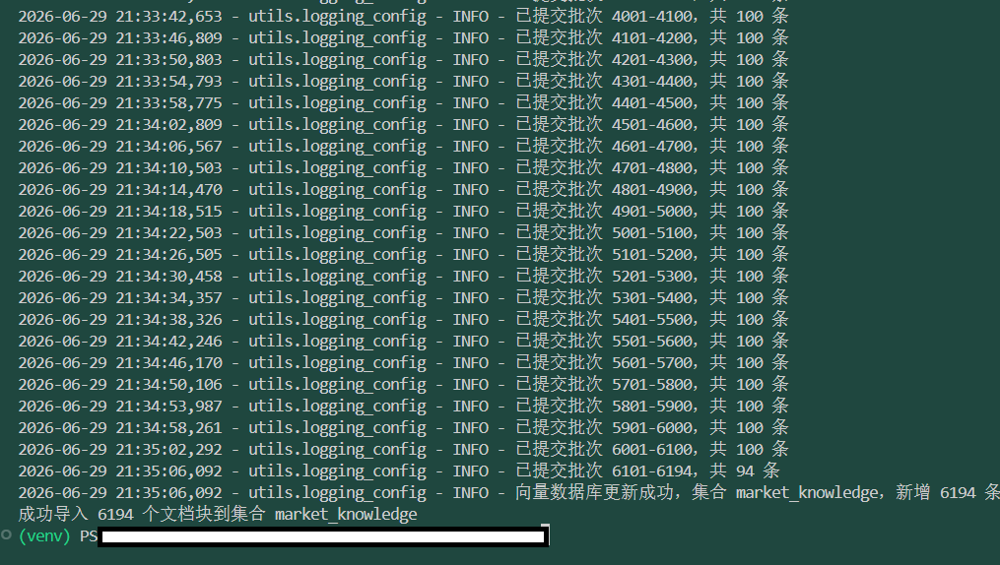
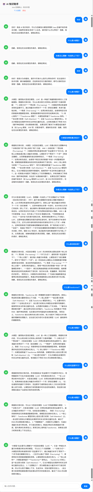
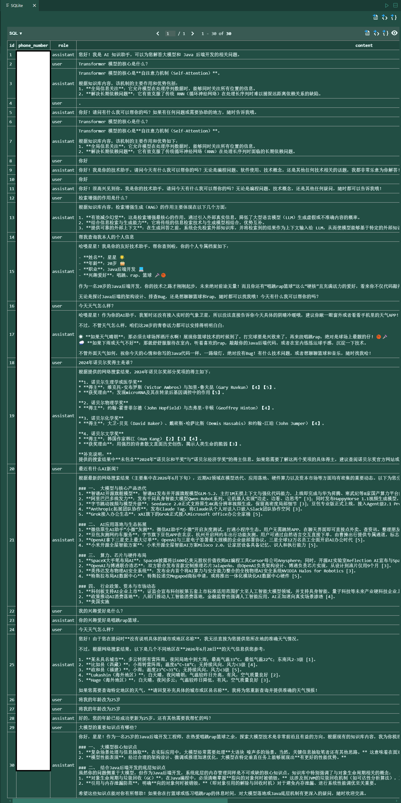
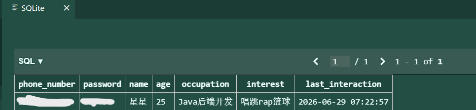
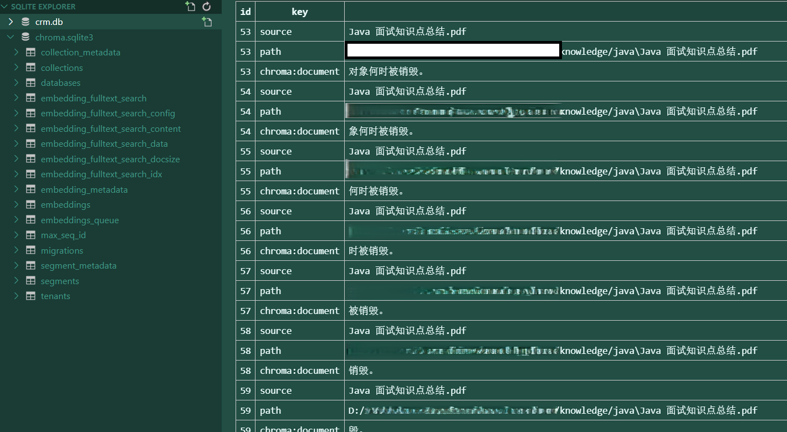

# 项目代码的阐述

### 1.*完整代码+运行截图/录屏*

#### 1.1**完整代码见项目代码文件夹**

#### 1.2**运行截图**

**项目启动示意图：**



**文件导入知识库示意图**



**聊天内容示意图：**


**数据库历史聊天记录示意图：**



**数据库个人信息示意图：**


**知识库内容示意图**：



### 2.*阐述function calling工具定义的基本信息，如function calling工具搭建的基本流程，定义的函数功能*

#### 2.1工具定义方式

在项目中，*Function Calling* 工具的定义主要采用两种方式：

**方式一：使用 *LangChain* 的 `@tool` 装饰器（早期原型 `tools.py`，已归档到 `../_archive_main_flow/`，生产代码走方式二）**

```python
from langchain.tools import tool

@tool
def get_user_info(phone_number: str) -> str:
    """根据手机号查询用户基本信息。"""
    info = get_user_info_from_db(phone_number)
    if info:
        return f"姓名: {info['name']}, 年龄: {info['age']}, 职业: {info['occupation']}, 兴趣: {info['interest']}"
    return f"未找到手机号 {phone_number} 的用户信息"
```

`@tool` 装饰器会自动将函数转换为 *LangChain* 的 `StructuredTool` 对象，并提取 *docstring* 作为工具描述，参数类型从函数签名推断。

**方式二：使用 `StructuredTool.from_function` 工厂方法（`function_calling_handler.py`）**

```python
from langchain.tools import StructuredTool

def _get_user_info() -> str:
    info = get_user_info_from_db(phone_number)
    if info:
        return f"姓名: {info['name']}, 年龄: {info['age']}, 职业: {info['occupation']}, 兴趣: {info['interest']}"
    return f"未找到手机号 {phone_number} 的用户信息"

get_tool = StructuredTool.from_function(
    func=_get_user_info,
    name="get_user_info",
    description="查询当前登录用户的个人信息，不需要任何参数。"
)
```

#### 2.2工具定义的基本流程

**定义功能函数**：编写完成特定业务逻辑的 Python 函数（如查询用户信息、更新用户信息）。

**包装为 LangChain 工具**：使用 `@tool` 装饰器或 `StructuredTool.from_function` 将函数包装成工具对象，并明确其名称、描述和参数说明。

**绑定到大模型**：在调用大模型时，通过 `bind_tools()` 方法将工具列表传递给模型，使模型具备调用这些工具的能力。

**处理工具调用响应**：模型返回 `tool_calls` 后，解析工具名称和参数，执行对应的函数，并将执行结果以 `tool` 角色消息返回给模型，最终生成自然语言回答。

#### 1.3 项目中定义的函数功能

| **工具名称**     | 功能描述                                             | 输入参数                                                     | 输出                   |
| :--------------- | :--------------------------------------------------- | ------------------------------------------------------------ | ---------------------- |
| get_user_info    | 查询当前登录用户的个人信息（姓名、年龄、职业、兴趣） | 无（通过闭包绑定 `phone_number`）                            | 格式化的个人信息字符串 |
| update_user_info | 更新当前登录用户的个人信息                           | `name`（可选）、`age`（可选）、`occupation`（可选）、`interest`（可选） | 更新成功或失败的提示   |

​	这些工具在 `function_calling_handler.py` 中被实际使用，当意图识别为 `4` 时，系统会调用该处理函数，让模型自主决定是否调用工具以及如何调用。

### 3.*RAG存储的内容描述，调研RAG有哪些优化方式，并阐述怎么跟本项目进行融合*

#### 3.1 RAG 存储内容描述

​	项目中的 RAG 知识库使用 **Chroma 向量数据库** 进行本地持久化，路径由 `config.CHROMA_PERSIST_DIR` 指定，当前为 `./data/chroma_db_v2`（`_v2` 是修复文本分块缺陷之后重建的库，旧库已删除）。集合空间度量为余弦（建集合时写入 `metadata={"hnsw:space": "cosine"}`）。包含两个集合：

| 集合常量 | 集合名 | 存储内容                                                     | 数据来源                                                     |
| -------- | --------------- | ------------------------------------------------------------ | ------------------------------------------------------------ |
| COLLECTION_MARKET | market_knowledge | 大模型知识点（Transformer、LLM、RAG、分布式训练、微调/RAG 面等） | 51 篇课程 PDF，经 `import_knowledge.py` 批量导入（当前 656 块） |
| COLLECTION_COURSE | java_knowledge   | Java 后端八股文（JVM、并发、Spring、MySQL、Redis、设计模式等） | `Java 面试知识点总结.pdf`（当前 16 块）                        |

​	每个文档在存入时会被切割成 **文本块（chunk）**，参数为 `chunk_size=500` 字符、`overlap=50` 字符，另有 `min_chunk=30` 的短块门槛（页眉、"扫码加查看更多"这类无信息行直接丢弃，否则短句会以高相似的身份抢走正文的召回位）。切分逻辑在 `file_loader.chunk_text`：逐行清洗后按**固定步长** `stride = chunk_size - overlap` 聚合落块，遇到超长单行（PDF 整段不换行）先落缓冲块、再对该行做定长滑窗。

当前库的实测规模与块长度分布：

| 集合 | 块数 | 嵌入维度 | 块长 中位数 | 块长 最短/最长 | ≥400 字符占比 |
| --- | --- | --- | --- | --- | --- |
| market_knowledge | 656 | 768 | 517 | 55 / 586 | 94.7%（621/656） |
| java_knowledge | 16 | 768 | 512 | 215 / 540 | 93.8%（15/16） |

每个块存储：

- **文本内容**（用于向量化和检索）
- **嵌入向量**（由本地 `BAAI/bge-base-zh-v1.5` 生成，768 维，中文语义优于 Chroma 默认的英文 `all-MiniLM-L6-v2`。踩过的坑：`client.get_collection()` 不会可靠恢复持久化时的 embedding function，会静默退回默认 384 维模型，导致查询时抛 `InvalidDimensionException`——所以读写两侧都必须显式传入同一个 embedding 函数，`db/vector_db.py` 已按模块级单例处理）
- **元数据**（`source` 来源文件名；`import_knowledge.py` 另存 `path`，`/upload_knowledge` 另存 `collection`，用于回答末尾的引用溯源）

检索时，用户问题先经 `kb_router.retrieval_plan` 做主题路由，再在选中的集合里按余弦相似度取最相似的块：**判为单域时该域独占 4 个槽位（`TOP_K_SINGLE=4`），判为双域或难以区分时两域各取 2 条（`TOP_K_SHARED=2`），总槽位恒为 4**，既去掉跨域噪声又不撑大 prompt。取回的块去重后拼接成上下文，与用户问题一起提交给大模型生成回答。

#### 3.2 RAG 优化方式调研及融合方案

| 优化方式                        | 描述                                                         | 本项目融合方案                                               |
| ------------------------------- | ------------------------------------------------------------ | ------------------------------------------------------------ |
| **分块策略优化**                | 调整 `chunk_size` 和 `overlap`，使块更贴合语义单元           | **已落地（本轮收益最大的一项）**：除 `500/50` 参数外，修复了 `chunk_text` 的**步长塌缩**缺陷——原实现 `start = max(end - overlap, start + 1)` 在断句点紧贴块起点时步长退化为 1，同一句话被"每次少一个字符"地重复切出大量 1~40 字的近重复块（旧库 6197 块中约 4110 块、即 66% 属此类）。现改为固定步长 `stride = chunk_size - overlap`，与标点位置彻底解耦，并用 `min_chunk=30` 门槛清掉无信息短句。重建后的块长分布见 3.1。 |
| **混合检索（Hybrid Search）**   | 结合向量检索（语义）和关键词检索（BM25/TF-IDF），提高召回率  | Chroma 原生支持 `where` 过滤，但混合检索需要额外集成。可在 `query_collection` 中先进行向量检索，再用关键词过滤或结合 `rank_bm25` 对结果重排序。 |
| **重排序（Re-ranking）**        | 使用专用模型（如 `cross-encoder`）对初筛结果重新打分，提高精准度 | 在 `get_response_from_vectorstore` 中，先检索 Top-10，再用轻量级重排序模型（如 `ms-marco-MiniLM-L-6-v2`）筛选 Top-3，提升最终上下文质量。 |
| **查询重写（Query Rewriting）** | 用大模型将用户问题改写为多个不同表述，分别检索后合并结果     | 在 `handle_other_intents` 或 RAG 分支中，可调用 LLM 生成 2-3 个同义问题，并行检索后融合结果，提升鲁棒性。 |
| **元数据过滤**                  | 根据用户信息（如兴趣）或文档标签提前过滤集合                 | 在 `query_collection` 中增加 `where` 参数，例如只检索与用户兴趣相关的文档，减少噪声。 |
| **多路召回 → 主题路由**          | 同时从多个集合检索并合并结果                                 | **已落地并升级**：固定"双库各取 top-2"会让另一个域的块稳定地污染上下文（两库内容分属大模型与 Java，任何一题只该从一个域取材）。现由 `kb_router.retrieval_plan` 按关键词计分决定单域独占 4 槽或双域各 2 槽；`response_generator.py` 与 `eval_rag.py` 共用同一份检索计划，保证评估测的就是线上链路。 |
| **缓存机制**                    | 对热门问题缓存回答或检索结果                                 | **已落地**（实现与设计取舍见 5.2）。最终实现与本行最初的设想有三处不同，且都是被实测逼出来的：① 挂在 **LangGraph 节点边界**而不是 Flask 路由层，且**读在意图分类之前**——命中时把分类与生成两次 LLM 调用一起省掉；② key 里**故意不含 `phone_number`**，只含 `normalize(query)`、用户**画像签名**与**配置指纹**（`CONFIG_FP`，2026-11-07 补），含了手机号就等于零跨用户命中、还把 PII 写进 key；③ 有效期 **3600s**，不是 10 分钟。 |
| **异步处理**                    | 将向量化生成和检索放入后台任务，不阻塞主线程                 | 当前为同步，可改造为异步，但考虑到服务并发不高，暂不优化。   |

**具体融入方式**：上表中**"分块策略优化""多路召回 → 主题路由"两项已在 RAG 这一轮落地**（效果与量化数据见 3.3），**"缓存机制"也已落地**（设计与实测数字见 5.2）；其余为调研后待实施的候选项，对应挂接位置如下——

- 在 `response_generator.py` 的 `get_response_from_vectorstore` 中，可增加对 `query_collection` 的 `where` 参数支持，实现元数据过滤。
- 在 `db/vector_db.py` 的 `query_collection` 中，可添加重排序逻辑，使用 `sentence_transformers` 的 CrossEncoder 模型。
- 在 `graph_flow.py` 的 `rag_node` 中，可对 `intent == 1` 的查询先进行查询重写，再并行检索。

#### 3.3 RAG 效果量化评估（RAGAS 四指标）

**评估设置（第一轮，6 题，2026-10-03）**：脚本 `eval_rag.py`，6 条课程领域问题，每条配人工撰写的标准答案（reference）。裁判模型取 `.env` 的 `MODEL_NAME`（**那轮为 `qwen-plus`**）且 `temperature=0`（保证打分可复现）；`answer_relevancy` 需要的 embedding 用本地 `bge-base-zh-v1.5`，不额外消耗额度。检索与生成**复用线上链路**——`eval_rag.py:138` 与 `response_generator.py:65` 调用同一个 `kb_router.retrieval_plan`，若评估脚本自己硬编码"双库各 top-2"，测的就是已经不存在的旧管线，结论无效。执行串行（`RunConfig(max_workers=1, timeout=600)`，该档位可在初始提交 `324f05f` 的 `eval_rag.py:196` 复核），6 样本 × 4 指标。

> ⚠️ **本节只描述第一轮（6 题 / 裁判 `qwen-plus` / 串行 600s）**。第二轮 9 题（2026-10-07，裁判换成 `qwen3.8-max`、`2 并发 × 1800s`）见 3.3.1，两轮换了一把尺子，**跨节只能看方向，不能把差值当提升幅度**。
> 另需如实说明证据强度：这四份留档 csv 的表头只有 `user_input`…`context_recall` 共 8 列，**没有 `judge_model` 等落款列**（那六列是 10-08 提交 `ed80ce6` 才追加的），所以"这轮裁判是 `qwen-plus`"目前由 `eval_rag.py:255-257` 的注释与本段文字记录，csv 数据本身不带这个字段。

**修复前后对比**（同一批 6 题；基线留档 `data/ragas_report_baseline_20260928.csv`，修复后留档 `data/ragas_report_v2_20261003.csv`）：

| 指标 | 修复前 | 修复后 | 变化 | 该指标在测什么 |
| --- | --- | --- | --- | --- |
| faithfulness | 0.4183 | **0.9290** | +0.5107 | 回答是否只依据检索到的上下文（幻觉程度） |
| answer_relevancy | 0.5473 | **0.7127** | +0.1653 | 回答切不切题（反向生成问题后算向量相似度） |
| llm_context_precision_with_reference | 0.4722 | **0.9167** | +0.4444 | 召回上下文中相关块的占比与排序 |
| context_recall | 0.1667 | **0.5506** | +0.3839 | 标准答案里的论断有多少能被召回上下文支撑 |

**两项改动各自的证据**（一次评估同时测了两项，但数据里能把它们分开看）：

1. **分块修复 → 主要抬 `faithfulness` 与 `context_recall`**。旧管线召回到的往往是 1~40 字的近重复碎片：修复前第 1 题的 4 个块合计只有 **47 字符**，而模型却生成了 988 字答案——没有内容可依据时模型转向自身先验作答，该项 `faithfulness` 只有 0.0606。修复后每题上下文规模约 1800~2150 字符，与 3.1 的块长分布一致。**需要如实说明：`faithfulness` 从 0.06 到 1.0 的实质是"上下文里终于有了可供忠实的内容"，不代表模型行为本身变好。**
2. **主题路由 → 主要抬 `llm_context_precision`**。修复前第 3、4 题的块数是不规整的 3 条（双库各 top-2 去重后的典型形状），修复后全部是整齐的 4 条单域块。跨域噪声被移除后精准度从 0.4722 升到 0.9167。另有只读复测佐证：10 题共 40 个槽位 **0% 跨域**、目标块均排第 1。

**已知边界与统计口径**（这两点决定了为什么到此为止）：

- `context_recall` 仍只有 0.5506，最低两题是"文本分块策略"(0.30) 与"多轮对话长期记忆"(0.375)。它们的 `reference` 是 9 项、8 项的长列举，而 4 个槽约 2100 字符的上下文装不下完整清单——瓶颈是**上下文预算与标准答案粒度**的矛盾，不是检索质量。再抬需要增大 top_k 或做查询分解，代价是 token 成本与首字延迟上升，收益不划算。
- 样本量 n=6，单个指标点约 0.167。因此只有 +0.38 量级以上的差异具备解释力；逐条之间 0.05 量级的排序差异（如第 6 题 0.6260 与第 2 题 0.6783 的 `answer_relevancy`）不具统计意义，不应据此调参。
- **评估集自身的覆盖缺口**：这 6 题经路由后**全部判为单域 `market`（各 4 槽）**，没有一个走到"双域各 2 槽"分支，也没有一道考察 `java_knowledge`。因此本次四指标只能证明"大模型域内的检索质量"，跨域分支只由 `tests/test_kb_router.py` 的单元测试覆盖。该缺口已在下方 3.3.1 补齐（Q7/Q8 单域 java、Q9 跨域双查）。
- 一轮评估同时改动两处会让归因变模糊，本项目靠上面的"块数/块长形状"证据链拆开；后续再优化时应保持**一次只动一个变量**。

**3.3.1 评估集扩到 9 题：补上 3.3 自己点出的覆盖缺口（2026-10-07）**

上面"评估集自身的覆盖缺口"那条是本轮改造的起点：旧 6 题经路由后全部落在 `market` 单域，
`java_knowledge` 和"双域各 2 槽"那条分支从来没被四指标量过。因此新增 3 题——
Q7/Q8 为 Java 单域题（路由判 `java ×4`），Q9 为真正的跨域题（Java 多线程 + 本项目检索链路，
路由判 `market ×2 + java ×2`）。三道题的 `reference` 不是凭直觉撰写的：先用
`kb_router.retrieval_plan` 确认路由结果，再用本地 bge 实跑一遍检索，只把"确实会被检回的块"
里的事实写进标准答案——否则 `context_recall` 测的就是我编的题，而不是线上那条链路。

**本轮设置**：9 题 × 4 指标 = 36 格；`ragas 0.2.15`；检索与生成仍复用线上链路；
embedding 用本地 `bge-base-zh-v1.5`。裁判模型与答案生成模型同为 `.env` 的 `MODEL_NAME`
（本轮为 `qwen3.8-max`，`temperature=0`）。

> ⚠️ **与 3.3 上表不可比**：3.3 那轮裁判是 `qwen-plus`，本轮是 `qwen3.8-max`，换了尺子。
> 跨轮只能看方向，不能把差值当提升幅度。为避免再次出现"没人知道自己比的是什么"，
> `eval_rag.py` 现已把 `judge_model` / `answer_model` / `max_workers` / `timeout` /
> `ragas_version` / `run_at` 六列写进每一份报告 csv（只追加元数据列，自评分数不动）。

**9 × 4 完整矩阵**（留档 `data/ragas_report_20261007_185522_patched.csv`；带 `†` 的格子
是主跑超时后补跑的，见下文"运行失败率与档位教训"）：

| 题号 | 问题 | 路由 | faith | relev | ctxprec | ctxrec |
| --- | --- | --- | --- | --- | --- | --- |
| Q1 | RAG-Fusion / RRF | market ×4 | 0.9362 † | 0.8156 | 1.0000 | 0.6000 |
| Q2 | ZeRO 三阶段 | market ×4 | 1.0000 | 0.8550 | 1.0000 | 0.6000 |
| Q3 | LoRA 原理与特点 | market ×4 | 0.9545 † | 0.7516 | **0.6389** | 0.3750 † |
| Q4 | 多轮对话长期记忆 | market ×4 | **0.6341** † | 0.8425 | 1.0000 | **0.2222** |
| Q5 | RAG 文本分块策略 | market ×4 | 0.8333 | 0.9244 | 1.0000 | **0.2000** |
| Q6 | PEFT 概念与选型 | market ×4 | 1.0000 | 0.7566 | 1.0000 | 0.7143 |
| Q7 | ConcurrentHashMap 读为何不加锁 | java ×4 | 0.7692 | 0.8107 | 1.0000 | 0.6667 |
| Q8 | wait() 与 sleep() 的锁语义 | java ×4 | 0.9500 | 0.8164 | 1.0000 | 1.0000 |
| Q9 | Java 多线程 + 本链路（跨域） | market ×2 + java ×2 | **0.2826** † | 0.8725 | 1.0000 † | 0.8571 † |
| **全 9 题均值** | | | **0.8178** | **0.8273** | **0.9599** | **0.5817** |

表中"路由"列不是估计值：用 `kb_router.retrieval_plan` 对这 9 个问题逐条实测，输出为
Q1–Q6 `market_knowledge ×4`、Q7/Q8 `java_knowledge ×4`、Q9 `market_knowledge ×2 + java_knowledge ×2`，
与报告 csv 里每题 4 条 `retrieved_contexts` 的实际来源一致。

**分域汇总**：

| 域 | 题数 | faith | relev | ctxprec | ctxrec |
| --- | --- | --- | --- | --- | --- |
| `market`（旧 6 题） | 6 | 0.8930 | 0.8243 | 0.9398 | 0.4519 |
| `java` 单域（Q7/Q8） | 2 | 0.8596 | 0.8135 | 1.0000 | 0.8333 |
| 跨域双查（Q9） | 1 | 0.2826 | 0.8725 | 1.0000 | 0.8571 |
| 单域 8 题合计 | 8 | 0.8847 | 0.8216 | 0.9549 | 0.5473 |

**三条结论**：

1. **跨域分支在"检索侧"是通过的，问题在生成侧越界。** Q9 的 `ctxprec` 1.0000、`ctxrec` 0.8571
   是全表最高召回覆盖，说明 `market ×2 + java ×2` 这条路确实把两域该检的块都检回来了：
   4 条召回块（合计 2072 字符）逐条看是 [1] RAG 服务链路、[2] RAG 痛点与解决策略（market 侧）、
   [3] `synchronized`/monitor/临界区、[4] Collection 与 Collections（java 侧），域与内容都对得上。
   但 `faithfulness` 只有 **0.2826**。**需要澄清一个容易读错的地方**：答案里 5 处引用标记
   全部指向 `[3]`，而 `monitor`、"被阻塞的线程无法被中断"这些 Java 论断本来就写在 `[3]` 里，
   是**有**依据的；`Faithfulness` 判定的是"逐条声明能否由召回上下文推出"，与有没有打引用标记无关，
   所以扣分的不是"没标引用"，而是答案超出这 2072 字符之外自行扩展的部分——模型把一道跨域题
   写成了两大部分、三节标题的 975 字教程，其中"哪些位置适合加锁、哪些不建议加锁"这类工程建议
   和把 [1] 的链路复述后继续展开的细节，在上下文里没有对应文本，全部计为无据。
   **结论：缺陷定位在生成提示的"依据上下文作答、不要自行扩展"这条边界约束上，不在 `kb_router`。**
   另附一条方法论提醒：引用标记数与 `faithfulness` **不相关**（Q2/Q8 各只有 5 处标记，faith
   却是 1.0000/0.9500；Q4 有 15 处标记，faith 只有 0.6341），所以不能拿"引用密度"当忠实度的
   代理指标——本项目一开始差点据此误判，实际数据否掉了它。
2. **均分曾经虚高 0.0927，成因是缺失而非质量。** 主跑（`max_workers=4 × timeout=900`）有
   7 格超时，ragas 把失败的格子留成 `NaN` 并在求均值时**剔出分母**，于是 `faithfulness`
   显示为 0.9105（n=5/9），补跑那 4 格后真实值是 **0.8178**（n=9/9）。缺失也非随机：
   `faithfulness` 要把答案拆成逐条声明再判定，答案越长声明越多、单 job 越久，越容易撞超时。
   因此脚本现在强制打印 `mean + n`——**n 不等于题数就说明该分数不可用**。
3. **`context_recall` 仍是短板（0.5817），且瓶颈未变。** 最低两题 Q5(0.2000)、Q4(0.2222)
   的标准答案是 8~9 项长列举，而 4 槽约 2100 字符的上下文装不下完整清单；对照 Q8（标准答案
   只 3 个论断、298 字）得 1.0000。这与 3.3 的结论一致：**瓶颈是上下文预算与标准答案粒度的
   矛盾**，要靠加大 top_k 或查询分解来解，代价是 token 与首字延迟，暂未做。

**运行失败率与档位教训**：同一批数据，`4 并发 × 900s` 主跑死 7/36 格，补跑降到
`2 并发 × 1800s` 后 **7/7 全通、总耗时 1499s**。其中 4 格（Q1/Q3/Q4 的 faithfulness 与
Q3 的 ctxrec）在同一秒 `18:42:18` 报 `TimeoutError`，是一次网络抖动同时打在并发 worker 上；
另 3 格都是题序最后的 Q9，属排队尾部超时。**结论：在思考型慢模型上，并发是风险而非收益**，
下一轮评估默认 `2 × 1800s`。另需说明：一轮 9 题 × 4 指标的评估在 `qwen3.8-max` 上耗时约
25~30 分钟、目录价十几元量级，因此它只作为离线工具，不与线上问答共用调用路径，也不进 CI。

**统计口径**：n=9，单个指标点粒度约 0.111，小于该量级的题间排序差异不具解释力；
跨域分支目前只有 1 题（Q9），它的 0.2826 是"一个观察"而不是"跨域路径的均值"，
后续应把跨域题补到 3 题以上再对该分支下结论。
（后续：同一批 9 题在 2026-11-05 又跑了一轮，见 **3.3.2**——那一轮的裁判与本表同为 `qwen3.8-max`，
是三轮里**唯一可以与本表做差值比较**的一轮；2026-11-06 的第四轮同为这把尺子，见 **3.3.4**，
到本节为止已有 **三份可互做差值的 csv**。）

**3.3.2 第三轮：生成上限 500 → 2,000（2026-11-05），以及一次"变量没控住"的自查**

**设置**：`eval_rag.py` 同 9 题、同 4 指标；档位沿用 3.3.1 的教训 `max_workers=2 × timeout=1800`，
**36 格 9/9 全通、无 `NaN`、无补跑**。留档 `data/ragas_report_20261105_195710.csv`，
六个元数据列即为落款（`judge_model` = `answer_model` = `qwen3.8-max`、`max_workers=2`、
`timeout=1800`、`ragas_version=0.2.15`、`run_at=2026-11-05 19:57:10`）。
**裁判与 3.3.1 基线是同一个模型**，所以这一轮第一次是"同一把尺子"，差值可以读成变化而不只是方向。

**输入冻结已验**：9 题的 `user_input` / `retrieved_contexts` / `reference` 三列与基线 csv
**逐字相同（9/9，脚本逐格比对，不是目测）** ⇒ 检索侧一个字符都没变，
任何分数变化只能来自"答案变了"或"裁判抖动"。

> ⚠️ **但这次冻结是运气，不是设计保证**（2026-11-06 补注，见 **3.3.3**）：
> `hnsw:search_ef` 默认 10 对 656 条的库遍历太浅，且 HNSW 图从未落盘
> （`sync_threshold` 默认 1000 > 656 条 ⇒ 持久化条件永不成立）
> ⇒ **每个进程都在内存里重建一张不完全相同的图**。5 个独立进程实测的抖动率是 Q5 4/5、Q9 2/5；
> 10-07 与 11-05 这两轮恰好都抽到同一张——**而且是 Q5 漏召的那张**
> （两份 csv 的 Q5 指纹都是 `fd2de168`，暴力精确解是 `5979cffd`）。
> 本节下面已经量到的结论**不受影响**——那两轮的输入逐字相同是实测事实，裁判噪声的幅度成立；
> 被打折的只有"检索侧稳定"这个**性质**：它当时并不存在，是修完之后才存在的（**3.3.3**）。

> ⚠️ **但配置层面这一趟变了两处，不是一处——这是本节最需要如实写的地方。**
> 计划中的唯一变量是 `.env` 的 `RAG_MAX_TOKENS` 500 → 2,000（见 5.1.3）。事后核对代码历史才发现，
> 基线那轮（10-07）与本轮（11-05）之间还夹着 5.1.2 的**主答案思考开关**：
> - 基线跑时 HEAD 是 `00ed3fd`（10-05），`git show 00ed3fd:response_generator.py | grep -c enable_thinking` = **0**
>   ⇒ 主答案走端点默认档，`max_tokens` 还是写死的字面量；
> - 主答案的 `extra_body={"enable_thinking": False}` 是 `ec0d78d`（11-03）才加的（`response_generator.py:204-205`），
>   本轮生效（`.env` 的 `QWEN_DISABLE_THINKING=true`）。
>
> **本轮确实是"思考关"，有 9 条 trace 佐证**：output 187~825 token 对应可见 387~1,587 字
> （≈1.7~2.1 字/token），单条 `llm-stream` 4.68~15.23s；对照 5.1.2 思考开那一档是
> completion 2,458 / 可见 866 字（≈0.35 字/token）/ 53.65s，量级完全不同。
> **基线那侧无法回溯测量**：`eval_rag.py` 当时在宿主 venv 跑，而 `.env` 的
> `LANGFUSE_HOST=host.docker.internal` 是容器专用名、宿主解析不了 ⇒ 那轮 9 条生成**一条 trace 都没留下**。
> ClickHouse 里 2026-10-07 只有 1 条浏览器问答的 `llm-stream`（`output=513`，在 cap=500 下几乎没有思考 token 的余地，
> 而 11-03 实测同一个默认档是 2,458）——**这条孤证既不能证明基线开了思考、也不能证明没开**。
>
> **⇒ 下表是"11-03 之后的生产配置"与"10-07 的旧配置"的整体对照，不是单变量实验。**
> 只有两类结论可以按单变量读：① **截断**（只由 cap 决定）；② **两个 context 指标**（输入冻结 ⇒ 只可能是裁判抖动）。
> `faithfulness` / `answer_relevancy` 的变化**不能**归给 cap 单独一项。

**9 × 4 前后对照**（题号与 3.3.1 同序；括号内 Δ = 2,000 档 − 500 档）：

| 题号 | faith | relev | ctxprec | ctxrec | 答案字符 |
| --- | --- | --- | --- | --- | --- |
| Q1 | 0.9362 → 0.9821 (+0.046) | 0.8156 → 1.0000 (+0.184) | 1.0000 → 0.9167 (−0.083) | 0.6000 → 0.6000 (0) | 910 → 1,322 |
| Q2 | 1.0000 → 1.0000 (0) | 0.8550 → 0.8626 (+0.008) | 1.0000 → 1.0000 (0) | 0.6000 → 0.6000 (0) | 456 → 486 |
| Q3 | 0.9545 → 0.8261 (−0.129) | 0.7516 → 0.8841 (+0.133) | **0.6389** → 0.6389 (0) | 0.3750 → 0.4737 (+0.099) | 898 → 1,010 |
| Q4 | **0.6341** → 0.6429 (+0.009) | 0.8425 → 0.9227 (+0.080) | 1.0000 → 1.0000 (0) | **0.2222** → 0.2222 (0) | 881 → 1,025 |
| Q5 | 0.8333 → **0.5254** (−0.308) | 0.9244 → 0.9898 (+0.065) | 1.0000 → 0.8056 (−0.194) | **0.2000** → **0.0000** (−0.200) | 887 → 1,145 |
| Q6 | 1.0000 → 1.0000 (0) | 0.7566 → 1.0000 (+0.243) | 1.0000 → 1.0000 (0) | 0.7143 → 0.8571 (+0.143) | 952 → 1,057 |
| Q7 | 0.7692 → 0.6000 (−0.169) | 0.8107 → 0.9786 (+0.168) | 1.0000 → 1.0000 (0) | 0.6667 → 0.6667 (0) | 937 → **387** |
| Q8 | 0.9500 → 0.8696 (−0.080) | 0.8164 → 0.9189 (+0.103) | 1.0000 → 1.0000 (0) | 1.0000 → 1.0000 (0) | 554 → 624 |
| Q9 | **0.2826** → **0.7636** (+0.481) | 0.8725 → 0.8236 (−0.049) | 1.0000 → 0.8333 (−0.167) | 0.8571 → 1.0000 (+0.143) | 975 → 1,587 |
| **全 9 题均值** | 0.8178 → 0.8011 (−0.017) | 0.8273 → **0.9311** (+0.104) | 0.9599 → 0.9105 (−0.049) | 0.5817 → 0.6022 (+0.021) | — |
| **上升题数** | 3/9 | **8/9** | 0/9 | 3/9 | — |

**四条能站住的结论**：

1. **截断从 6/9 降到 0/9，两侧都是实测——这条可以按单变量读。** 本轮有 5.1.3 的埋点：
   9 条 `llm-stream` 全部 `finish_reason=stop`、`truncated=false`，output token 187~825，
   **最大 825 只占上限 2,000 的 41%**。基线那轮没有这个字段（埋点是 11-05 才提交的 `85a3c97`），
   但**答案文本自己招了**：按"最后一个字符是否落在 `。.！!？?）)】]` 这个集合里"逐条判定（脚本判的，不是目测），
   9 条里有 **6 条不以句末标点结束**，断点长这样——Q1 停在"为了缓解这个问题"、
   Q3 停在"LoRA 的训练任务比较稳定，"、Q6 停在"等方法也是目前应用较多"，**都是句子中途**。
   **两侧同为 6/9，但只能算计数级互证，逐题并不对应**：基线断尾的是 Q1/Q3/Q5/Q6/Q7/Q9，
   本轮 output>500 的是 Q1/Q3/Q4/Q5/Q6/Q9，Q4 与 Q7 互换——因为答案长度本身是采样出来的
   （Q7 最典型：基线 937 字断在半句，本轮同一道题自然写完只用了 187 token / 387 字）。
   **所以"哪几题会被截断"不可预测，能预测的只有"cap 2,000 下这批题一个都不会"。**
2. **`answer_relevancy` +0.104（8/9 同向）是全表最一致的变化，但归因必须打折。**
   机制上它确实与截断相关：`AnswerRelevancy` 是从答案反向生成问题、再与原问题算向量相似度，
   断尾答案反推出来的问题带着噪声。**但本轮同时变了思考开关（见上方警告框），二者没有分离**，
   所以只能写成"放开上限并关闭思考之后，切题度上升 0.104"，**不能**写成"放开上限使切题度上升"。
   要分离得再跑第四轮（cap 2,000 × 思考开），成本同样 ¥9–20 量级，**本轮不做**。
   ✅ **2026-11-06 更新：第四轮已跑，这条限制可以撤销**（见 **3.3.4** 第 ⑦ 条第 1 点）。
   cap 2,000 × 思考开拿到 relev **0.9213**，即基线→第四轮 **+0.094（8/9 同向）**，与本轮的 +0.104 同幅度；
   而第三轮→第四轮**直接量出思考开关对 relev 的贡献只有 −0.010（3/9 同向）**
   ⇒ 思考这一路已被独立测量排除，**+0.09~0.10 可以归给上限**。两条残留假设见 3.3.4（基线侧无 trace 可回溯、
   以及"无交互"未测），所以准确写法是"放开上限使切题度上升约 0.10，思考开关的贡献实测≈0"。
3. **`faithfulness` 均分 −0.017 在噪声内，能读的是单题的此消彼长。** 均分差远小于一题的权重（0.111），
   不构成"质量退化"的证据；单题里 Q9 +0.481（基线断尾最严重的一题，975 字停在半句，
   大量声明无从对照上下文）与 Q5 −0.308 几乎相互抵消。**Q5 那条是抬上限的代价**：
   答案从 887 字写到 1,145 字，多出来的部分越出了 4 槽约 2,100 字符的上下文——
   与 3.3.1 结论 1「缺陷在生成提示的边界约束、不在 `kb_router`」是同一件事的两面。
   **⇒ 下一步该动的是生成提示里"只依据上下文作答"那条约束，不是再调 cap。**
4. **两个 context 指标的变化是裁判抖动，而这一轮顺手把噪声幅度测了出来。**
   `LLMContextPrecisionWithReference` / `LLMContextRecall` 的输入只有 `user_input` /
   `retrieved_contexts` / `reference` 三项，而这三项 **9/9 逐字冻结** ⇒
   ctxprec 0.9599→0.9105（0/9 上升）与 ctxrec 0.5817→0.6022（3/9 上升）**全部来自裁判 LLM 的判定抖动**，
   单格最大摆动 ctxprec −0.194、ctxrec ±0.200。**这条比数字本身值钱**：它给出了本项目裁判噪声的实测幅度——
   **输入完全冻结时，单个 context 格仍能摆动 0.20**。
   ✅ **2026-11-06 更新：样本从 9 格扩到 25 格，噪声条被钉死**（见 **3.3.4** 第 ⑥ 条）。
   第四轮的加入让"同输入对"从 1 对变成 3 对（基线↔第三轮 9 格、基线↔第四轮 8 格、第三轮↔第四轮 8 格）：
   ctxprec **5/25 跳档、单格 max 0.194、sd 0.066 ⇒ 9 题均值的噪声条 ±0.022**；
   ctxrec **10/25 跳档、单格 max 0.286、sd 0.104 ⇒ ±0.035**。
   分布**不是高斯而是"多数为 0、偶发跳档"**——本条记的 ctxprec −0.049 就是 Q1/Q5/Q9 三格各跳一次除以 9，
   其中 Q1 与 Q9 在第四轮**精确跳回原值**（−0.0833/+0.0833、−0.1667/+0.1667）⇒ 裁判在这两题上是双峰的，
   **本轮抽到了低谷**。⇒ 任何用 0.05 量级的 ctx 均值差做的论证都不成立。因此 5.1.2 边界 3 里
   "1/9 题检索槽换文档、总分浮动 <0.02"那个噪声底说法需要升级：本轮 **0/9 题换文档**，
   而裁判抖动独立存在、量级还更大。
   ⚠️ **原先紧跟在"0/9 题换文档"后面那句"（Chroma 跨进程抖动没有发生）"是错的，2026-11-06 更正**：
   实测（**3.3.3**）抖动一直在——5 个独立进程里 Q5 有 4 次、Q9 有 2 次换文档；
   0/9 只是这两轮**恰好抽到同一张图**（而且是 Q5 漏召的那张）。本条结论本身不受影响
   （那两轮的输入确实逐字相同，裁判噪声的幅度是真的），但"检索侧稳定"从此不能当作项目的既有性质来引用。

**顺带白拿的两组数据**（评估跑走的就是线上同一个 `_stream_llm`，所以 9 条 trace 带着生产埋点的全部字段）：

- **TTFT 第一次有了分布**：9 条 `ttft_ms` = 530.5 / 651.2 / 667.4 / 672.0 / 776.4 / 785.6 / 801.5 / 886.1 / 1,124.2，
  **中位 0.776s、均值 0.766s**，占各自 `llm-stream` 总时长 **5.3%~17.1%（均值 8.5%）**。
  与 5.1.1（12.54s / 16.66s，占端到端 48.6%）、5.1.2（思考开 43.48s，占 74%）对照，
  **思考关掉之后 TTFT 已经不是主要时间开销**，剩下的九成是逐 token 生成本身。
  ⚠️ 口径：这 9 条来自 `eval_rag.py`，它绕过 `graph_flow` ⇒ **不含意图分类（约 0.9s）、检索（0.1~0.2s）与缓存查询**，
  所以这里的 `total_ms` 不等于生产端到端。
- **单条生成时长**：4.68~15.23s、均值 **10.12s**，与 5.1.2 那唯一样本的 10.42s 吻合——
  等于把"思考关之后主答案约 10s"从 1 个样本变成 9 个。

**成本：实测 ¥0.30，比 5.1.3 的最坏情况估算 ¥0.80 低 2.7 倍。** 答案侧 9 题合计
input 10,883 + output 4,690 token，按 input $1.690/M、output $5.071/M、汇率 7.1 计 = $0.042175 ≈ **¥0.2994**。
差这么多是因为 **`max_tokens` 是上限、不是预留**：本轮最长答案 825 token，只有 2,000 的 41%。
⇒ 5.1.3 那张成本表应当读成"上界"而不是"预期"。**裁判侧不在这笔账里**：ragas 自己发起的调用
不经 `observability.py`、没有 trace，所以整轮 ¥9–20 的量级仍是估算。

**生产决定（已落地）**：`.env` 置 `RAG_MAX_TOKENS=2000` → `docker compose up -d --force-recreate`
（只改 `.env` 不需要 `--build`）→ 容器内实测三值 `2000 300 800`。依据是第 1 条（截断 0/9、余量 2.4 倍）
与成本实测（9 题 ¥0.30，最坏上界也只 ¥0.80）。**回滚路径**是同一条命令把值改回 `500`；
⚠️ 5.2 已知边界③ 在这次改动上是**真实发生**而非假设：当时缓存 key 不含任何生成侧配置，
改完 `.env` 之后一小时内、TTL 里问过的同题仍会端出旧 cap 生成的答案
（#43，2026-11-07 已由配置指纹修掉，四项残余见 5.2）。
本轮评估不受影响——`eval_rag.py` 全程不 import `qa_cache`。

**本轮没有覆盖的**：`CHAT_MAX_TOKENS=300`（闲聊）与 `WEB_MAX_TOKENS=800`（联网）两档不在这轮评估里
——`eval_rag.py` 只走 RAG 分支，所以它们仍是 5.1.3 的默认值、行为未实测；
主答案"思考开"那一档的质量同样未测（见第 2 条）。
✅ **2026-11-06 更新：后者已补齐**——第四轮就是"cap 2,000 × 思考开"那一格，见 **3.3.4**。
✅ **2026-11-07 更新：两档非 RAG 上限也已实测**（独立付费跑 ≈¥0.22）——
结论是 `CHAT_MAX_TOKENS=300` / `WEB_MAX_TOKENS=800` 在对抗性提问下 **6/6 撞满并截断**
（`finish_reason=length`；实测断点在闲聊 **521~580 字**、联网 **1,418~1,431 字**，
且五条都断在 markdown 列表中间），但那趟**绕过了意图分类**，
所以"生产流量会不会走到这两档"仍无数据 ⇒ 上限值维持不变、改由哨兵先跑真实流量。
✅ **同日再补一格（≈¥0.03 的意图分类探针）：上面那个"绕过意图分类"的缺口堵上了一半**——
「你能帮我做什么」这一类实测**判意图 0** ⇒ 会走 cap 300 ⇒ 那个截断在常规流量里**会**发生；
而「帮我写一篇两千字的大模型发展史」实测**判意图 1** ⇒ 走 cap 2,000，长文请求不会掉进 cap 300。
数字、双路核对与仍未测的那一格写在 **5.1.3 的"意图分类补测"**。
数字、射程与对 5.1.3"不做前端截断提示"那个决定的更正都写在 **5.1.3 末尾**。

**3.3.3 一次检索侧自查：跨进程不可复现，以及 Q5 一直在漏召（2026-11-06）**

第四轮评估开跑前做 0 成本预检时撞出来的缺陷。它不属于"分数不好看"，而是**评估的输入本身在漂**，
所以必须排在所有付费跑之前修——一题的权重是 1/9 = 0.111，而 3.3.2 要归因的 `faithfulness` 变化只有 −0.017，
**输入漂一题就足以把那个结论淹没 6.5 倍**。

**现象**：同一批 9 题、同一份向量库，在 5 个**独立进程**里各跑一遍，Q5 的第 4 个检索槽有 4 个进程抽到的
不是精确解那一块、Q9 的 rank1 有 2 个进程不是；其中 1 次 9 题全同。**进程内**重复查询则完全稳定
（6/6、5/5 一致）⇒ 不是并发、不是缓存，是**每个进程拿到的索引本身不一样**。

在与生产逐字节同构的副本（影子 J）上复现，而且**连"翻哪一题"都不固定**：一次是 Q5 第 4 槽被
`for i in range(0, len(text), chunk_size)` 顶掉（精确解那块是"RAG 的组织方法具有高度灵活性…"），
另一次 Q5 对了、换成 Q9 的 rank1 错（合并指纹 `58c221e9`，精确解 `579d955e`，`与CSV相同` 从 8/9 掉到 7/9）。

**成因是两层，各自独立，缺一个都不会出现这个现象**：

**A. 不对——`hnsw:search_ef` 默认 10，对 656 条的库遍历太浅。** `hnsw_params.py:58` 的默认值是 10，
即查询时只维护 10 个候选。把 `n_results` 抬到 20 后，Q9 的精确 rank1 在 3/3 个进程里都回来了
⇒ **那块内容一直在库里、也一直在图里，只是 ef=10 的遍历没走到它**。

翻面丢的是不是"无关紧要的近平局"？用 numpy 暴力 top-k 量了 9 题的**边界间距**
（精确解第 k 名与第 k+1 名的余弦差；间距越小越像平局，翻了也读不出差别）：

| | Q1 | Q2 | Q3 | Q4 | Q5 | Q6 | Q7 | Q8 | Q9 |
| --- | --- | --- | --- | --- | --- | --- | --- | --- | --- |
| 边界间距 | 4.757e-02 | 6.403e-03 | **6.900e-04** | 2.170e-02 | **8.928e-03** | 4.524e-02 | 8.063e-03 | **2.218e-04** | **5.400e-03** |

实际翻过面的两题是 Q5（8.928e-03）与 Q9（5.400e-03）——**被丢掉的那块比顶替它的明显更该召回**，
所以这是真漏召，不是平局歧义。间距最小的两题 Q8（2.218e-04）与 Q3（6.900e-04）才是近平局，
它们在观察窗口内没翻过，但**这不能读成"它们免疫"**（没测到 ≠ 不会发生）。

Q9 是这 9 题里**唯一的双域计划**（`market_knowledge` k=2 + `java_knowledge` k=2，其余 8 题都是单域 k=4），
因此它有**两个**边界。表里填的是两者中更紧的那个（java 侧 5.400e-03；market 侧实测 9.672e-03）。
取更紧的是**保守口径**：间距越小越像平局，所以拿小值去论证"这是真漏召而不是平局歧义"只会更难成立——
既然用 5.400e-03 都能与近平局的 2.218e-04 / 6.900e-04 拉开一个数量级，换成 market 侧的 9.672e-03 结论更强。

另：影子 J 与生产库这 9 个间距**逐题完全相同** ⇒ 两边装的是同一批向量，
于是"J 得 8/9、修后的生产得 9/9"之间唯一的差别就是 `search_ef`，这一格是干净对照。

**B. 不稳——图从来没有落盘，每个进程都在内存里重建一遍。** `local_persistent_hnsw.py:106` 用
`index_metadata.pickle` 是否存在来决定"加载"还是"重建"（`:137-139`）。生产两个段目录里
**只有 4 个 `.bin`、没有 pickle**——备份时的 xcopy 清单直接作证：整个 `chroma_db_v2` 只有 9 个文件
（`chroma.sqlite3` + 2 段 × 4 个 `.bin`）。而 `_persist()`（`:187-207`）只由 `_apply_batch`（`:213-219`）
在"自上次持久化以来新增条数 ≥ `sync_threshold`"时调用，`sync_threshold` 默认 **1000**，
market 段只有 656 条 ⇒ **这个条件永远不成立** ⇒ 每个进程都从 sqlite 日志重建 HNSW 图，
而重建不是逐位可复现的。

> 重建为什么不可复现，我**没有测**（推测是 hnswlib 分配层级用的随机数每进程重新播种）。
> 这条推测**不影响修法的正确性**：修法不是"让图落盘"，而是"让查询深到不在乎图长什么样"。

**修法：往两个 VECTOR 段的 `segment_metadata` 插 `hnsw:search_ef = 200`。**
五个影子库的实测（全部 0 token；判据用 numpy 暴力 top-k，不用"看起来对"）：

| 影子库 | 配置 | 精确解 | 跨进程一致性 | 9 题检索耗时 |
| --- | --- | --- | --- | --- |
| J | 生产原样（ef=10） | 8/9 | 翻面，且两次翻的题不同 | 1739ms |
| G | ef=10 + `sync_threshold=100` | — | 5/5 一致，**但一致在漏召版** | — |
| I | ef=100 | 9/9 | 5/5 一致 | 1457ms |
| H | ef=200 | 9/9 | 5/5 一致 | 1548ms |
| G' | 已落盘的坏图 + ef=200 | 9/9 | 3/3 一致 | 1378ms |

`search_ef` 同时治 A 和 B：遍历足够深时，**哪个进程建的图、建得对不对，都不再影响 top-k 结果**。
G' 是这一点的关键对照——图已经是持久化下来的那张坏图，ef=200 照样给出 9/9。

🔴 **上表的字母与磁盘上的目录名不是一回事**（`_lab_inventory_57.py`，2026-11-07 实测，
sqlite 一律以 `mode=ro` 只读打开，0 token、不启动服务、不进容器）

上表点的是 J / G / I / H / G'，正文另外点了影子 G 与影子 K 两个反例；但本节从头到尾
**没有出现 `_lab_chroma_` 这个目录名前缀**（全文 grep 命中 0 次）⇒ 拿着字母复现不了任何一行。
实测把字母认回去（判据 = `segment_metadata` 里 VECTOR 段的 `hnsw:search_ef` / `hnsw:sync_threshold`
取值组合，K 那一行还要看 `collection_metadata`）：

| 表里的字母 | 实测到的配置 | 磁盘上的目录 |
| --- | --- | --- |
| J | 两个键都没有（ef 走默认 10） | `_lab_chroma_E`、`_lab_chroma_J` |
| G | 只有 `sync_threshold=100` | `_lab_chroma_A`、`_lab_chroma_F` |
| G' | `sync_threshold=100` + `search_ef=200` | `_lab_chroma_G` |
| I | 只有 `search_ef=100` | `_lab_chroma_I` |
| H | 只有 `search_ef=200` | `_lab_chroma_H` |
| K | 段里两个键都没有，`collection_metadata` 里有 `search_ef=200` | `_lab_chroma_K` |

**目录名会骗人**：`_lab_chroma_G` 里装的是 **G'**，而 G 在 `A` 与 `F` 里。成因是
`_lab_shadow_patch.py` 的用法为 `_lab_shadow_patch.py 影子目录 hnsw:xxx 整数值`——**就地改、不产出新目录**，
所以名字停在了改之前的字母上。另有 `_lab_chroma_B`（`sync_threshold=1000`，也就是"把默认值显式写一遍"的对照）
与两个 0 向量的空壳 `_lab_chroma_fix1` / `_lab_chroma_fix2`；B **不在上表任何一行**，它的结论没有进报告。

⇒ **清理时的删除边界因此翻转过一次**。按目录名判"报告没点名 ⇒ 可删"，得到的是
`A` / `B` / `E` / `F` 共 53.7MB；照它执行会把 G 那一行的**两份物证一起删掉**，
偏偏本节上面明写着"重建为什么不可复现，我没有测" ⇒ 删了补不回来。
按**实测配置**判，可删的只有 `_lab_chroma_B`（13.5MB），其余 10 个目录（107.1MB，含两个空壳）都在支撑上表。
这条与"扫描里没有 ≠ 不存在"是同一类错误：**判据本身必须先被检查过**，否则删除清单会把正在引用的证据列进去。

**顺手拿到一份不需要跑任何查询的物证**：`_lab_chroma_E`、`_lab_chroma_J` 与生产备份
`chroma_db_v2_bak_20261106`（在 `data` 下）三者的 `chroma.sqlite3` **逐字节相同**（md5 均为 `a748367db68c`），
而各自 8 个 HNSW `.bin` 的合并指纹**三者互不相同**（`ba1b42f6a004` / `77658b67e6c5` / `cd4456425c4b`）。
⇒ 同一批向量、同一份段配置，落盘的图仍然不同——与上表 J 那一行"翻面，且两次翻的题不同"是同一件事，
只是这次连查询都不用发。

⚠️ 这份物证的**射程**：它证明的是"图不由 sqlite 决定"这个**现象**，没有触及**成因**。
本节上面那句"推测是 hnswlib 分配层级用的随机数每进程重新播种"**仍然是推测**，没有被它升级。

⚠️ 方法论一条：数 `.bin` **必须递归**。它们在段目录下的 `hnsw` 子目录里，不在 persist 目录顶层；
先写的那版只查顶层，11 个库连生产库一起报 0 个 `.bin`，是个纯粹的假象。

**生产库现状（同一次实测顺带核的）**：`data` 下的 `chroma_db_v2` 段配置实测为 `search_ef=200`，
与上表 H 那一行相同 ⇒ **#47 的修法仍在生产库上活着**。核这一步不需要启动服务、也不需要进容器。

**落生产**（`_lab_apply_search_ef.py`）：xcopy 备份 9 个文件到 `data/chroma_db_v2_bak_20261106`
→ `docker compose stop app` → 只读预检 → `--confirm` 写入（两段各 INSERT 一行）→ `docker compose up -d`。
落完两个判据各连跑 5 次：

- `精确解 9/9 | 与11-05CSV相同 8/9`，5 次全同；9 题检索耗时 1483–1757ms
  （修前生产 1528ms、影子 J 1739ms ⇒ **代价在噪声里**）；
- `FULL 45c3e99ab491bb51 | 与11-05csv逐题相同: 8/9`，5 次全同（修前 5 个进程里 4 次不同）。

**两个反例，写下来是为了防止再踩**：

1. **`sync_threshold=100` 只治"不稳"、不治"不对"，而且会把坏图冻成永久。** 影子 G 5/5 进程一致——
   一致地返回 Q5 的漏召版。⇒ **"N 次都一样"这个判据会被"稳定地错"骗过**：一致性/幂等类修复必须配一个
   独立的正确答案来源（这里是 numpy 暴力 top-k）。本项目从这次起把验收写成两个判据同时过。
2. **改 `db/vector_db.py` 的 `metadata={...}` 字典，对已存在的集合是空操作**（影子 K 实测：
   `collection_metadata` 里确实多了 `hnsw:search_ef=200`，`segment_metadata` 一个字没动，Q5 仍旧漏召）。
   链路是 `sysdb.py:208-212` 发现 metadata 不同就转 `update_collection`，而 `update_collection`
   （`:569-628`）只删改 `collection_metadata`；段只在 `created=True` 时创建（`api/segment.py:182-185`），
   HNSW 参数是段构造时从 `segment_metadata` 读的（`local_persistent_hnsw.py:100`）。
   ⇒ 代码里那两行只对**将来某次重建**有意义，现存库必须直接写 sqlite。

**对历史评估数据的影响（读 3.3.1 / 3.3.2 那两张表时必须带上这条）**：

- 10-07 与 11-05 两份 CSV 里 Q5 的 `retrieved_contexts` 指纹都是 `fd2de168`，也就是**漏召版**
  ⇒ 修复后与历史**只有 8/9 题可比**：Q5 的两个 context 指标不能再与前几轮做差值，其余 8 题可以。
- 因此验收脚本里"与 CSV 相同 N/9"这一项**方向是反的**：修好之后 **8/9 才是对的，
  9/9 说明又抽回了那张坏图**。
- 连带推翻 3.3.2 第 4 条的一句表述——那里写的"本轮 **0/9 题换文档**（Chroma 跨进程抖动没有发生）"，
  实测抖动率是 Q5 4/5、Q9 2/5；0/9 不是没发生，是那两轮**恰好抽到同一张图**（而且是漏召的那张）。
  该处与 5.1.2 边界 1/边界 3 已就地标注。

**这个修法什么时候会失效**：ef=200 之所以等于精确解，是因为 656 条下它已接近穷举；
**语料变大后跨进程差异可能回来**，届时复跑 `_lab_exact_all.py <库目录>`，判据仍是"精确解 N/N"。
容器侧同理，判据也只能是"精确解 N/N"、不能是宿主指纹 `45c3e99ab491bb51`——
但**这条规则原先给的理由是错的，2026-11-07 实测更正**：我当时写的是"容器与宿主 CPU 数不同
（`hnsw:num_threads` 默认取 `cpu_count()`）⇒ 两边图形状不同"。实测两侧 `os.cpu_count()` 同为 **12**
（容器内 `os.sched_getaffinity(0)` 也是 12，`docker-compose.yml` 里没有任何 `cpus`/`mem_limit`/`deploy`
限额键），且 `hnsw:num_threads` **压根不在** `segment_metadata` 里——两个 VECTOR 段各只有
`hnsw:search_ef=200` 与 `hnsw:space=cosine` 两行 ⇒ 该参数不落盘、两侧都取运行时默认值，而默认值相同。
所以"图形状不同"这个前提在本机不成立。**规则保留，依据换掉**：指纹一致只能证明"返回的 top-k 相同"，
证不了两张图同构（ef=200 已近穷举，形状不同也可能返回同一批成员）；而"精确解 N/N"这个判据
对图形状、对 CPU 配额、对将来任何一侧加 `cpus:` 限额都免疫。依据从"已知的 CPU 差异"
改成"对未知的形状差异免疫"。**而且这份报告自己早就写着反证**：4.2 的瓶颈表里明写
"`app` 服务没设 `cpus:` / `mem_limit:`（`docker-compose.yml:2-27`）⇒ 进程可用宿主全部核"——
两处自相矛盾，是我写 3.3.3 时没有回查自己写过的 4.2。

**容器侧验收已补做（2026-11-07，0 token）**：`docker compose cp _lab_exact_all.py app:/tmp/` 之后跑
`docker compose exec -e PYTHONPATH=/app app python /tmp/_lab_exact_all.py /app/data/chroma_db_v2`。
**必须带 `PYTHONPATH=/app`**——脚本落在 `/tmp`，Python 就拿 `/tmp` 当 `sys.path[0]`，
不带直接 `ModuleNotFoundError: No module named 'config'`（第一次跑就是这么失败的）。
库目录是宿主同一份 bind mount，容器内 sqlite 直读复核两个 VECTOR 段 `search_ef` 均为 200。
连跑 3 次全部 **精确解 9/9 | 与 11-05 CSV 相同 8/9**，唯一不同的仍是 Q5（CSV 记的是漏召版
`fd2de168`，容器与宿主的精确解同为 `5979cffd`），9 题指纹与 9 个边界间距与宿主逐题相同
⇒ **#47 的修法在生产容器里成立，那一半遗留至此闭合**。
**耗时数字必须先自证局限再引用**：这个脚本打印的"检索=N ms"**不是纯检索延迟**——它把
`query_collection()` 与 `exact_topk()`（额外一次 bge 编码 + 对全库 6,194×768 做 numpy 暴力点积）
圈在同一个 `perf_counter` 里，所以只能读成"验收脚本自身每题跑多久"，**绝不能拿去填 4.2 的容量表**；
容器侧纯检索延迟仍以 4.2 瓶颈 3 那份 `_lab_retrieval_latency.py` 的稳态 **111~222ms** 为准。
（两者并不冲突：196–328ms 减去暴力对照那一半，落回 111~222ms 的量级。）
冷热要拆开，否则会把一次性冷启动当成常态代价：首跑 9 题共 6,318ms，其中 Q1 一题就占 3,995ms
（＝首次 `get(include=["embeddings"])` 把全库向量拉进内存 + 模型首批推理）；第 2、3 次跑同一脚本
降到 2,579 / 2,550ms、Q1 降到 728 / 673ms，稳态每题 196–328ms（双域的 Q9 591ms）。
宿主同脚本 5 次全落在 1,483–1,757ms（含首次冷启动）⇒ **同一脚本在容器里稳态约慢 1.6 倍、
冷启动至少慢 3.6 倍**（比的是脚本总耗时，不是检索延迟）。这个差没有再往下拆：`data/` 是
Windows 路径 bind mount 进 WSL2，大头**疑似**在跨 9p 的 sqlite I/O，但没做对照实验，只记为推测——
它与 4.2 证据缺口 ③（容器 111ms vs 宿主离线 54ms 未归因）是同一笔账，不重复记。

**3.3.4 第四轮：cap 2,000 × 思考开（2026-11-06）——把 3.3.2 欠的那个变量补上**

3.3.2 第 2 条留下的欠账：那一趟同时动了上限与思考开关，所以 `answer_relevancy` +0.104 只能写成
"放开上限**并关闭思考**之后"。本轮就是为分离它而跑的第四格：**cap 2,000 × 思考开**。
配合已有的三格，两个归因一次拿到——**第四轮 vs 第三轮只分离思考开关**（cap 同为 2,000），
**第四轮 vs 10-07 基线只分离上限**（两版 HEAD 都不传 `enable_thinking`）。

**设置**：`eval_rag.py` 同 9 题、同 4 指标、同档位 `max_workers=2 × timeout=1800`，
**36 格 9/9 全通、无 `NaN`、无补跑**。留档 `data/ragas_report_20261106_220433.csv`。
开关是在 **cmd 会话里 `set QWEN_DISABLE_THINKING=false`** 打开的（`load_dotenv()` 默认 `override=False`，
会话变量压过 `.env`），**`.env` 一个字没改** ⇒ 生产全程保持思考关，这一格只为评估存在。
落款从 6 列扩到 **9 列**（`eval_rag.py:257-266` 补了 `disable_thinking` / `rag_max_tokens` / `embedding_model`）：
前三轮"用什么尺子量的"要靠翻代码历史才能确定，从这一轮起写在 csv 里。
跑前 `_lab_probe_r4.py` 六段全 PASS 并给出 `VERDICT: GO`，其中 **B2 段专查 #47 的修法**
（`带 search_ef 的 VECTOR 段数 = 2`、两段都 `= 200`）——检索侧没修好就不该花这笔钱，见 3.3.3。

**① 思考确实开了：三条独立证据，不是靠探针推断**

探针只能证明"我们没叫它别思考"（`QWEN_DISABLE_THINKING=False` 且 `_stream_llm` 的 `kwargs == {}`），
模型到底吐没吐 reasoning 只有计费与延迟能证明。`_lab_r4_thinking.py` 直读 Langfuse ClickHouse
`observations` 表，与第三轮**同表同字段**对照：

| | 第三轮 思考关 cap2000 | 第四轮 思考开 cap2000 |
| --- | --- | --- |
| `ttft` min / 中位 / max | 0.5s / 0.8s / **1.1s** | **5.4s** / 11.6s / **49.7s** |
| 可见字 ÷ output token | **1.843** | **0.805** |
| output token 合计 | 4,690 | **13,473**（×2.87） |
| 可见字合计 | 8,643 | 10,845（×1.25） |
| 单条耗时 min / 中位 / max | 5s / 10s / 15s | 12s / 27s / **87s** |
| `finish_reason` | `stop` 9/9 | `stop` 9/9 |
| `truncated=true` | 0/9 | 0/9 |
| 答案侧成本 | ¥0.2994 | **¥0.6202**（+107%） |

**`ttft` 是决定性的那条**：`response_generator.py:225-228` 只在**第一个非空 `delta.content`** 上打点，
`reasoning_content` 根本不参与 ⇒ `ttft` 就是"第一个可见字之前白等了多久"，等于纯思考时间。
第四轮**最快**的一条（5.4s）也比第三轮**最慢**的一条（1.1s）慢 5 倍，9/9 无一重叠。
第二条：可见字只涨 1.25 倍而 output token 涨 2.87 倍 ⇒ 字/token 从 1.843 被稀释到 0.805，
多出来的 token 是看不见的。第三条与 5.1.2 那唯一样本（思考开 completion 2,458 / 可见 866 字 / ttft 43.48s）
量级一致——**这等于把 5.1.2 的 1 个思考开样本扩到 9 个**。

**② 顺手修正一个口径：这里的"思考开"是"不再强制关"，不是"每题等量思考"**

`response_generator.py:203-205` 在开关为 `False` 时是 `kwargs = {}`，即**不传 `enable_thinking`**，
走端点默认档；只有开关为 `True` 时才传 `{"enable_thinking": False}`。而默认档是**自适应**的——
按第三轮每题自己的字/token 换算率折算可见 token、与第四轮 output 相减，估算的思考 token 是：

| 题号 | Q1 | Q2 | Q3 | Q4 | Q5 | Q6 | Q7 | Q8 | Q9 |
| --- | --- | --- | --- | --- | --- | --- | --- | --- | --- |
| 思考 token（估） | ≈2,178 | ≈235 | ≈1,792 | ≈214 | ≈418 | ≈547 | ≈384 | ≈172 | ≈1,697 |

合计 ≈7,637，**最重的一题是最轻的 12.7 倍**。这解释了第四轮单条耗时为什么横跨 12~87s：
不是抖动，是模型按题目难度自己决定想多久。⇒ 报告里"思考开/思考关"这对口径的准确含义是
**"不传 `enable_thinking`（走默认，实测会思考）" vs "显式传 `False`（实测零思考 token）"**；
两侧的行为都已被上表测过，但**"开"这一侧不是恒定档位**，拿它做成本预算时要按最坏题算。

**③ 一个新边界：`max_tokens` 管不住 reasoning**

Q9 的 output token 是 **3,624 > 2,000**，而 `finish_reason=stop`、`truncated=false`
⇒ 上限只约束**可见回复**，reasoning 不计入这个预算。这直接打破 5.1.3 那张成本表的前提
（"思考关、答案写满上限 ⇒ cap 2,000 时单请求最坏 ¥0.0888"）：本轮实测单请求最高
**¥0.1454**（Q9：input 1,247 + output 3,624），是它的 **1.64 倍**，而且这个上界**不再由 `RAG_MAX_TOKENS` 决定**。
⇒ 谁想靠 `RAG_MAX_TOKENS` 控成本，在思考开时会被打穿；本轮 0/9 截断也只说明"可见回复没撞上限"，
不说明"总输出有界"。生产当前思考关，这条边界不生效，但打开开关前必须先重估成本上界。

**④ #47 的修法在这趟付费跑里真生效了**

Q5 的 `retrieved_contexts` 指纹：基线 `fd2de168` → 第三轮 `fd2de168` → **第四轮 `5979cffd`**，
后者正是 3.3.3 用 numpy 暴力 top-k 算出的**精确解**；其余 8 题三轮**逐字节相同**，
`user_input` 9/9、`reference` 9/9 相同。⇒ **输入三元组 8/9 冻结，唯一变的那题正是我们修的那题，
而且变对了方向**（不是又抽到一张别的坏图）。这也是 3.3.3 那条"验收读数 8/9 才是对的"的付费侧确认。

**⑤ 三轮均值对照**

| 指标 | 基线 10-07<br>cap500 | 第三轮 11-05<br>cap2000·思考关 | 第四轮 11-06<br>cap2000·思考开 | Δ(四−三)<br>=思考开关 | Δ(四−基)<br>=上限 |
| --- | --- | --- | --- | --- | --- |
| faithfulness | 0.8178 | 0.8011 | **0.8514** | +0.050（6/9↑） | +0.034（4/9↑） |
| answer_relevancy | 0.8273 | 0.9311 | **0.9213** | −0.010（3/9↑） | **+0.094（8/9↑）** |
| ctx_precision | 0.9599 | 0.9105 | **0.9414** | +0.031（3/9↑） | −0.019（0/9↑） |
| context_recall | 0.5817 | 0.6022 | **0.5511** | −0.051（1/9↑） | −0.031（1/9↑） |
| 可见字合计 | 7,450 | 8,643 | 10,845 | — | — |

**逐题（Δ = 第四轮 − 第三轮；Q5 那一行的两个 context 指标不可读，见下）**：

| 题号 | faith | relev | 可见字 | output token | ttft |
| --- | --- | --- | --- | --- | --- |
| Q1 | 0.9821 → 1.0000 (+0.018) | 1.0000 → 0.9413 (−0.059) | 1,322 → 1,308 | 729 → 2,899 | 1.1s → 49.7s |
| Q2 | 1.0000 → 1.0000 (0) | 0.8626 → 0.8588 (−0.004) | 486 → 569 | 287 → 571 | 0.5s → 6.9s |
| Q3 | 0.8261 → 0.9412 (+0.115) | 0.8841 → 0.8673 (−0.017) | 1,010 → 882 | 592 → 2,309 | 0.7s → 40.1s |
| Q4 | 0.6429 → 0.6889 (+0.046) | 0.9227 → 0.8778 (−0.045) | 1,025 → 838 | 538 → 654 | 0.8s → 5.4s |
| Q5 ⚠️ | 0.5254 → 0.7200 (+0.195) | 0.9898 → 0.9608 (−0.029) | 1,145 → 1,261 | 645 → 1,128 | 0.7s → 11.6s |
| Q6 | 1.0000 → 0.9155 (−0.085) | 1.0000 → 0.9831 (−0.017) | 1,057 → 1,181 | 562 → 1,175 | 0.8s → 13.1s |
| Q7 | 0.6000 → 0.9375 (+0.338) | 0.9786 → 0.9915 (+0.013) | 387 → 420 | 187 → 587 | 0.8s → 11.2s |
| Q8 | 0.8696 → 0.8824 (+0.013) | 0.9189 → 0.9759 (+0.057) | 624 → 679 | 325 → 526 | 0.7s → 5.5s |
| Q9 | 0.7636 → 0.5774 (−0.186) | 0.8236 → 0.8348 (+0.011) | 1,587 → **3,707** | 825 → **3,624** | 0.9s → 87.0s |
| **均值** | 0.8011 → 0.8514 (+0.050) | 0.9311 → 0.9213 (−0.010) | 8,643 → 10,845 | 4,690 → 13,473 | 0.8s → 11.6s |

⚠️ **Q5 一整行的四个指标都不能与前三轮做差值**：它的上下文在这一轮从漏召版换成了精确解（④），
所以 Q5 的变化里混着"检索修好了"这一项，不属于思考开关。上表的均值是 9 题口径（含 Q5）；
剔掉 Q5 的 8 题口径为 faith +0.032、relev −0.008、ctxprec +0.031、ctxrec −0.070，
**结论方向逐条不变**。

**⑥ 计划外的收获：裁判噪声第一次有了 25 个同输入样本**

`LLMContextPrecisionWithReference` / `LLMContextRecall` 只吃 `user_input` / `retrieved_contexts` /
`reference`，**不看答案**。三轮之间这三样在 基线↔第三轮 是 **9/9 相同**、在 基线↔第四轮 与
第三轮↔第四轮 各是 **8/9 相同**（Q5 剔除）⇒ 这 **25 个同输入格子**的差值与生成侧无关，
**100% 是裁判 LLM 自己的抽样波动**。`_lab_judge_noise.py` 把它量出来（0 token，只读三份 csv）：

| 指标 | 同输入格子 | 跳档格子 | 单格 max&#124;Δ&#124; | 标准差 | 9 题均值的噪声条（sd/√9） |
| --- | --- | --- | --- | --- | --- |
| ctx_precision | 25 | 5/25 | **0.194** | 0.066 | **±0.022** |
| context_recall | 25 | 10/25 | **0.286** | 0.104 | **±0.035** |

分布**不是高斯的，而是"多数为 0、偶发 ±0.2~0.29 的跳档"**：ctxprec 的 5 次跳档里，
Q1 与 Q9 都是基线→第三轮往下跳、第三轮→第四轮**精确跳回原值**（−0.0833/+0.0833、−0.1667/+0.1667）
⇒ 裁判在这两题上是**双峰**的，第三轮抽到了低峰。ctxrec 同理，Q3/Q6/Q9 在第三轮**系统性地偏高**
（三轮里第三轮那侧总是高值）。

**把这把尺子套回三轮的均值差**：

| 对照 | ctxprec Δ | 判读 | ctxrec Δ | 判读 |
| --- | --- | --- | --- | --- |
| 基线 → 第三轮 | −0.049 | = Q1/Q5/Q9 三格跳档 ÷ 9，噪声 | +0.021 | 噪声 |
| 基线 → 第四轮 | −0.019 | 噪声 | −0.031 | 噪声 |
| 第三轮 → 第四轮 | +0.031 | 噪声 | −0.051 | 噪声 |

⇒ **`context_recall` 0.5511 这个"三轮最低分"不能读成检索变差了**：它三轮都在 0.55~0.60 之间被裁判来回拨，
而检索侧输入 8/9 逐字节相同。这也把 3.3.2 第 4 条的噪声幅度从"一对同输入（9 格）"升级到
"三对同输入（25 格）"，并**证伪了任何用 0.05 量级的 ctx 均值差做论证的写法**。

**⑦ 能站住的结论**

1. **`answer_relevancy` 的上限效应：归因成立，3.3.2 第 2 条那句限制可以撤销。**
   基线→第三轮 **+0.104（8/9 同向）**、基线→第四轮 **+0.094（8/9 同向）**——
   在两个**相反的思考设置**下复现出同一幅度；而第三轮→第四轮直接量出思考开关对它的贡献只有
   **−0.010（3/9 同向）**。⇒ 思考这一路已被独立测量排除，**+0.09~0.10 可以归给上限**。
   8/9 同向在 n=9 下的二项概率是 p=0.0195，是三轮里**唯一过显著性**的效果。
   *两条残留假设，都不曾测量*：① 基线与第四轮的**代码侧**差异只有 `max_tokens`
   （两版 HEAD 都不传 `enable_thinking`），但基线那趟一条 trace 都没留下（3.3.2 警告框）
   ⇒ 无法验证供应商一个月内的默认思考行为没变；② "思考对 relev 的影响 ≈0"是在 cap 2,000 下测的，
   外推到 cap 500 假设了无交互——机制上成立（cap 只约束可见回复，reasoning 不占这个预算，见③），但没测。
2. **思考开关在 n=9 下没有任何一项超出噪声的质量收益，而代价是实测的。**
   faith +0.050 只有 **6/9 同向**（二项 p=0.254，**不显著**），且被两题主导——
   Q7 +0.338、Q9 −0.186（Q9 答案从 1,587 字涨到 3,707 字、断言变多，反而更容易被判不忠实）；
   relev −0.010；两个 context 指标全在⑥的噪声条内。
   代价一侧全是硬数：生成侧成本 **+107%**（¥0.2994 → ¥0.6202）、单条耗时中位 **10s → 27s**（最慢 87s）、
   `ttft` 中位 **0.8s → 11.6s**（最慢 49.7s，即用户盯空白页的时间）。
3. **`faithfulness` 的裁判噪声至今没有测过，这条要如实写。**
   faith 与 relev 都依赖答案，三轮答案各不相同 ⇒ **不存在同输入格子**，⑥那把尺子**不能**拿去套它们。
   所以 faith 的 +0.050 / −0.017 / +0.034 三个均值差**全都缺少噪声基准**，只能报方向与同向题数，
   不能报结论。要测它得对**同一份答案**重复打分（例如把第四轮的 csv 原样再评一遍），成本约 ¥9–20，本轮不做。
4. **截断仍是 0/9，但含义变了。** 第四轮 9 条 `llm-stream` 全部 `finish_reason=stop`、`truncated=false`，
   与第三轮一致；不同的是这一轮的 output token 最高 **3,624**，已经越过 2,000（见③）
   ⇒ "0/9 截断"只证明**可见回复**没撞上限，**不证明总输出有界**。

**⑧ 成本与生产决定**

答案侧实测 **¥0.6202**（input 11,262 + output 13,473，$0.087354），是第三轮 ¥0.2994 的 **2.07 倍**；
裁判侧同模型同题数，成本不变（仍不经 `observability.py`、无 trace，整轮 ¥9–20 量级仍是估算）。

**生产决定：`.env` 保持 `QWEN_DISABLE_THINKING=true`（思考关）、`RAG_MAX_TOKENS=2000` 不变。**
5.1.2 那个决定原先是**带着"质量未验证"这条边界上线的**，现在边界关掉了：思考开在 n=9 下
换不来任何超出噪声的质量收益，却要多付 107% 的钱、把中位延迟抬 2.7 倍、把首字时间抬 14 倍。
`RAG_MAX_TOKENS=2000` 的依据也从"余量 2.4 倍"补成"思考关时余量 2.4 倍；**思考开时该上限不约束总输出**"（③）。

**本轮仍没有覆盖的**：`CHAT_MAX_TOKENS=300` / `WEB_MAX_TOKENS=800` 两档不在 `eval_rag.py` 路径上，
行为仍未实测（**2026-11-07 已由一趟独立付费跑补上：两档在对抗性提问下 6/6 截断；
同日再用 ≈¥0.03 的意图分类探针补测——「你能帮我做什么」这一类判意图 0 ⇒ 生产流量**会**走到 cap 300，
长文请求判意图 1 ⇒ 不会；生产的真实截断**发生率**仍无数据，上限值暂不改；详见 5.1.3 末尾**）；
n=9 的样本量决定了**任何小于 0.05 的 faith/relev 均值差都不可读**（⑥只给了 context 类的噪声条），
要把 faith 的噪声也测出来需要一次"同答案重复评分"。
（这里原先还挂着第三条"容器侧的'精确解 N/N'验收没做、只做了 sqlite 直读"——**2026-11-07 已补做并通过**，
精确解 9/9，数字、耗时冷热拆分与那条判据规则的依据更正都写在 3.3.3 末尾。）

### 4.*给出接口文档，对服务并发数量进行预估*

#### 4.1 接口文档

项目基于 Flask 提供 RESTful API，所有接口均返回 JSON 格式（`/chat` 返回流式 JSON）。

***基础信息***

- **Base URL**: `http://<host>:5000`
- **Content-Type**: `application/json`（文件上传除外）

***接口列表***

| 路径                  | 方法 | 功能                                             | 请求参数                                                     | 响应示例                                                 |
| --------------------- | ---- | ------------------------------------------------ | ------------------------------------------------------------ | -------------------------------------------------------- |
| `/`                   | GET  | 登录页面（静态 HTML）                            | 无                                                           | HTML 页面                                                |
| `/chat_page`          | GET  | 聊天页面                                         | 无                                                           | HTML 页面                                                |
| `/profile`            | GET  | 个人信息页面                                     | 无                                                           | HTML 页面                                                |
| `/chat`               | POST | 发送聊天消息（流式）                             | `{"phone_number": "138...", "query": "..."}`                 | `{"content": "块1"}\n{"content": "块2"}\n...`            |
| `/login`              | POST | 登录/注册                                        | `{"phone_number": "138...", "password": "..."}`              | `{"status": "success", "user": {...}, "is_new": false}`  |
| `/update_profile`     | POST | 更新用户个人信息                                 | `{"phone_number": "138...", "name": "...", "age": 20, "occupation": "...", "interest": "..."}` | `{"status": "success", "user": {...}}`                   |
| `/chat_history`       | POST | 获取用户聊天历史                                 | `{"phone_number": "138..."}`                                 | `{"history": [{"role": "user", "content": "..."}, ...]}` |
| `/update_vectorstore` | POST | 以 JSON 方式直接添加知识文档                     | `{"collection": "market_knowledge", "documents": ["文本1", "文本2"], "metadatas": [...], "ids": [...]}` | `{"status": "success", "added": 2}`                      |
| `/upload_knowledge`   | POST | 上传文件（PDF/Word/Markdown/HTML/TXT）并自动导入 | `multipart/form-data` 含 `collection` 字段和 `files` 文件列表 | `{"status": "success", "total_chunks": 10}`              |
| `/sql_query`          | POST | 通过自然语言查询 SQLite 数据库                   | `{"question": "查询所有用户的手机号"}`                       | `{"question": "...", "answer": "..."}`                   |

#### 4.2 服务并发量预估

> **先给定位（2026-11-07 更新：这句话现在只对一半成立）**：本节原先是由"实测的单请求耗时 + 逐条可核对的运行形态"
> 推出的**容量推算，不是压测结果**，只用来说明量级和瓶颈顺序、不能当 SLA。
> **当天补上了一趟 0-token 并发压测**（`_lab_load.py`，N=1/2/5/10/20，命中与未命中分两组，
> 判据 15/15 通过、错误率全 0），结果见下面新增的"进程内并发实测"。
> ⚠️ **但它没有把本节升级成 SLA**：压测走 Flask `test_client()`（进程内，不过 werkzeug 的 socket / WSGI 队列），
> 模型耗时是合成的 `sleep` ⇒ **入口层（accept 队列、连接数上限、worker 数）与百炼侧配额仍然是实测空白**。
> 下面那张 Little's law 表照旧只能读量级；新增小节的"射程"六条写清了它不能用来推什么。

**运行形态（每条都能回代码核对）**

| 事实 | 出处 | 对并发的含义 |
| --- | --- | --- |
| 单容器单进程：`CMD ["python","app.py"]`，`requirements.txt` 里没有 gunicorn / uwsgi | `Dockerfile:44` | 所有请求共用一个 Python 进程，受 GIL 与一份常驻模型约束 |
| `app.run(...)` 没传 `threaded=`，而 Flask 内部 `options.setdefault("threaded", True)`，Werkzeug 据此建 `ThreadedWSGIServer`（`ThreadingMixIn`，`daemon_threads=True`） | `app.py:304`；venv `flask/app.py:882`、`werkzeug/serving.py:930-932,869,877` | **每请求新起一个线程，既没有线程池上限也没有排队**。过载时不会返回 503，只会整体变慢、线程与句柄一路涨到崩——即"没有背压" |
| `app` 服务没设 `cpus:` / `mem_limit:` | `docker-compose.yml:2-27` | 进程可用宿主全部核；bge 的 CPU 推理在请求之间争用同一批核 |
| 线程占用时长 = **端到端流式时长**，不是"处理完就释放"：`stream_with_context(generate())` 逐 chunk yield，SSE 不断开就不返回 | `app.py:144-145,126-142` | 未命中 **70.3s** / 命中 **0.1s**（5.2 实测表）必须按"流结束"计入占用 |
| 全项目只建一个 embedding 实例；权重 391MB、Chroma 库 14MB、`crm.db` 60KB（`du -sh` 实测） | `db/vector_db.py:31` | 常驻约 0.4GB，**并发不会复制模型**；但改多进程部署时是"每进程一份 391MB" |
| 宿主直接 `python app.py` 时 `FLASK_DEBUG` 未设 ⇒ `debug=True`；容器里 compose 显式置 0 | `app.py:302`、`docker-compose.yml:18` | 内置服务器的调试器只在宿主直跑时开着，对外部署形态是关的 |

**换算成吞吐**（Little's law：稳态在途请求数 `n` = 到达率 `λ` × 平均占用时长 `W`，即 `λ = n / W`；`W_eff = h×0.1s + (1−h)×70.3s`，h 为缓存命中率）

| 同时在途请求（= 活跃线程数） | 全未命中 (h=0, W=70.3s) | h=50% (W=35.2s) | h=80% (W=14.1s) | h=90% (W=7.1s) |
| --- | --- | --- | --- | --- |
| n=1 | 0.85 req/min | 1.7 | 4.2 | 8.4 |
| n=2 | 1.7 | 3.4 | 8.5 | 16.8 |
| n=5 | 4.3 | 8.5 | 21 | 42 |
| n=10 | 8.5 | 17 | 42 | 84 |

反过来读更直观：**"5 个人各每 30 秒问一次"= λ=10 req/min，全未命中要 n≈11.7 条线程长期挂着；命中率 80% 后只要 n≈2.4。** 所以 5.2 的缓存对容量的意义不是"快一点"，而是**把 W 砍一个数量级**——它同样是并发上限的主要调节旋钮（下一步的语义缓存若把 h 从"逐字命中"提上去，这张表整列都要重算）。

> ⚠️ **这张表的 `W = 70.3s` 已经过期（2026-11-06 核对）**：它是"思考开 + cap 500"那一档的单次实测值，
> 而 5.1.2（11-03）关掉了主答案的思考、3.3.2（11-05）把生成上限抬到 2,000。同一条未命中路径现在的量级是
> **生成 4.68~15.23s（9 条 trace，均值 10.12s）+ 意图分类约 0.9s + 检索 0.1~0.2s**，
> 即 **均值口径 W ≈ 11.2s（比 70.3s 低约 6 倍），区间口径 5.8~16.3s（低 4~12 倍）**
> ⇒ 上表所有 req/min 都应当读成**当前形态的保守下界**，按新 W 换算整列要乘 4 以上。
> **但没有重测**：5.1.2 的 16.55s 是另一道题的单样本，3.3.2 那 9 条走 `eval_rag.py`
> （绕过意图分类与缓存查询），两者都不能直接当生产 W 用，所以上表保留原值、只加这条口径说明。
> 补齐它最便宜的一步是**在生产容器里对同一道未命中题连打 5 次、读 5 条 trace 的根 span 时长**
> （要花 token，约 5 × ¥0.04）。表的结构与结论顺序不受影响——W 变小只会把瓶颈推后，
> "先撞百炼配额、再撞内置服务器"这个顺序依然成立。

> ⚠️ **补一条（2026-11-06，第四轮 9 条 trace 实测）**：上面那个 W ≈ 11.2s 是**思考关**下的量级。
> 3.3.4 显示同一批题在**思考开**时单条生成中位 **27s**、最慢 **87s**，`ttft` 中位 **11.6s**
> ⇒ 若打开思考，W 会回到 **30s 量级**，上表 req/min 整列要再除 3 左右。
> 这是"生产保持思考关"在**容量侧**的理由，与 5.1.2 边界 3 的**质量侧**理由互相独立、各自成立。

**进程内并发实测（2026-11-07，`_lab_load.py`，0 token，宿主 venv）**

上面那张表是推导。这一节是把推导里**能在进程内验证的那一层**真的打了一遍：N 个线程各持一个
`app.test_client()`，用 `threading.Barrier` 卡住后同时发车，读完整条 SSE 流（到 `data: [DONE]`）才算结束；
级别 N=1/2/5/10/20。完整输出留在 `data/_lab_load_55.log`（与 3.3.3 引用的 `_lab_retrieval_latency.log` 同一存法）。

**为什么能不花钱**：只在**客户端那一层**打桩——替掉 `response_generator.client` 与 `intent.client`，不是替掉函数。
于是 `_stream_llm`（含 ttft / finish_reason / 截断判定）、`detect_intent_code`、`parse_intent`、`gen.end`、
prompt 组装、检索、SQLite 读写、SSE 编码全部照常真跑，只有"等百炼返回"这一段换成 `time.sleep`：
命中组 delay=0，未命中组 delay=16s（按 `ttft_frac=0.5` 拆成首 delta 前 8s、之后 20 个 delta 均分 8s）。
`sleep` 释放 GIL，所以它**能**复现"请求被长时间占住时的争用"，**不能**量到百炼侧的 TPM/QPS 限流与 429 重试。

**四条必须打桩的地方（漏一条整组数字就悄悄作废，每一条都是本轮真踩过的）**：

| 桩 | 为什么必须 |
|---|---|
| 替 `intent.client` 而不是 `intent.detect_intent_code` | `graph_flow.py` 是 `from intent import detect_intent_code`，函数级打桩对**已编译的图**无效 |
| 计数器必须**全局**、不能用 `threading.local` | LangGraph 在自己的执行器线程里跑节点，虚拟用户线程里读 thread-local 永远是 0（第一版 15 组里 10 组判据 FAIL、假 LLM 调用全报 0） |
| **每请求换一个新手机号** | `finalize` 的写缓存门是 `intent==1 and not history`；复用号码会把首轮请求悄悄变成回头客 ⇒ 不写缓存、prompt 变大，过 `SUMMARY_THRESHOLD=20` 后还多一次摘要调用（第二版"假 Redis set=0"就是这个） |
| 进程内假 Redis | 宿主 `.env` 里没有 `REDIS_URL` ⇒ `qa_cache.enabled()` 为 False，命中组会一声不响退化成未命中组 |

另外两条与 Flask/sqlite 本身有关的顺序约束：**控制路由必须在第一个暖机请求之前注册**
（Flask 的 `_check_setup_finished` 会在首个请求之后拒绝 `add_url_rule`）；**`journal_mode` 对照必须排在最后**
（它是数据库文件的持久属性，先改成 WAL 就再也测不到默认档了）。

**生效档位（配置派生的数字必须连档位一起记）**：win32 / `cpu_count=12` / python 3.9.10；
`observability.ENABLED=False`（宿主清空三个 `LANGFUSE_*` 后，见 5.4 那条噪音规则）；
`MODEL_NAME=qwen3.8-max`、`QWEN_DISABLE_THINKING=True`、`RAG_MAX_TOKENS=2000 / CHAT=300 / WEB=800`、
**`CONFIG_FP=7730ed2d`**（与 5.2 记录的生产指纹相同）；`torch=2.8.0+cpu`、`get_num_threads()=6`
（**刻意不改**：改了就不代表生产形态）。SQLite 换成系统临时目录里的临时库（跑完 `rmtree`，实测 `存在=False`），
Chroma 只 query 不写，**生产 `crm.db` 全程没被打开写入**。暖机：首次检索（含嵌入模型冷加载）5,865ms，
热态单集合检索 p50 49ms，暖机请求 `/chat` 82ms / 150 字 / `[DONE]=True`。

**主结果（端到端秒；"开销"= 端到端 − 合成等待）**

| 组 | delay | N | p50 | p95 | p99 | 开销 p50 | 开销 p95 | 错误率 | 吞吐 req/s |
|---|---|---|---|---|---|---|---|---|---|
| 命中 | 0 | 1 | 0.018 | 0.018 | 0.018 | 0.018 | 0.018 | 0% | 55.26 |
| 命中 | 0 | 2 | 0.020 | 0.040 | 0.040 | 0.020 | 0.040 | 0% | 48.93 |
| 命中 | 0 | 5 | 0.091 | 0.117 | 0.117 | 0.091 | 0.117 | 0% | 40.70 |
| 命中 | 0 | 10 | 0.148 | 0.255 | 0.255 | 0.148 | 0.255 | 0% | 37.45 |
| 命中 | 0 | 20 | 0.330 | 0.482 | 0.492 | 0.330 | 0.482 | 0% | 38.94 |
| 未命中 | 0 | 1 | 0.071 | 0.071 | 0.071 | 0.071 | 0.071 | 0% | 13.88 |
| 未命中 | 0 | 2 | 0.111 | 0.116 | 0.116 | 0.111 | 0.116 | 0% | 16.82 |
| 未命中 | 0 | 5 | 0.297 | 0.361 | 0.361 | 0.297 | 0.361 | 0% | 13.60 |
| 未命中 | 0 | 10 | 0.592 | 0.727 | 0.727 | 0.592 | 0.727 | 0% | 13.60 |
| 未命中 | 0 | 20 | 1.209 | 1.394 | 1.395 | 1.209 | 1.394 | 0% | 14.06 |
| 未命中 | 16 | 1 | 16.202 | 16.202 | 16.202 | 0.202 | 0.202 | 0% | 0.06 |
| 未命中 | 16 | 2 | 16.205 | 16.230 | 16.230 | 0.205 | 0.230 | 0% | 0.12 |
| 未命中 | 16 | 5 | 16.396 | 16.425 | 16.425 | 0.396 | 0.425 | 0% | 0.30 |
| 未命中 | 16 | 10 | 16.641 | 16.767 | 16.767 | 0.641 | 0.767 | 0% | 0.60 |
| 未命中 | 16 | 20 | 17.303 | 17.495 | 17.519 | 1.303 | 1.495 | 0% | 1.14 |

分位数用**最近秩**（样本量只有 1~20，插值法会造出实际不存在的分位值）。合成等待的批次级交叉核对**逐级精确**：
16.00 / 32.00 / 80.00 / 160.00 / 320.00 s 对应期望值，判据 15/15 通过、`join` 后存活线程全 0。

**这三组要分开读**

1. **命中组不是"0.1s 恒定"，是随 N 线性变差**：p50 从 18ms（N=1）到 330ms（N=20），
   吞吐在 N≥5 之后**卡在 37~41 req/s 不涨**。所以 5.2 表里那个"命中 0.1s"是**单请求值**，
   20 并发下它变成 0.33s——仍在 Redis 客户端 0.5s 超时之内，但已经吃掉三分之二。
2. **未命中组的吞吐与 N 无关（13.6~14.1 req/s，delay=0）**：这是**进程内**的硬顶，不是模型顶。
   它意味着"把模型换快"能提吞吐，但进程内还有另一道墙在下面（见六层对照）。
3. **delay=16s 那组的"开销"随 N 涨：0.202 → 1.303s（p50）**。这就是"请求被长时间占住"时线程争用的代价，
   也是 Little's law 表里 W 的真实构成——生产 W 是 16~70s，这一项会同比放大。

**"吞吐不随 N 上升"是谁造成的：六层对照（同一进程、同一批 N，每层只多一个真实依赖）**

压测进程里另外注册了六个只在本进程存在的 `lab_*` 路由（**不改 `app.py`**）：

| 路由 | 比上一层多了什么 | N=1 p50 | N=20 p50 | N=20 吞吐（该层顶） |
|---|---|---|---|---|
| `/lab_ping` | 只有 Flask 路由 + `jsonify` | 0.001 | 0.000 | **1292 req/s** |
| `/lab_conn` | 4 次 `sqlite3.connect().close()` | 0.003 | 0.035 | 426 |
| `/lab_read` | 4 个真实读函数（历史 / 计数 / 摘要 / 画像） | 0.005 | 0.071 | 218 |
| `/lab_sql` | 再加 2 读 + **2 条 INSERT + commit** | 0.016 | 0.222 | **52** |
| `/lab_retr` | 一次真实 `query_collection(..., n_results=4)` | 0.051 | 1.017 | **19** |
| `/lab_graph` | 完整 `chat_graph.stream()`（走缓存命中路径） | 0.028 | 0.286 | 44 |

两个直接结论：

- **单步掉得最狠的是"加两条 INSERT + commit"**：218 → 52 req/s。成因是 sqlite 的**单写者串行**，不是索引、不是 IO。
- **进程内最紧的那道墙是检索：~19 req/s**，而且它在 N=1/2/5/10/20 上分别是
  **19.31 / 21.07 / 19.25 / 18.57 / 18.96** ——**完全不随并发变化**，正是 GIL 下 bge 编码不并行的形状；
  p50 从 51ms 涨到 1.017s（20 路排队），但**吞吐不动**。

**未命中路径 = 两段串行，算术能闭合**：两段串行的合成吞吐是 `1/(1/A + 1/B)`，
用实测的 A=19（检索层）、B=52（DB/图层）得 **13.9 req/s**，而 `/chat` 未命中组实测
**13.60 / 13.60 / 14.06**（N=5/10/20）⇒ **闭合在 2% 以内**。这条把 13.9 从拟合变成可核对的加法，
也说明这一档的进程内上限**由检索决定、DB 层第二**。

**一个被自己打掉的假设：`journal_mode=WAL` 不是解药**

瓶颈 4 原先写的是"扩容顺序：先 `PRAGMA journal_mode=WAL`"。对照实验（**只改这一个 PRAGMA**，
同一临时库、同一代码、同一 N=20，排在整轮压测最后以免污染默认档）：

| journal_mode | 墙钟 | 吞吐 | p50 | p95 | 错误 |
|---|---|---|---|---|---|
| `delete`（sqlite 默认：写时建回滚日志、提交 fsync） | 0.376 s | **53.23 req/s** | 0.213 | 0.351 | 0% |
| `wal` | 0.841 s | **23.79 req/s** | 0.169 | **0.719** | 0% |

⇒ **吞吐 ×0.45、p95 翻倍**，只有 p50 好一点（0.213 → 0.169）。读法：WAL 让**单个读者**不必等写锁，
但给每次提交加了 checkpoint 与 `-wal` 文件维护，在"20 路并发、每路 2 写"这个形态上净亏。
**串行来自 sqlite 的单写者约束，WAL 移不掉它**——它移掉的是"写阻塞读"，而这个形态里读本来就不是瓶颈
（`/lab_read` 218 req/s vs `/lab_sql` 52 req/s）。瓶颈 4 的扩容顺序已按实测改写（见下）。

**预测里的 `database is locked` 一次都没出现**：15 组共 76 个请求 + 六层对照（N 最高 20）错误率全 0。
每次写是 ms 级、sqlite 默认 busy timeout 5s，串行队列根本走不到超时。**外推（不是实测）**：
要撞 5s 超时得有几百个并发写者排队，而那之前进程内早就先撞检索那道 ~19 req/s 的墙了。

**这份数字不能用来推什么（射程，六条）**

1. **没有 HTTP 服务层**：`test_client()` 不过 werkzeug 的 socket / WSGI 队列 ⇒ 量不到 accept 队列、
   连接数上限、gunicorn worker 数这些**真正的入口瓶颈**。瓶颈 2 那条"没有背压"仍然是推断。
2. **模型耗时是合成的 `sleep`** ⇒ 量不到百炼侧 TPM/QPS 限流、429 重试、真 ttft 抖动。
   生产未命中 16~70s 里绝大部分是这一段，**所以生产的 p95 一定远高于本表**。瓶颈 1 仍然是天花板。
3. **埋点是关的**：生产容器里 `ENABLED=True`，每请求多两个 span 的构造与异步上报 ⇒ 本表偏乐观。
4. **Redis 是进程内 dict**：没有网络往返 ⇒ 命中组是**乐观下界**（真 Redis 还要加一次容器网往返）。
5. **SQLite 是临时库、每请求新建连接**：文件锁行为与生产同构，但生产库数据量更大，索引扫描成本不在本表里。
6. **单进程多线程、受 GIL 约束**：生产若起多 worker，本表的争用结论**不能直接外推**
   （多进程还要各自一份 391MB 模型，见瓶颈 2 的内存账）。

**瓶颈按"先撞到"的顺序**

1. **百炼配额是真正的天花板**。未命中一次要串 2 次调用（意图分类 + 生成），并发的单位成本是"调用数"而不是"请求数"。可参考的实测只有离线侧那一条：`eval_rag.py:235-237`——用 ~1952 prompt / 600~950 completion（接近裁判负载）的请求打百炼，**4 并发总耗时 17.5s vs 串行 4 次约 95s，单请求延迟没随并发变差，也没出现 429 / TPM 限流**。这只证明"4 路没问题"，**账号配额档位本项目没有实测数字，所以这里不给具体 RPM/TPM 上限**。思考型模型的 completion 含思考 token，通常先撞的是 TPM 而非 RPM。
2. **内置开发服务器没有背压**。`threaded=True` 且无上限，过载表现是"越打越慢直到 OOM / 句柄耗尽"，而不是拒绝服务——演示规模（个位数并发）够用，对外服务前必须换 `gunicorn --worker-class gevent`。`Dockerfile:41-43` 的注释记了这条约束：**SSE 必须用能逐 token 推流的 worker，普通 sync worker 会把流憋住**。换多进程时记得内存账：4 进程 ≈ 1.6GB 起（每进程一份模型）。
3. **GIL 与单进程内的 CPU 推理**。LLM 等待期间线程只是 sleep，所以并发能力主要"借"在 IO 等待上；而向量编码是 torch CPU 计算，多线程不会让它变快。**这条前提已经量化（2026-10-16 离线脚本 `_lab_retrieval_latency.py`，宿主 venv，0 token）**：单条 query 纯编码中位 **53.1ms**，走线上同一个 `query_collection()` 的"编码 + HNSW 检索"中位 **54.2ms**（检回 4 块 / 2081 字符），即 **HNSW 本身 <2ms**；`init_vectorstores()` 冷启动 8.90s 是**进程级一次性**开销，不落在每个请求上。按单核算编码也能撑 ~18 次/秒（≈1100 req/min），比未命中路径的 0.85 req/min 高三个数量级 ⇒ **CPU 侧确实不是瓶颈，瓶颈在模型侧配额与服务器背压**。
   🔴 **这个"~18 次/秒"现在是实测而不是外推（2026-11-07，`_lab_load.py` 的 `/lab_retr` 层）：N=1/2/5/10/20 上分别 19.31 / 21.07 / 19.25 / 18.57 / 18.96 req/s，完全不随并发变化。**但**结论要改一半**："CPU 侧不是**延迟**瓶颈"仍然成立（相对 16~70s 的模型等待，20 路排队那 1.017s 可以忽略），**而 CPU 侧确实是进程内吞吐的硬顶（~19 req/s）**——它比内置服务器那一层（`/lab_ping` 1292 req/s）紧两个数量级，也比 SQLite 写那一层（52 req/s）紧。所以"瓶颈在模型侧配额与服务器背压"这句只覆盖了**延迟**维度；在**进程内吞吐**维度上，第一个撞到的是 bge 编码。六层对照见上面"进程内并发实测"。
   **那套"对不上"的数现在已经被检索 span 拆开并定位（2026-10-25 容器内真实 trace）**：`retrieval` span 上线后，同一条 trace 里可以直接做减法——`rag` 节点总时长减去 `llm-stream` 生成时长再减去 `retrieval`，剩下的就是"除检索和生成之外的全部开销"。两条样本：**稳态那次** `rag 23729 − llm-stream 23608 − retrieval 111 = 10ms`；**冷启动那次** `rag 13738 − llm-stream 11966 − retrieval 1762 = 10ms`。结论有三条，都要如实分开：
   - 原先怀疑的"每请求 SQLite 画像/历史读取、prompt 组装"**根本不是候选**，它总共只有 10ms 量级——两次减法闭合在同一个数字上，不需要推断。
   - 容器内**稳态检索 111~222ms**，与宿主离线的 54ms 同一量级（差值是 WSL2 文件 IO 与容器 CPU 配额，没有单独量化，不硬归因）。
   - 那 **1.3~2.9 秒属于容器重建后进程内的首次检索**，即 672 块 HNSW 索引第一次从磁盘读进内存的一次性开销，**不落在每个请求上**（同一镜像里后续请求的 `retrieval` 回落到 111ms / 222ms）。也就是说 4.2 早期版本里"1.34~2.9s 未定位"是**把一次性冷读当成了稳态成本**——这是这套埋点纠正的第一个判断。
4. **SQLite 写**。`get_db_connection()` 每次新建连接（`db/sqlite_db.py:63-64`），没开 WAL、也没传 `timeout=`（默认 busy timeout 5s）。每请求 2 条 INSERT（`prepare` 写 user 行 `graph_flow.py:74`、`finalize` 写 assistant 行 `graph_flow.py:146`；**命中路径也一样写两条**，所以 0.1s 那次并没有绕过 SQLite），单条 ms 级，60KB 的库远不到瓶颈；但 rollback-journal 下写会阻塞读。
   🔴 **原来这句后面的两条都被 2026-11-07 的压测打掉了**（原文是"真上去时第一个报错会是 `database is locked`。扩容顺序：先 `PRAGMA journal_mode=WAL`，再考虑换 PostgreSQL。"）：
   - ① **`database is locked` 一次都没出现**：15 组 76 个请求 + 六层对照，N 最高 20，错误率全 0。单次写是 ms 级、默认 busy timeout 5s，串行队列走不到超时。**外推（不是实测）**：要撞超时得有几百个并发写者，而那之前进程内先撞检索那道 ~19 req/s 的墙。
   - ② **WAL 不是解药，是净亏**：只改这一个 PRAGMA 的对照里，`/lab_sql` N=20 的吞吐**53.23 → 23.79 req/s（×0.45）**、p95 **0.351 → 0.719**（p50 反而 0.213 → 0.169）。串行来自 sqlite 的**单写者约束**，WAL 移掉的是"写阻塞读"，而这个形态里读本来就不是瓶颈（`/lab_read` 218 req/s vs `/lab_sql` 52 req/s）。
   **扩容顺序改成**：先减写次数（`prepare` / `finalize` 那 2 条 INSERT 能不能合并成 1 条、或异步落盘），再考虑换 PostgreSQL；**`PRAGMA journal_mode=WAL` 只在"读多写少且读确实被写阻塞"时才值得开，本项目这个形态上实测是净亏的，不要照抄这条建议**。数字见上面"进程内并发实测"的 journal_mode 对照表。
5. **Redis 不会是瓶颈**，也是全链路唯一"并发越多越省"的一环：命中 0.1s、客户端超时 0.5s（`qa_cache.py:76-77`）、`--maxmemory 64mb --maxmemory-policy allkeys-lru`（`docker-compose.yml:33`）。

**结论档位**

- 课程 / 演示规模（同时在线 ≤5、问题高度重复、走缓存）：当前单容器形态可支撑，量级在**几十 req/min**（见上表 h≥50% 各行）。
- 未命中为主且并发 ≥10：先撞百炼配额、再撞内置服务器，两者都不是加代码能解决的。落地顺序 **#32（关闭思考模式压 W——2026-10-25 已在意图分类与滚动摘要两处落地，单次账单 ¥0.1159→¥0.0916；剩下的 85% 在主答案 `llm-stream`，**已于 2026-11-03 一并关掉**：端到端 58.62s→16.55s、单次账单 ¥0.110→¥0.037，见 5.1.2；⚠️ 它是**带着"质量未验证"这条边界上线的**——11-05 那趟付费跑同时动了生成上限，没能单独验证思考开关，见 3.3.2；**该边界已于 2026-11-06 由第四轮"cap 2,000 × 思考开"关掉，见 3.3.4：思考开在 n=9 下没有超出裁判噪声的质量收益，而成本 +107%、生成时长中位 10s→27s ⇒ 关闭思考这个决定现在同时有质量侧与容量侧的依据**）→ S4 语义缓存（提 h）→ 生产服务器 + PG（补背压）**。⚠️ 这里原先写的是"WAL/PG"，**WAL 已按 2026-11-07 的对照实验删掉**：在"20 路并发、每路 2 写"这个形态上 WAL 净亏（吞吐 ×0.45、p95 翻倍），见瓶颈 4。

**这节的证据缺口（面试会被追问的地方）**：① **进程内**并发压测已补（2026-11-07，`_lab_load.py`，见上面"进程内并发实测"），**但入口层与百炼侧仍是空白**——没有过 werkzeug 的 HTTP 压测、也没有多 worker 形态的数据 ⇒ 上面那张 Little's law 表依旧只是量级推算、不能当 SLA；② **百炼配额未实测**（只有 4 并发离线样本，见瓶颈 1）；③ 容器内稳态检索 111ms 与宿主离线 54ms 之间那段差值**没有单独归因**（怀疑是 WSL2 文件 IO / 容器 CPU 配额，未量化所以不写进结论）。
**原来记在这里、现在已经被实测关掉的两条**：TTFT 已从"没有"变成 `llm-stream` 的 metadata 字段（样本 12.54s / 16.66s，占端到端 48.6%，但只有个位数样本、没有分布）；检索侧已从"宿主机外推 54ms"变成容器内真实 span 直读（稳态 111ms / 冷读 1.7~2.2s，见瓶颈 3）。✅ **原先记在这里的"补齐成本最低的下一条 = 对命中路径做本地并发压测"已于 2026-11-07 做掉**（`_lab_load.py`，0 token，命中与未命中各 5 档、判据 15/15 通过），实测曲线见上面"进程内并发实测"；它把第 ① 条从推断变成了实测，**但只覆盖进程内那一层**。**下一条最便宜的现在是"给命中路径过一次真 HTTP"**——起服务后用 `ab` / `hey` 打回环地址，同样 0 token，能把射程第 1 条（量不到 accept 队列与连接数上限）也关掉。

### 5.*工程化补充：可观测性与问答缓存*

> 说明：下面两项来自阶段 3 的工程化里程碑（可观测性、缓存），因为它们的效果都要靠 RAG 链路来度量，单列一节而非塞进第 3 节的优化表。

#### 5.1 可观测性：Langfuse v3 自托管埋点

**为什么自托管，而不是直接用 SaaS**：trace 的内容必然包含用户问题原文和模型回答（回答里带课程 PDF 正文片段）。把这种数据送到第三方观测平台，等于在项目之外又复制了一份完整对话库；而本项目此前刚做过一次密钥外泄的调用取证，所以"数据不出本机"的优先级高于省一次部署。

**部署形态**：独立栈 `docker-compose.langfuse.yml`，7 个服务 / 6 类镜像——`langfuse-postgres`（postgres:16，业务元数据）、`langfuse-clickhouse`（clickhouse-server:24.8，trace/observation 本体）、`langfuse-redis`（redis:7，事件队列）、`langfuse-minio`（minio，事件与导入对象存储）、`langfuse-minio-init`（一次性建桶任务，`restart: "no"`）、`langfuse-worker`（langfuse/langfuse-worker:3，异步消费写 ClickHouse）、`langfuse-web`（langfuse/langfuse:3，UI 与 SDK 入口）。**只有 web 暴露端口**（`3030:3000`），数据库与对象存储全部留在 compose 内部网络；数据落 4 个 named volume。应用侧通过 `LANGFUSE_HOST=http://host.docker.internal:3030` 跨栈上报，两个 project key 只写 `.env`（已 gitignore，仓库里只有同名空键的 `.env.example`）。

**埋点入口只有一个文件 `observability.py`**，业务代码只认它的五个函数：

| 挂接点 | 代码位置 | 产生什么 |
| --- | --- | --- |
| 每次请求 new 一个 `CallbackHandler`，塞进 `chat_graph.stream(config=)` | `app.py:127,132-134` | 一次请求 = 一条 trace，**每个图节点自动成为一个 span**；LangChain 调用会继承 callbacks，所以 `db_node` / `fc_node` 两个 Agent **一行埋点代码都没写**就有 span |
| `trace_meta("chat-request", phone)` | `graph_flow.py:69`（在 `prepare` 里） | trace 命名 + user_id / session_id |
| `generation("intent-classify", ...)` | `intent.py:27-28`，收尾 `:44` / 异常 `:48` | 意图分类的 input / output / token |
| `generation("llm-stream", ...)` | `response_generator.py:189-190`，收尾在 `finally:215-221` | 答案生成的 messages / response / token，外加 `ttft_ms` / `total_ms` / `chars` / `deltas` 四个 metadata |
| `span("retrieval", ...)` | `response_generator.py:69`，收尾 `:77-78` | **不花 token 但花时间**的那一段：路由计划、检回块数、字符总量、来源文件名 |
| `generation("summary", ...)` | `response_generator.py:279-280` | 滚动摘要压缩——**这一次调用原本是完全没有观测的**，见下面的解剖 |

后四个要手工记，是因为它们走**裸 openai client**、不在 LangChain 体系内，callbacks 覆盖不到。`_stream_llm` 顺带做了三件事：从 `choices` 为空的收尾 chunk 里取 `usage`（`usage_from` 的原则是"端点没回 usage 就返回 None，绝不拿字符数估一个假数字填进报表"）；记 **TTFT**（第一个非空 delta 的到达时刻），为的是把"排队/握手慢"和"生成慢"分开；以及把收尾放在 `finally`——SSE 客户端中途断开时生成器会被销毁并收到 `GeneratorExit`（`response_generator.py:216-217` 的注释记录了这次实测），不在 `finally` 收尾就会留下一条永远不结束的 span。

**三条安全 / 健壮性约束（这节真正的看点）**：

1. **PII 不落原文（2026-11-03 补完——这一条此前写的是失实的）**：手机号有**两条**上报通道，原来只堵了一条。`trace_user_id()` 把 trace 的 `user_id` / `session_id` 映射成 `sha256(...)[:12]`（`observability.py:15-17`），同一号码恒定映射 ⇒ 能按人聚合会话；但 `app.py:132` 把 `{"phone_number": 明文, "query": ...}` 当作**图的输入 state** 交给 `chat_graph.stream(...)`，而 LangGraph callback 会把链路的 input/output 整体记进根 observation——`trace_user_id()` 管不到这条通道，2026-11-03 就在根 span 的 Output 里读到了明文（涉及 3 条历史 trace，号码全是我自造的测试号、**不是真实用户数据** ⇒ 这是设计缺陷，不构成泄露事件）。修法是给 SDK 挂**客户端级 mask**：模块级 `Langfuse(mask=_mask_pii)`（`observability.py:47-52`），`_mask_node`（`:25-34`）按键名把 `phone_number` 换成**同一个** `sha256[:12]`（于是正文里的号码与 `user_id` 可对齐），并用 `(?<!\d)1[3-9]\d{9}(?!\d)` 兜住被拼进文本的号码，负向环视是防止误伤长数字串里的一段。**两条只能读源码得到的约束**：① mask **只在第一次初始化时生效**——`LangfuseResourceManager.__new__` 对同一 `public_key` 直接返回已注册实例并**忽略新参数**（`resource_manager.py:101-102`），而 `Langfuse._mask` 取自那个共享实例（`client.py:289`），所以先建带 mask 的、之后 `trace_meta` / `generation` / `span` 里的无参 `Langfuse()` 会继承，反过来后补则永久失效；② `CallbackHandler.__init__` **没有 mask 参数**，它靠 `get_client()` 把 `instance.mask` 传下去（`get_client.py:52`），而 `get_client()` 在"一个实例都没注册"时会自建一个**不带 mask** 的（`:107-109`）⇒ 这正是选**模块级急切初始化**、而不是包一层懒构造的原因：`callback_handler()` 比图先执行，懒构造会让无 mask 实例抢先注册。**mask 只作用于上报的那份数据，发给用户的 SSE 正文不经这里**；`_mask_pii` 的 `except` 分支返回占位符而非原值——宁可丢一条 trace 的正文，也不能把明文送出去。**实测（全程 0 token）**：用单节点 LangGraph + 生产的 `callback_handler()` 跑一次，资源管理器上注册的 mask 身份 `is observability._mask_pii` = True；样本 `{"phone_number":…, "answer":"联系 … 谢谢", "ctx":[{"t":…}], "n":42, "z":None}` 的输出里明文 0 条残留、`42` / `None` 原样穿过；Langfuse UI 的 Input / Output / Corrected Output 三处号码均已是 12 位哈希或 `<masked>` ⇒ 掩码发生在**序列化之前**，不是显示层遮一下。新增 `tests/test_observability_mask.py` 4 条纯函数用例（键名哈希 / 正文与嵌套容器 / 长数字串不误伤 / 其它类型穿透），**CI 里 `ENABLED=False` 也能跑**——为此 `_mask_node` 与 `_mask_pii` 刻意定义在 `if ENABLED:` **之外**。**残余与新副作用**：mask 只对**新** trace 生效，此前入库的 3 条明文 trace 要手工删；`db/sqlite_db.py:87` 的落库日志原来也打明文，已改成同一个 `trace_user_id()`，好处是**一行容器日志能直接跳到对应 trace**；宿主上 `ENABLED=True` 时 import 即构造客户端（起后台线程并注册 atexit flush），而 `LANGFUSE_HOST` 在宿主未必可解析 ⇒ 宿主跑离线脚本时退出阶段可能多出连接噪音，与 `tests/conftest.py` 那个坑同源，容器内不受影响。
2. **绝不写请求头**：`_Generation` 只写 `messages` / `response` / token 数与错误信息（`observability.py:81-105`）。Authorization 头里就是密钥，把它记进 trace 等于在观测平台里重演一次密钥外泄。
3. **埋点不能带崩业务，也不能污染 CI**：每个 obs 调用都包 `try/except: pass`；`ENABLED = bool(HOST and PUBLIC_KEY and SECRET_KEY)`（`observability.py:8`）为 False 时这些函数全部退化成空操作对象。这里刻意**没用 SDK 自带的 disabled client**——实测它会往 stderr 打 3 行 `Authentication error`，把 CI 日志弄脏。GitHub Actions 没有这三个环境变量，天然不需要 Langfuse；**宿主 venv 不一样，这里踩过一次，值得记下来**：`.env` 里三键齐全 ⇒ 宿主 `ENABLED=True`，而 `LANGFUSE_HOST=http://host.docker.internal:3030` **只在容器内可解析**，于是 2026-10-25 新加的那两条"关思考开关"用例（它们真的会走 `detect_intent_code` → 建一个 `intent-classify` generation）在 pytest 收尾时刷 span 到不可解析的域名，赶上 pytest 已关闭捕获流，打出 `ValueError: I/O operation on closed file` 一长串。修法是 `tests/conftest.py` **顶部**（必须排在任何会 `import config` 的语句之前，因为 `ENABLED` 在 import 时就算死了）把三个 `LANGFUSE_*` 清空。**两条判断要留下来**：一是**生产代码一行没动**——测试环境该关观测，不是让业务模块迁就测试；二是**噪音不等于污染**：查了最近 12 条 trace，全是真实问答的 `chat-request`，一条测试垃圾都没进库，因为 export 本来就失败了。

**实测（2026-10-06）**：`/api/public/health` 返回 `OK`、版本 3.225.11；容器内 `observability.ENABLED=True`、`Langfuse().auth_check()=True`；零成本打桩冒烟已产出结构完整的 trace（`chat-request` → `LangGraph` → `prepare` / `classify` / 路由 / 生成节点，节点内嵌 generation span 且 token 数正确）。

##### 5.1.1 一次 48 秒问答的解剖：埋点换来了什么

这节是埋点的**价值证明**，不是功能说明。同一老账号（历史 28+ 条，所以每次都会触发滚动摘要）、同一链路、容器内两条真实问答：

| 阶段（trace 直读） | 改前 `2b70b73c` 10-25 10:08 | 改后 `27fb0d18` 10-25 11:11 |
| --- | --- | --- |
| `prepare`（内含摘要 LLM 调用） | **20.228s** | **6.157s** |
| 　└ `summary` 生成 | 20.157s，out=**970** tok，占账 **35.3%** | 6.081s，out=**201** tok，占账 12.9% |
| `classify` / `intent-classify` | 3.802s，out=**105** tok，占账 5.3% | 0.893s，out=**1** tok，占账 2.1% |
| `rag` = `retrieval` + `llm-stream` | 24.017s（retrieval **222ms**） | 27.098s（retrieval **1.767s** 冷读） |
| `llm-stream` | 23.787s，ttft 12.536s，out=961 tok，¥0.0688 | 25.324s，ttft 16.657s，out=1081 tok，¥0.0780 |
| 端到端 / 单次账单 | 48.088s / ¥0.1159 | 34.256s / ¥0.0916 |

**表格读法（这一段是防止自己把功劳记大）**：改后那条 `rag` 反而更长，因为它赶上的是**容器重建后的首次检索**，白吃了 1.5s 冷读；把它按稳态检索扣回去，端到端约 **32.7s（−32%）**。而两次问的**不是同一个问题**（`llm-stream` 的 prompt 2854 vs 3254 token、可见输出 919 vs 655 字），所以端到端 −28.8% / 账单 −21.0% 只能读成方向，**不能当受控实验的结果**。

**改的是什么**：`qwen3.8-max` 是思考型模型，思考 token 计入 completion 计费、内容却落在 `delta.reasoning_content` 里——**RAG 主答案以外的两处调用本来就把这段丢掉，却照付钱**。改法是 `extra_body={"enable_thinking": False}`（顶层同名字段会被百炼兼容端点直接 `TypeError` 拒掉），用 `config.py:71` 的 `QWEN_DISABLE_THINKING` 开关控制，`.env` 里置 `true`；首批只给**意图分类**和**滚动摘要**两处加，主答案不动。

**三个只有 trace 才能给的发现**：

1. **账单里 35% 花在一次用户完全看不到的调用上**。`summary` 原本既不是图节点也没有埋点，它藏在 `prepare` 内部——所以"慢"在 UI 上表现为一个 20 秒的黑盒（`prepare` 20.228s 里有 20.157s 是它）。埋点之后它现出原形：输出 970 token，真正落进 `conversation_summary` 表的只有 307 字。**这一项不是优化出来的收益，是观测出来的事实**；#32 原本拟的题（"意图分类是不是瓶颈"）对着数字直接被否掉了——`intent-classify` 在这两条真实问答里只占单次账单的 5.3%（改前）和 2.1%（改后），连量级都够不上对手。
2. **真正干净的因果证据来自受控探针，不来自这两条 trace**。`_lab_thinking_probe.py` 用**同一条 prompt** 跑三个变体：意图分类 completion **86→44**、可见正文反而 **61→73 字**；顶层传 `enable_thinking` 直接 `TypeError`，只有 `extra_body` 被接受。再叠上语义没有退化的旁证：`summary` 输出 token 970→201 的同时摘要**反而变长**（307→373 字，因为省下来的 `max_tokens=500` 预算不再被思考吃掉）；`intent-classify` 输出 105→1 个 token 而分类结果仍然正确（它只需要一个数字，且 `max_tokens=10`）。**结论：凡是"输出本来就被丢弃或只是结构化标签"的调用，关思考零风险；主答案不能这么判**，它需要先跑 9 题 RAGAS 质量对照——所以当时生产代码里主答案那处调用**刻意没动**。（后续：主答案那一层已于 2026-11-03 做了受控的耗时/账单对照并落地，见 5.1.2；**付费的质量对照仍未做**——2026-11-05 那趟 9 题 RAGAS 跑同时跨越了 `RAG_MAX_TOKENS` 500→2,000，不是"思考开/关"的单变量对照（见 3.3.2 警告框），那一节因此只报速度与成本，不报质量。）
3. **`llm-stream` 才是钱和时间的真正去处**：改后占单次账单 **85.1%**、端到端 **73.9%**，而它的 `ttft_ms=16.657s` 单独就占端到端 **48.6%**——接近一半的时间用户在看空白。这就是"下一层优化该动主答案的思考模式 / TTFT"的量化依据，也是它被搁置的原因：动它等于动答案质量，而质量要用付费评估换，不是 0 token 探针能替我决定的。（这一层已于 2026-11-03 落地，见 5.1.2：`llm-stream` 53.65s→10.42s、端到端 58.62s→16.55s、单次账单 ¥0.110→¥0.037；**质量对照仍未付费验证**，所以那里同样只报速度与成本。后续补测：11-05 那趟评估留下 **9 条**同路径 trace，`llm-stream` 4.68~15.23s、均值 **10.12s**，与这里的单点 10.42s 吻合；`ttft_ms` 中位 **0.776s**、占各自总时长 **5.3%~17.1%（均值 8.5%）** ⇒ 思考关掉之后"用户看空白"那一段从 48.6% / 74% 降到不足一成，数据见 3.3.2。）

**已知边界**：`retrieval` / `summary` 这两处埋点是 2026-10-25 才补的，**样本仍只有个位数**，所以上表只报单点直读数、不给分位数；`ttft` 到 2026-11-06 已攒下 **18 条**同路径样本，但**必须拆成两个总体读、不能合并算分位数**：思考关 9 条（中位 0.776s、均值 0.766s，见 3.3.2）与思考开 9 条（中位 **11.6s**、最慢 **49.7s**，见 3.3.4）——因为 `ttft` 只在第一个非空 `delta.content` 上打点（`response_generator.py:225-228`），思考开时它量到的主要是 reasoning 时间，与思考关时量到的"握手+排队"不是同一件事；这 18 条都来自 `eval_rag.py`、**不含意图分类与缓存查询**，不能与上表的生产端到端混用。容器重启后首次检索的冷读（1.7~2.2s）会污染"稳态"，比较时必须挑同一次运行里的第二条。🔴 **本段原先最后一句写的是"RAGAS 的四项分数也还没写回 Langfuse Scores，评估与观测两条线尚未闭环"，这句 2026-11-07 已过期。** 它当时是对的：11-05 与 11-06 两趟确实只是让评估的**生成调用**顺带进了 trace（因为 `eval_rag.py` 复用线上同一个 `_stream_llm`），分数只躺在 csv 里。现在这 **72 条分数已用一次 0-token 的离线回填挂回 trace**（18 条 trace × 4 个指标，落库后另跑只读复核 PASS），两条线**在这两轮上**闭环了。⚠️ 但闭环靠的是**按内容做的离线匹配**、不是链路能力 ⇒ **下一趟评估仍然不会自动写分**；做法、硬门槛、幂等性与射程见紧随其后那一段。

**RAGAS 分数写回 Langfuse Scores（2026-11-07，`_lab_scores_53.py`，0 token）——评估↔观测闭环**

这一格的做法与"再跑一趟评估"**完全相反**，值得单独记：写分数本身不需要 LLM。
11-05 与 11-06 那两趟**已付过费**的评估把分数留在了 csv 里（`data/` 下一共 7 份 `ragas_report_*.csv`，本次回填的是这两份）；重跑一趟要 ¥9~20，
而且答案是随机生成的 ⇒ **新分数对不上旧 trace**，等于花钱把可对账的东西换成不可对账的东西。
所以正确解法是**离线回填**。

**前置核实（工单点名的那一步）**：7 份 csv **逐份核过表头，全都没有 `trace_id` 列**
⇒ 不能用 id 直连，必须按内容匹配。

**为什么精确匹配是可能的**：`eval_rag.py` 直接调 `stream_response_from_vectorstore`，
它内部的 `generation("llm-stream")` 在**没有 LangGraph CallbackHandler 上下文**时
会自建一条根 trace（`observability.py:113` 的 `Langfuse().start_observation(...)`）
⇒ 每道题一条根 trace，`input` 带 messages、`output` 是完整答案；
而收尾那句 `gen.end("".join(parts))`（`response_generator.py:238`）里的 `parts`
就是 yield 给用户的那些 delta ⇒ **`trace.output` 与 csv 的 `response` 逐字相同**。

**匹配键 = (问题指纹, 问题+答案指纹)**，各取 `sha256[:12]`，问题与答案之间用一个 NUL 字节拼接。
**只按问题指纹会撞**——9 道题在两天里问的是同一批，问题指纹两轮完全相同
（`_lab_two_rounds_53.py` 实测 **9/9 同题**），加上答案指纹才唯一。

**硬门槛：必须恰好命中 1 条。** 0 条或 ≥2 条一律跳过并打印原因，理由是
**分数写错 trace 比不写更坏**——它会在看板上把 A 题的分挂到 B 题上，而且挂上去之后没人看得出来。
0 命中时还刻意把原因**分成两类**打印：**问题指纹能命中但答案对不上**（多半是空格/解析差异，值得追）
与 **问题指纹也命中 0 条**（该批次压根没留下可对账的 trace，追也没用）——两种的处置完全不同。

**实测（干跑，只读）**：全库 **68 条 trace**，其中问题+答案都可取的 28 条；
name 分布 `{chat-request 21, llm-stream 24, retrieval 18, intent-classify 4, r4-preprobe 1}`。
**24 条 `llm-stream` 的账能对上**：11-05 的 9 条 + 11-06 评估的 9 条
+ 11-06 那 6 条属于 5.1.3 的截断实验（不归属任何 csv）⇒ 评估批次的边界是清楚的，
不存在"漏了一批却不知道"。两份 csv 各 9 行，**18/18 唯一匹配、0 跳过**。

**落库后的复核（`_lab_scores_verify_53.py`，只读，当场重跑，不引用已删的日志）**：
带 `ragas_*` 分数的 trace **18 条**、每条**恰好 4 个**（个数分布 `{4: 18}`），
分数总数 **72**，四个名字各 **18** 条、**无计划外的分数名**；
按 comment / metadata 里的 csv 归属计数，两份**各 36** 条；
`data_type` 非 NUMERIC **0** 条、metadata 为空 **0** 条。
**"正好 72、每条正好 4、没有多余名字"本身就是"没重复写、没写错名"的证据。**

三个只有落库时才需要做的决定：

1. **分数名刻意保留 `ragas_llm_context_precision_with_reference` 的全名**，
   不简写成 `context_precision`——简写会把"这是**带参考答案的 LLM 变体**"这个口径事实藏掉，
   日后在看板上按名字聚合就会与 RAGAS 的非 LLM 变体混成一列。
2. **metadata 里带 `ctx_fp` / `ref_fp`**（该行检索上下文与参考答案的指纹）。
   用处是把 3.3.4 第 ⑥ 条那把噪声尺**搬到看板上**：两轮之间 **8/9 行 ctx 逐字相同**
   （只有 Q5 变了，正是 3.3.3 记录的那个跨进程抖动），
   按 `ctx_fp` 相同挑出来的那些行，它们之间的分差**就是纯裁判噪声**，不必再跑脚本对 csv。
3. **`gen_max_tokens` / `gen_temperature` / `gen_enable_thinking_sent` 三个键是从 trace 里读回来的、
   不是从 csv 读的**：11-05 那份 csv **没有** `disable_thinking` / `rag_max_tokens` 两列
   （那时 `eval_rag.py` 还没写这些元数据），当次真实生效的档位只能问遥测。
   读回来的结果是两轮都 `temperature=0.7` / `max_tokens=2000`、且**都没有 `enable_thinking` 键**
   ⇒ 按本项目已记录的口径（不传 = 自适应档 = **思考开**）**两轮同档**，
   所以这 18 行是**同一配置的两次采样**——正是 3.3.4 第 ⑥ 条那 25 个同输入格子里的一对。

**幂等性**：`--apply` 不带 `--force` 时同名分数一律跳过。2026-11-07 的干跑在 18 行上
全部读到「已有分 = 4」⇒ 现在再跑一次 `--apply` 会写 **0** 条，不会翻倍。

🔴 **一个必须记下来的坑：`create_score` 不是同步 HTTP。** 它把 score-create 事件塞进
SDK 的 `_resources.add_score_task` 队列（langfuse 3.7.0 的 `_client/client.py:2085`），
`flush()`（`:2262`）只保证事件**发出去**，服务端还要过一遍异步入库管道才可见。
第一版写完立刻回读 ⇒ **72 条全报"缺"**，两分钟后再读 18/18 都在。
这个坑的代价不是数据错，而是**把一次成功的写入误判成失败、然后照着"失败"再写一遍**；
脚本因此改成**轮询回读**（上限 120 秒），并且回读时连 comment / metadata 一起核——
服务端版本不支持 metadata 时会**静默丢掉**，只看"分数在不在"发现不了。

**射程（这段能被引用到哪、不能到哪）**：

- 匹配是**按内容、离线**做的 ⇒ 它是一次**回填**，不是链路能力。
  **下一次评估跑完仍然不会有分数自动进 Langfuse。**
- 真正的闭环要动两个文件（**2026-11-07 已落地，`df972ff`，见下面"阶段 B 落地"**）：
  `observability.py` 加一个 `eval_span`（评估专用的父 span，yield 出当次 trace_id；
  要它的原因就是上面那条——`generation()` 在没有上下文时自建的根 trace，
  **调用方拿不到那个 id**），`eval_rag.py` 在 `build_dataset()` / `main()` 里把 trace_id 写成 csv 的一列。
  **顺序自检一起做**：`len(trace_ids) == len(df)` 且
  `list(df["user_input"]) == [q for q, _ in QUESTIONS]`，**不满足就中止、整份 csv 不落盘**。
  计划阶段这里写的是"不满足就不写这一列"，实现时改成 `assert`：宁可这一轮评估没有 csv，
  也不能留一份"分数与 trace 对不上"的留档——写一列错位的 trace_id 比不写更坏，
  理由与上面那条硬门槛完全相同。
- 只回填了 11-05 / 11-06 两轮，因为只有这两轮在 Langfuse 里留下了可对账的 trace
  （见上面 24 条 `llm-stream` 的分解）；更早的留档 csv 分数**仍然只在 csv 里**——
  那不是遗漏，是没有可挂的对象。
- 分数写回**没有改变任何评估结论**：3.3.2 / 3.3.4 的所有数字都来自 csv，
  本次只是把同一批数字挂到 trace 上，让它们能在看板上按分数筛选与排序。

**阶段 B 落地（2026-11-07 13:40，`df972ff`）：让评估自己带上 `trace_id`**

先把定性说准，别把它当成 bug 修复：**上面那套内容指纹匹配实测 18/18 唯一匹配、0 跳过**，
也就是说它一直在正常工作。阶段 B 买到的不是"修好某次错配"，而是**去掉一个巧合依赖**——
原方案要求 `trace.output` 与 csv 的 `response` **逐字节相同**，这个等式成立靠的是
"`gen.end("".join(parts))` 里的 `parts` 恰好就是 yield 出去的 delta"（见上面"为什么精确匹配是可能的"）；
哪天中间多一次归一化、多一个前缀、或者流式与落库分头改一次，匹配就会**静默从 18/18 掉成 0/18**，
而看板上的分数看起来一切正常。把 trace_id 变成流水线自己带的一列，就把"能对账"从运气变成了契约。

**改动落点（两处，均由用户本人粘贴）**

1. `observability.py`：新增 `eval_span(name, input=None)`（`@contextmanager`，
   埋点没开时 `yield ""` 直接返回，不碰 Langfuse）。用 `ExitStack` 把
   `Langfuse().start_as_current_span(...)` 的上下文管理器握在手里、`yield` 出 `span.trace_id`，
   而**不是**把 `with` 的主体塞进 `try`：后者在主体抛异常时会被 `except` 吞掉再 yield 一次，
   `@contextmanager` 于是报一个"generated twice"的 `RuntimeError`，堆栈指向框架内部、完全看不出是自己写错。
2. `eval_rag.py`：`build_dataset()` 返回 `(dataset, trace_ids)`（两个列表**在同一次循环里 append**），
   `main()` 在 `df = result.to_pandas()` 之后先 `assert` 行对齐、再 `df["trace_id"] = trace_ids`。
   `answer = "".join(stream_response_from_vectorstore(...))` 必须留在 `with eval_span(...)` **里面**——
   流式生成器在 `with` 外消费的话，`generation()` 就落在父 span 外面，等于白加一层。

**验证顺序上有一条硬约束：两处改动必须"成对验"**
改动 2 的第一行就是 `from observability import eval_span`，改动 1 不落盘它连 import 都过不去；
分开验等于把手上两段"我以为能拼起来"的代码交给对方。做法是 `_lab_tracecol_63.py`：
把改动 1 的正文**按标记从已实测的探针文件里逐字切出来**、`exec` 进 `observability` 的命名空间，
再用 5 处锚点生成 `eval_rag.py` 的影子副本（`_lab_eval_rag_63shadow.py`），
把检索与生成换成假函数跑一遍——**0 token、0 出网、0 trace**。

**实测（全部 0 token，2026-11-07）**

| 检查 | 结果 |
| --- | --- |
| `_lab_evalspan_53.py`（真实 Langfuse 探针） | 5/5：yield 出 32 位 trace_id；主体抛异常原样传出；`ENABLED=False` 时 `yield ""` 且不碰 Langfuse；回读确认 `generation` 挂在父 span 下；探针 trace 已删除 |
| `_lab_tracecol_63.py` 影子管线 | **14 项 PASS / 0 项 FAIL**，`VERDICT ✅` |
| 其中负对照（两条 `assert` 从影子文件**逐字抽出后 `exec`**，不是另抄一遍） | 4/4 全红：行序被打乱 / 少一条 id / 多一条 id / 行数相等但换了题目 |
| 盘上 `eval_span` vs 探针那份 | 仅 `stack.close()` 行尾 3 个空格之差，去掉行尾空白后指纹同为 `d0a10398eb91` ⇒ 语义等价 |
| 历史 7 份 csv | 仍然**没有** `trace_id` 列——这一列只对改后新跑的评估生效（不是遗漏，是改前没这信息） |

**射程（能被引用到哪、不能到哪）**：那两条 `assert` 只保证"行"对得上，**不检查 id 自身的排列**。
实测把一份"内容互不相同但顺序颠倒"的 id 列表递进去，它会**放行**。真正的同序保证是
"samples 与 trace_ids 在同一次循环里 append"这个结构，`assert` 兜的是它之外的两种破法
（ragas 重排了行序 / 某一题压根没产生行）。谁将来把它拆成两个循环，这层保证就没了、`assert` 抓不到。
**端到端仍未观测**：分数真正挂到"带 trace_id 的 trace"上，要等下一次付费评估跑完才算闭环（¥9~20 量级，时机由用户定）。

🔴 **这一轮我自己犯的两个错，都值得记下来，因为两个都是"验证器骗人"**

1. **交付的 import 行少了 `ExitStack`**（只写了 `from contextlib import contextmanager`，
   而函数体用了 `ExitStack()`）。`py_compile` 拦不住（不是语法错）、`pytest` 拦不住（不 import 这条路径）、
   我那套 14 项影子验证也拦不住——**因为验证脚本自己手工注入了 `contextmanager` / `ExitStack` 两个名字，
   等于替被测文件把缺的依赖补齐了**。而 `ENABLED=False` 时那一行根本执行不到，
   所以它唯一的暴露时机就是**开着 Langfuse 真跑那次评估、在第 1 题抛 `NameError`**（钱白花）。
   是用户贴代码时 Pylance 报"未定义 ExitStack"才抓到的。
   ⇒ 改法：盘上已有 `eval_span` 时验证器**不再注入**，改为逐名核对 `observability.py` 自己 import 了没有，
   缺就记 FAIL（这条负对照实测过：改回缺 import 的状态会打印 `缺 ExitStack ⇒ 交付片段的 import 行漏了`）。
   **规则：验证脚本绝不能用打桩/注入替被测文件补齐它缺的依赖——那样测到的是我的副本，不是他的文件。**
2. **锚点替换不幂等**：`OLD` 常常是 `NEW` 的前缀（`return EvaluationDataset(samples=samples)` ⊂
   `... , trace_ids`），所以"粘贴后重跑验证"会**把已经改过的地方再改一遍**，影子文件里长出
   `, trace_ids, trace_ids`、`build_dataset()` 返回三元组 ⇒ 检查报 `FAIL`，
   看起来像是生产代码坏了。实测核对：生产 `eval_rag.py` 里 `trace_ids, trace_ids` **0 命中**、
   五个标记各 **1 命中**，双写只存在于我的影子文件（1 命中）⇒ **是我的脚本不幂等，不是改动有问题**。
   ⇒ 改法：每条锚点配一个"标记行"，用**标记行是否恰好出现一次**判断"已粘过 / 未粘 / 粘重了（>1 次直接中止）"，
   不再用整段 `NEW` 逐字节比对（逐字节比会被行尾空格误判成"没粘"）。
   顺带更正一句：我在口头汇报里把 #54 的验证说成"6/6 PASS"，实测计数是 **5 项 PASS / 0 项 FAIL**
   ——数字要以 `grep -c ' PASS '` 为准，不能以我印象为准。

##### 5.1.2 层级②：把主答案的思考也关掉——一次受控对照（2026-11-03）

①做完之后 `llm-stream` 反而更突出：占单次账单 **85.1%**、端到端 **73.9%**，其中 `ttft_ms=16.657s` 单独占端到端 **48.6%**。①之所以零风险，是因为那两处调用的输出**本来就被丢弃、或只是一个结构化标签**；主答案不一样，它直接决定用户看到什么，所以这一层不能靠 0 token 探针下结论。做法是**先把"值不值得花钱验证质量"这件事量化**：跑一次受控对照拿到耗时与账单的量级差，再决定要不要为质量对照付 ¥9–20。

**对照设计（唯一变量 = `.env` 的 `QWEN_DISABLE_THINKING`）**：同一镜像（只改 `.env` 不需要 `--build`）、同一道题（LoRA 的原理与特点）、两个**都是首轮无历史、画像四字段全空**的新账号 ⇒ `scope` 同为 `be5be69f55e9`，检索与 prompt 拼装路径一致；两轮之间执行 `docker compose up -d --force-recreate`——因为 `env_file:` 是在**容器创建时**注入的，只改 `.env` 不 recreate 不生效。

**第一次尝试作废，两个原因都值得记（这是测量纪律，不是插曲）**：

1. 两轮打在**同一个未 recreate 的容器**上 ⇒ 两轮都是"思考关"，根本没有基线。
2. 第二个账号"回复特别快"其实是 **Redis 命中**：它的答案与第一个账号**逐字节相同**（826 字 vs 828 字，只差一个行尾空行），缓存载荷的 `created_at` 正是第一个账号的落库时刻，Langfuse 里也没有它的 trace（压根没调模型）。命中是**设计如此**——5.2 的 `scope` 只哈希画像四字段、故意排除手机号，所以"没填资料的访客"之间同题必然命中（1 小时 TTL 内）。**⇒ 任何延迟对照都必须先显式 `del` 缓存键、并用无历史的新账号**，否则测到的是缓存不是模型。

**结果（trace 直读，两轮各一条 `chat-request`）**：

| 指标 | 思考开 `7d783cf7` | 思考关 `bb7b17f5` | 变化 |
| --- | --- | --- | --- |
| `llm-stream` 时长 | 53.65s（ttft **43.48s**） | 10.42s | **−80.6%** |
| `llm-stream` prompt / completion | 1,439 / **2,458** | 1,403 / **500** | completion −79.7% |
| `llm-stream` 单次成本 | $0.014895 | $0.004906 | −67.1% |
| `intent-classify` completion | 59 | 1 | 与①共用同一开关 |
| 根 span prompt / completion | 1,638 / 2,517 | 1,553 / 501 | completion −80.1% |
| 端到端 | 58.62s | 16.55s | **−71.8%** |
| 单次账单 | $0.015531 ≈ **¥0.110** | $0.005165 ≈ **¥0.037** | **−66.7%** |

**token 归因**：两轮的**可见**答案长度几乎一样（思考开 866 字 / 思考关 828 字，都约 500 token），所以思考开多出的 **1,958 个 completion token 基本全是思考**——与①的机理完全一致：思考内容落在 `delta.reasoning_content`，被 `_stream_llm` 丢弃，却照计入 completion 计费。另一条只有 trace 才能给的事实：思考开那一轮 `ttft_ms=43480.8`，**占端到端 58.62s 的 74%**——四分之三的时间用户在看空白页。**思考关那一轮的 ttft 没有采到**（当时只留了 `total_ms`），因此只能确定它 < 10.42s；要把"体感快来自 ttft 而非总时长"写成结论，还需要补读一次那条 generation 的 metadata，所以本节只主张已测到的那半边：**思考开时 ttft 是主要时间开销**。

**四条边界（不写清楚，这张表就会被读成"免费提速 3.5 倍"）**：

1. **不是 100% 同输入**：两轮 prompt 差 36 token（1,439 vs 1,403）⇒ 检回的上下文不完全相同，量级与离线扫描记录的 **Chroma 跨进程检索抖动**一致（同一 query 的 bge 向量逐字节相同，但 k=4 时候选集会换成员，k=20 才稳）。它不影响 completion 的量级结论（1,958 vs 36），但严格说这是一次"同题对照"而非"同输入对照"。**这个抖动源已于 2026-11-06 定位并修掉，见 3.3.3**：根因是 `hnsw:search_ef` 默认 10 对 656 条的库遍历太浅，且 HNSW 图从未落盘（`sync_threshold` 默认 1000 > 656 ⇒ 持久化条件永不成立）⇒ 每个进程重建一张不完全相同的图；修法是把 `hnsw:search_ef=200` 写进两个 VECTOR 段的 `segment_metadata`，落生产后 5 个进程 × 9 题全部等于 numpy 暴力精确解。"k=20 才稳"这条旧观察也随之有了机制解释——抬 k 等于变相放宽遍历深度，治的是症状而不是根因。**本表两轮仍是修复之前的快照**，36 token 的差值不会因为修复而改变。
2. **两轮都被 `max_tokens=500` 截断**：思考开停在半句（`……LoRA 的低秩分解方式比较直观，在不少`），思考关停在光秃秃的小标题（`## 三、LoRA 的缺点与局限`），而 SSE 客户端**收不到任何截断信号**。⇒ ②省下的钱**略微高估**（不断尾的话思考关的可见 token 会更多），同时暴露出一个独立缺陷（答案被静默截断），当时单列为待办、现已修，见 5.1.3：`finish_reason` 会记进 Langfuse 的 generation metadata，生成上限也从字面量变成 `.env` 可调。**本表两轮仍是 cap=500 下的快照**，抬上限不会让这两组数字变化。
3. **质量未验证——已于 2026-11-06 关掉**（第四轮"cap 2,000 × 思考开"，见 **3.3.4**）：这张表原先只证明"快 3.5 倍、便宜 3 倍"，**没有证明答案质量没退化**。11-05 确实跑了一趟 9 题 RAGAS 付费对照（见 3.3.2），**但它同时跨越了本节的思考开关与 `RAG_MAX_TOKENS` 500→2,000 两处改动 ⇒ 不是"思考开/关"的单变量对照**，所以这条边界当时**没有被那趟跑关掉**；11-06 补跑了缺的那一格。**测到的结论是：思考开在 n=9 下换不来任何超出裁判噪声的质量收益**——faith +0.050 只有 6/9 同向（二项 p=0.254，**不显著**，且被 Q7 +0.338 / Q9 −0.186 两题主导）、relev **−0.010**、两个 context 指标全部落在 3.3.4 第 ⑥ 条实测出的噪声条内（ctxprec ±0.022、ctxrec ±0.035）；而代价是硬数：答案侧成本 **+107%**（¥0.2994 → ¥0.6202）、单条耗时中位 **10s → 27s**（最慢 87s）、`ttft` 中位 **0.8s → 11.6s**（最慢 49.7s，即用户盯空白页的时间）。⇒ **本节的生产决定（`.env` 保持 `true`）从"未验证的取舍"升级为"有质量侧依据的取舍"，方向不变**。⚠️ 但**不能反过来读成"思考开有害"**：测不到收益 ≠ 测到退化——faith / relev 这两个依赖答案的指标**至今没有同输入噪声基准**（3.3.4 第 ⑦ 条第 3 点），而 n=9 决定了小于 0.05 的均值差本就不可读。**噪声底也要按 3.3.2 第 4 条改写**：那趟跑的检索输入 `user_input` / `retrieved_contexts` / `reference` **9/9 逐字冻结**，即这里原先记的"1/9 题检索槽换文档"**那两轮没有观测到（0/9）**——⚠️ 2026-11-06 更正：0/9 是运气不是性质，检索侧当时确实存在跨进程抖动（5 个独立进程实测 Q5 4/5、Q9 2/5 换文档），只是那两轮恰好抽到同一张图，根因与修法见 **3.3.3**；真正测到的噪声在**裁判侧**——输入完全冻结时 `ctxprec` 单格仍摆动 **0.194**、`ctxrec` 摆动 **0.200**，均分层面 `ctxprec` 动了 **−0.049**。⇒ 原来写的"总分浮动 <0.02 不能当证据"**这个阈值本身偏小、已被实测否掉**：context 类指标的纯裁判噪声在**均分 0.05 量级、单格 0.20 量级**，单题变化量级约 11%。**2026-11-06 再更新：第四轮把同输入格子从 9 格扩到 25 格（3 对轮次），噪声条收紧为 ctxprec ±0.022、ctxrec ±0.035（sd/√9），单格 max 分别 0.194 / 0.286，见 3.3.4 第 ⑥ 条。⇒ 上面那句"均分 0.05 量级"要按指标分开读**：ctxprec 的均值噪声条其实只有 0.022，这里记的 −0.049 是 Q1/Q5/Q9 **三格同时跳档**凑出来的尾部事件（其中 Q1、Q9 在第四轮精确跳回原值），不是常态；分布形状是"多数为 0、偶发 ±0.2~0.29 跳档"，所以**用高斯式的"±X 阈值"去判读它本身就不合适，正确做法是逐格看有没有跳档**。
4. **不与 5.1.1 的数字串成一条链**：5.1.1 是另一道题、一个有 28+ 条历史的老账号（每次都触发滚动摘要），本节是新账号首轮（无历史、无摘要调用）。两组数字各自成立，**不能相加、相减，也不能换算成"累计提速 X%"**。

**生产决定**：`.env` 保持 `true`（思考关）；`.env.example` 的默认值也从 `false` 改成 `true`——否则别人 clone 后照模板填，跑出来的就是 58 秒那一档，与报告数字对不上。开关解析用 `config.py:71` 的白名单 `strip().lower() in ("1","true","yes","on")`，所以字符串 `"false"` 真的是 `False`（朴素的 `bool(os.getenv(...))` 会把 `"false"` 读成 `True`，这是这类开关最常见的翻车点）；代码层兜底默认仍是 `false`，即**不显式配置就不改变模型行为**。落地后容器内三处实测（`config` / `response_generator` / `intent`）都是 `True`，全量测试 **80 passed / 8.50s / 覆盖率 95%**。`tests/test_thinking_toggle.py` 为此从 2 条扩到 4 条，新增的 2 条打 `_stream_llm`（假 stream + 断言 `extra_body` 传/不传）；因为 `response_generator` 不在 `--cov` 分母里，**覆盖率仍是 95%**——加用例不加覆盖率是正常的，理由见 5.4。

##### 5.1.3 生成上限：把"静默截断"变成可观测、可配置（2026-11-03）

**缺陷**：RAG 主答案的 `max_tokens` 是写死在 `response_generator.py:116` 的字面量 `500`，而 `finish_reason` **全项目没有任何一处读它**——不是前端把它忽略了，是服务端从来没取过。于是截断在三个层面同时隐形：SSE 客户端只收到 `[DONE]`（`chat.js:149`），Langfuse 里只有 token 数，日志里什么都没有，唯一的线索是"答案刚好停在 500 token、结尾是半句话"。5.1.2 那两轮就是这么被发现的（边界 2）。

**为什么它比"贵"更值得修**：`max_tokens` 是全项目唯一一处**付了钱却拿不到货**的设置——上限写满时，你为 500 个 output token 付了费，拿到的是一段没有结尾的文本，而且没有任何信号告诉你它没写完。贵至少是看得见的。

**改法（两步，都 0 token）**：

1. **可观测**：`_stream_llm` 从每个 chunk 的 `choices[0]` 上读 `finish_reason`（`:222`），连同派生出的 `truncated`（`== "length"`）一起写进 `gen.end(metadata=...)`（`:244-245`）。截断从此是 Langfuse 里**一个能筛的字段**，不必再靠答案长度反推。两个实现细节都是被现有代码逼出来的：取值用 `getattr(choice, "finish_reason", None)` 而不是直接点属性，因为真实端点每个 chunk 都带这个字段，而已有的 `tests/test_thinking_toggle.py::_FakeStream` 是 `SimpleNamespace` 造的、没造它，直接点属性会把那两条测试打挂；`finish` 的初始化放在 `try` 之外（`:197`），因为 `finally` 要引用它——若 `create()` 本身抛异常，循环一次都没进过，那个名字就是未定义的，`finally` 里会再抛一次 `NameError`，把真正的异常盖掉。
2. **可配置**：三个字面量（RAG 500 / 闲聊 300 / 联网 800）提到 `config.py:77-79` 的 `RAG_MAX_TOKENS` / `CHAT_MAX_TOKENS` / `WEB_MAX_TOKENS`，各带同名 `.env` 覆盖，**默认值与提取前逐字相同** ⇒ 这次改动对线上行为是中性的（容器内实测三个值仍是 `500 300 800`）。这么做的目的不是"以后好调"，而是让**抬高上限变成一次 `.env` 改动 + `--force-recreate`**，与 `QWEN_DISABLE_THINKING` 同一套回滚路径，不必再动代码。

顺带一次事实核对：**"按意图分档"本来就是现状**（RAG 500 / 闲聊 300 / 联网 800 / 滚动摘要 500，`response_generator.py:304` / 意图分类 10，`intent.py:28`），所以它不是一个待选方案；真正被质疑的只有 RAG 那个 500。

**上限抬到多少：本轮不定，等一次付费跑给出数据**（该跑已于 2026-11-05 完成，结论见本节末尾的"上限落地"与 3.3.2；下面这张表是**跑之前**按最坏情况估的，原样保留以便与实测对照）。按 5.1.2 那两轮的 token 与账单反推出的单价（input $1.690/M、output $5.071/M，用第三个独立数据点交叉验证，差 $0.000001；汇率 7.1），在思考关、prompt 1,403 token、**答案写满上限**的最坏情况下，单次 RAG 请求的成本是：cap 500 → ¥0.0348；800 → ¥0.0456（×1.31）；1,000 → ¥0.0528（×1.52）；2,000 → ¥0.0888（×2.55）。9 题跑一遍分别是 ¥0.31 / ¥0.41 / ¥0.48 / ¥0.80 ⇒ **抬到 2,000 只多花 ¥0.49**，相对 RAGAS 裁判那 ¥9–20 属于噪声级。所以抬上限不单独试，与 3.3 那次质量评估合并成同一趟付费跑：一次拿到质量分、自然答案长度分布、真实截断率三样东西，再按数据定生产上限。

**上限落地（2026-11-05）：三样都拿到了，其中一样与估算差 2.7 倍**（完整对照表与归因限制见 3.3.2）。

| 要的东西 | 实测结果 | 出处 |
| --- | --- | --- |
| 真实截断率 | **0/9**：9 条 `llm-stream` 全部 `finish_reason=stop`、`truncated=false` | 5.1.3 这次加的 metadata 字段，Langfuse ClickHouse `observations` 表直读 |
| 自然答案长度分布 | output **187~825 token**（中位 562），可见 **387~1,587 字**；最大值只占 2,000 的 **41%** | 同上，`usage_details['output']` 与 `metadata['chars']` |
| 质量分 | relev **0.8273 → 0.9311**（8/9 同向）；faith 0.8178 → 0.8011（均分差在噪声内，单题 Q9 +0.481 / Q5 −0.308 相互抵消） | `data/ragas_report_20261105_195710.csv` × 基线 `..._20261007_185522_patched.csv` |
| 答案侧成本 | **¥0.2994**（input 10,883 + output 4,690 token，$0.042175） | 同上 trace；单价与汇率同本节 |

**估算 ¥0.80 → 实测 ¥0.30 的差因**：那张表按"答案写满上限"算，而 **`max_tokens` 是上限不是预留**，
本轮最长答案 825 token。⇒ 该表读作**上界**，不是预期值；决策时用得上界是安全的，但别把它当预算写进汇报。

⚠️ **"上界"这个读法在思考开时不成立（2026-11-06 第四轮实测，见 3.3.4 第 ③ 条）**：
`max_tokens` **只约束可见回复，reasoning 不占这个预算**——第四轮 Q9 的 output 是 **3,624 token > 上限 2,000**，
而 `finish_reason=stop`、`truncated=false`。实测该请求成本 **¥0.1454**，是本节那张表 cap 2,000 最坏值
**¥0.0888 的 1.64 倍**，且这个新上界**不由 `RAG_MAX_TOKENS` 决定**（思考 token 的量由模型按题目难度自适应，
本轮 9 题估算 172~2,178、差 12.7 倍）。⇒ 生产当前思考关，那张表仍是安全上界；
**打开 `QWEN_DISABLE_THINKING` 之前必须按"可见 2,000 + reasoning 不可控"重估**，不能沿用本节的数字。
同理 3.3.2 记的"最长答案 825 token 只占上限 41%、余量 2.4 倍"**只对思考关成立**。

**生产决定**：`.env` 置 `RAG_MAX_TOKENS=2000`，`docker compose up -d --force-recreate`
（只改 `.env`，不需要 `--build`），容器内实测三值 **`2000 300 800`**。
依据是余量（最大答案只用到上限 41%）与成本（9 题 ¥0.30，上界也只 ¥0.80）；
回滚就是同一条命令把值改回 `500`。⚠️ 5.2 已知边界③ 在这次改动上**真实发生了**：
当时缓存 key 不含生成侧配置，改完 `.env` 后一小时内、TTL 里问过的同题仍会端出旧 cap 生成的答案
（#43，2026-11-07 已由配置指纹修掉，四项残余见 5.2）。

**两档非 RAG 上限的实测（2026-11-07）**：下面那条"没有验证到的"里的**第一半已经补掉**，
补的方式是一趟独立的付费跑（`_lab_trunc_52_run.py`，容器内、与生产同一份 `.env`，
开场实测档位 `RAG=2000 CHAT=300 WEB=800 思考关=true`，全程 **≈¥0.22**：in 4,520 + out 2,505 token
按本节单价折算 ¥0.144，加博查 2 次 ¥0.074）。

**为什么这一步没有免费替代方案**：Langfuse 里 51 条 generation 中 `max_tokens=300` 只有 **1 条**、
`=800` 只有 **2 条**，全在 2026-10-28，且都早于 #38（`85a3c97`，11-05 17:52）⇒
**那 3 条压根没有 `finish_reason` / `truncated` 字段**，判不了截断。0-token 段只能改用标定法估
（下面第 3 条），n=1 / n=2 的样本量不足以定论。

**设计成对照实验，不是"跑几条看看"**，三件事缺一不可：

1. **阳性对照**——临时把**本进程**的 `rg.CHAT_MAX_TOKENS` 压到 5 再跑一条，必须看到 `truncated=True`。
   没有它，"5 条都没截断"这个负结果毫无意义（可能只是信号根本没生效）。这个覆盖之所以成立，是因为
   `stream_other_intents` 在**调用时**才解析模块级全局、不是 import 时绑定；已用 0-token 干跑
   （`_lab_trunc_52_dry.py`）与新增的 `tests/test_max_tokens_wiring.py`（**3 passed，0 token**，
   已提交 `f6804a3`；全量 90 passed / 8.13s / 覆盖率 95%，同日 #62 补第 15 条指纹用例后是 **91 passed / 7.58s / 覆盖率 95%**，权威口径见 5.4）双向钉住。
   后者同时钉住"闲聊档接到 `CHAT_MAX_TOKENS`、联网档接到 `WEB_MAX_TOKENS`"这两处**接线**——
   在此之前 `tests/test_truncation_signal.py` 三条用例的 cap 全是硬编码 `500`，
   **没有任何测试保护 300 / 800 / 2000 的接线**，改错了也是全绿。
2. **对抗性 prompt**——刻意要长答案，把两档往上限上顶，这样"没截断"才是有意义的结论。
3. **以 Langfuse 回读的 `finish_reason` 为准**，本地字符数只当旁证；生成器必须排空，
   否则 `finally` 不执行、trace 不落。
4. **不带任何真实用户数据**——手机号位置填的是 `eval_user`（`get_user_info_from_db` 查不到 ⇒
   画像段退化成"新用户"），且 `history=[]`、`summary=""`。所以下面引用的正文字符数与
   末尾片段里**没有任何 PII**，这也是本节敢把那两段断点原文抄进来的前提。

**结果：6/6 全部 `finish_reason=length`、`truncated=True`，且 `completion_tokens` 逐条精确等于 cap。**

| 条目 | cap | in | out | ttft_ms | 可见正文字符 | finish_reason | truncated |
| --- | --- | --- | --- | --- | --- | --- | --- |
| 阳性对照（闲聊档临时压到 5） | 5 | 85 | **5** | 952.3 | 9 | length | **True** |
| 闲聊 1 | 300 | 85 | **300** | 877.8 | 572 | length | **True** |
| 闲聊 2 | 300 | 84 | **300** | 475.7 | 521 | length | **True** |
| 闲聊 3 | 300 | 85 | **300** | 428.5 | 580 | length | **True** |
| 联网 1 | 800 | 1,759 | **800** | 674.7 | 1,418 | length | **True** |
| 联网 2 | 800 | 2,422 | **800** | 622.4 | 1,431 | length | **True** |

回读做了两遍：付费脚本自己回读一次，另用 `_lab_trunc_52_readback.py` 从宿主走 HTTP API 独立拉一次
（宿主必须覆盖 `LANGFUSE_HOST=http://localhost:3030`——`.env` 里那个
`host.docker.internal:3030` 在 Windows 宿主上解析不了），两次**逐字段相同**；
并顺带核对 `metadata['chars'] == len(output)` **6/6 成立**。

**这轮钉死的三件事**：

1. **#38 的截断哨兵在三档上都真的工作**，不只是 RAG 档；`truncated` 从此是一个跨档可筛的字段。
2. **两档的可见余量比估的更薄**：实测被切断的位置是闲聊档 **521 / 572 / 580 字**、
   联网档 **1,418 / 1,431 字**——这五个数都是**被 cut 的断点，不是自然收尾**
   （`finish_reason=length`），也就是说"一条想写详细的闲聊答案"在 **500 字出头**就会被打断，
   联网答案在 **1,400 字出头**就会被打断。与 0-token 段按 0.5416 token/字 标定的估值
   （300 token ≈ 554 字、800 ≈ 1,477 字）量级一致：闲聊三个断点把 554 夹在中间，
   联网两个断点略低于 1,477（联网正文里数字与英文模型名更多，chars/token 略密）。
   更要紧的是**断在哪儿**：五条都截在 markdown 列表中间，实测末尾是
   `' **使用注意事项**：\n    *  '` 与 `'\n*   **优点**：\n   '` 这种**悬空的半截项目符号**
   ⇒ 用户看到的是**排版坏掉的答案**，不是"短答案"。
3. **标定法本身被独立验证**：0-token 段用 10 条思考关样本标出 **0.5416 token/字**
   （区间 0.4832–0.6039），本轮 6 条实测的 out/chars 是 **0.5172–0.5758**，
   **6/6 全落在该区间内** ⇒ 那个"闲聊历史样本已用到 cap 的 74%"的估值可信。

⚠️ **这轮的射程必须写准**：脚本直接调 `stream_other_intents` / `stream_web_search`，
**绕过了 `detect_intent_code`**。所以它证明的是"**这两档的上限会截断**"，
**不**证明"生产流量会走到这两档并被截断"。6 条里 5 条用的是技术长文类 prompt
（大模型发展史 / 注意力机制 / 近一年十项进展 / 开源模型对比），这些问题在生产里
**很可能被判成意图 1** 而走 RAG 档（cap 2,000），未必落到 300 / 800。
唯一一条生产里真的常见的是闲聊 1「请详细介绍你能帮我做哪些事情，每一类都给两个具体例子」
——客服机器人被问"你能干什么"是常态，而它**可能被判成意图 0**；但这是**推测，本轮没有验证
意图分类的实际结果**（一次 `detect_intent_code` 调用即可证，≈¥0.001，未做）。
另有一条结构性风险同样**未测**：`stream_other_intents` 的 docstring 写明它兼作**兜底**（意图 0），
所以任何被分类器错判的长问题都会掉进 cap 300 这一档。

**意图分类补测（2026-11-07，付费 ≈¥0.03，`_lab_intent_probe_60.py`，4 次分类）**

上面那条"推测，本轮没有验证"当天就补测了，方向是对生产不利的那一侧。
宿主跑、开头自报 `MODEL_NAME=qwen3.8-max 思考关=True`（与生产同档）：

| 用例 | 实际发给分类器的 query | 意图 | 落到哪一档 |
|---|---|---|---|
| 你能帮我做什么 | 请详细介绍你能帮我做哪些事情，每一类都给两个具体例子。 | **0** | 闲聊 cap 300 |
| 纯寒暄（护栏） | 你好 | 0 | 闲聊 cap 300 |
| 知识库问题（护栏） | 什么是 RAG？ | **1** | RAG cap 2,000 |
| 长文请求 | 帮我写一篇两千字的大模型发展史，越详细越好。 | **1** | RAG cap 2,000 |

1. **第 1 行 = 0 ⇒ 上面那条推测成立，#52 的截断在生产里会真的发生。** 探针的 query 与 #52 的闲聊 1
   只差末尾一个从句（「并说明使用时要注意什么」），而 #52 实测那条在 **572 字**处撞满 cap 300、
   断在 markdown 列表中间。客服机器人被问"你能干什么"是常态 ⇒ 这不是对抗性构造，是常规流量。
2. **第 4 行 = 1 ⇒ 长文请求走 RAG 档 cap 2,000，不会掉进 cap 300。** "5 条技术长文类 prompt
   很可能被判意图 1"那句由推测转为实测（一例）⇒ **风险面没有比"寒暄/自我介绍"这一类更大**，
   上面那条结构性风险（错判的长问题掉进 cap 300）在这 4 条样本里没有发生。
3. **两条护栏都符合预期**（`你好→0`、`什么是 RAG？→1`）⇒ 分类器本身正常，前两行才读得出来。

⚠️ **探针自报的序列本身不足以采信，另外做了两件 0-token 的核对**：
① `intent.py:46-49` 是"调用失败后回退意图 0"的兜底分支（覆盖率报告里那 4 行始终缺失，
说明它从没被测到过）⇒ 表里那两个 `0` 有两种读法：**真被判成闲聊**，或者**那次调用失败走了兜底**，
两者对结论完全相反。用 Langfuse 独立回读（`_lab_intent_60_readback.py`）确认：窗口内
`intent-classify` generation **恰好 4 条、每条 `completion_tokens=1`、回读序列 `[0,0,1,1]`
与探针自报逐位相同** ⇒ 四次调用都成功，两个 `0` 是真分类结果、不是兜底。
② 这 4 条 `max_tokens=10` 而 out=1、**0/4 越过上限**，与 **5.1.2** 那张「思考开/关」对照表里
`intent-classify` completion 那一行（思考开 **59** / 思考关 **1**）一致；
把历史上全部 **18 条** `intent-classify` 拉出来聚合（`_lab_intent_hist.py`）是
**9 条 out=1 / 9 条 out ∈ [59,152] 越过 cap 10，两者零重叠**，越过的全部落在思考开的日期上
（10-07 / 10-08 / 10-25 / 11-02），out=1 的全部落在思考关的日期上（10-28 / 11-06）。
⇒ **"cap 管不住 reasoning"这条只在思考开档成立；思考关档下 `max_tokens=10` 是真上限。**
⚠️ 这个按日期的归因是**推测**：`intent.py` 不给 `gen.end` 传任何 metadata（见 #59），
所以单条记录上没有"当次思考档位"这个字段可查——**#59 那个"不可观测"的缺口在这里直接代价可见**。

⚠️ **仍未测的一格**：短问句「你能帮我做什么」本身（不带"详细介绍 / 每类两个例子"）会不会截断。
它同样判意图 0，但答案可能本来就短、300 token 够用。实测到的是"这一类问题会走 cap 300"
加"这一类问题的详细版会撞满 cap 300"，不是"任何问法都撞"。

**决定：`CHAT_MAX_TOKENS` / `WEB_MAX_TOKENS` 本轮不改。** 理由就是射程那句——
生产流量在这两档上的**真实**截断率没有数据，而现在有三条改法（抬上限 / 加前端提示 / 维持现状），
在拿到"这两档各占多少请求、其中多少撞上限"之前选任何一条都是拍脑袋。
可观测性已经就位（上面第 1 条），所以下一步是**让哨兵先跑一段真实流量**、
用 `truncated=true` 在 Langfuse 里筛出真实发生率再按数据定——与 5.1.2「思考开/关」、
上面「RAG cap 500→2000」两次决定用的是同一套方法。

🔴 **2026-11-07 补测之后，这个"不改"的依据变了一半：结论暂时不变，但 #60 的优先级上调。**
"真实截断率没有数据"这句仍然成立（没有真实流量），但"生产流量会不会走到这两档"已经有答案了：
**会**（上面"意图分类补测"第 1 条）。于是三条改法里"维持现状"这一条的代价从"未知"变成
"已知会让常规问题返回排版坏掉的半截答案"。抬上限的代价可以算：`CHAT_MAX_TOKENS` 300→800 的
最坏增量是 500 个 output token ≈ **¥0.018/条**（按 3.3 那趟的成本口径 output $5.071/M × 汇率 7.1），
量级上不构成阻碍。
**建议的下一步：先把 `CHAT_MAX_TOKENS` 抬到 800（一行，与 `WEB_MAX_TOKENS` 对齐），
再用 `_lab_trunc_52_run.py` 原样复跑一趟（≈¥0.2）看 6 条里还剩几条截断**；
前端提示那 15 行只在"抬完上限仍然截断"时才值得做——它是**告诉用户答案被切了**，
不是**让答案不被切**，两者不该互相替代。这一步要花钱、且改的是生产行为，等拍板。
✅ 顺带验证了 5.2 `CONFIG_FP` 的一处设计：指纹**刻意不含这两档**（只含 `RAG_MAX_TOKENS`），
本轮证明这个排除是对的——调闲聊/联网上限**不会**让 RAG 缓存整体失效；
而这两档本来就因 `CACHEABLE_INTENTS = {1}` 从不进缓存，两头都没有陈旧风险。

**顺带查出来的一件事（0 token，历史数据里的一处语义漂移）**：那 51 条里有 **3 条**
（2026-10-25 09:08 / 09:39 / 09:47）的 `metadata['chars']` 存的其实是 **delta 条数**而不是字符数
（135 / 74 / 64，而 `len(output)` 是 836 / 474 / 418；比值 6.19 / 6.41 / 6.53，
与正常记录的 `chars/deltas = 937/144 = 6.51` 同量级），且这 3 条**没有 `deltas` 键**。
`git log -G'chars'` 定位到该字段是 10-25 **20:01** 才进代码的 ⇒ 这 3 条出自一个
**从未提交的中间版本**（`git log -S` 查不出来，因为它只数出现次数、不看修改）。
影响面 3/51、全部早于 #38，本轮标定一律用 `len(output)` 且已把这 3 条排除（它们都是思考开的样本），
**结论不受污染**；记下来是因为它说明一件事：**对着一个活服务反复改埋点时，
同一个字段名可能在同一天内换过含义**，任何跨轮统计都得先按时间切开看字段语义。

**这次落地没有验证到的**：`CHAT_MAX_TOKENS=300` / `WEB_MAX_TOKENS=800` 两档不在评估路径上
（`eval_rag.py` 只走 RAG 分支），行为仍是默认值——**2026-11-07 已单独实测，见上面那一整块**，
结论是"两档会截断、但生产流量会不会走到它们未测"，因此**上限值维持不变**；
另外 3.3.2 的警告框说明了一件必须记住的事——**这趟付费跑同时跨越了 5.1.2 的主答案思考开关，
所以它不是 cap 的单变量实验**（"思考开 × cap 2,000"那一格当时没有数据，
**次日已由第四轮补齐，见 3.3.4**）。

**还没做（把截断信号透到前端）**。技术上可行且向后兼容——`chat.js:152-157` 只认 `content` 和 `error` 两个键，对未知 JSON 键是静默忽略的，所以加一个 `{"truncated": true}` 事件不会打挂现有客户端——但要动 `graph_flow` 的消费端、`app.py` 的 SSE 编码、`chat.js` 三处约 15 行。截断率现在有了（3.3.2 第 1 条）：cap 2,000 下 **9/9 `finish_reason=stop`**、最长答案 825 token 只占上限 41%，也就是说**这 15 行改动落地后一次都不会触发**。所以决定是**不做**——`truncated` 留在 Langfuse 的 generation metadata 里当**线上哨兵**（真出现 `truncated=true` 时能在 trace 里直接筛出来），比给一个当前永不为真的分支加界面噪音划算。⚠️ 边界：0/9 是"9 道课程域问题 × 思考关"下的结果，不证明 2,000 永远够用；将来列举型长答案撞上限时，哨兵字段会先于用户发现它，那时再补前端提示不迟。**2026-11-06 补测（3.3.4）：思考开那一档同样是 0/9 截断、9/9 `finish_reason=stop` ⇒ "不做"这个决定在两个档位下都成立**；但那 9 条里最长的一条 output 已达 **3,624 token**（越过 2,000 却没被判 `length`，因为 `max_tokens` 只约束可见回复）⇒ **哨兵监控的是"可见回复撞上限"，它看不见 reasoning 侧的成本**，这两件事必须分开看。

🔴 **2026-11-07 更正："一次都不会触发"这句只对 RAG 档成立，本段那个"不做"的射程要收窄。**
上面这句的依据是 cap 2,000 下 9/9 `finish_reason=stop`，而那 9 条**全部走 RAG 分支**；
`CHAT_MAX_TOKENS=300` / `WEB_MAX_TOKENS=800` 两档当时一次都没测过。本轮实测（见上"两档非 RAG 上限的实测"）
拿到的是 **6/6 `finish_reason=length`**：对抗性提问下闲聊档在 **521~580 字**、联网档在
**1,418~1,431 字**处**全部撞满 cap**，而且断在 markdown 列表中间（悬空的半截项目符号）⇒
**那 15 行前端改动在这两档上是会触发的**，"落地后一次都不会触发"这个前提在跨档意义上**不成立**。
但决定**仍然是暂不做**，理由换了一个：本轮**绕过了 `detect_intent_code`**，
证明的是"这两档的上限会截断"、不是"生产流量会走到这两档并被截断"——
真实发生率没有数据，先让哨兵跑一段真实流量、用 `truncated=true` 筛出发生率再定。
⚠️ 因此本段的"不做"应读作：**RAG 档确定不做（已实测有余量）；两档非 RAG 已实测会截断、改法待拍板**，
不是原先那个"全局永不为真"。原先那句 ⚠️ 边界只写了"0/9 不证明 2,000 永远够用"，
**完全没提到另外两档**，是这段最大的漏洞。
🔴 **同日还要再更正一次上面那个"理由换了一个"**：换上去的理由是"绕过了 `detect_intent_code`、不知道生产流量会不会走到这两档"，而它当天就被 ≈¥0.03 的意图分类补测部分推翻了——「你能帮我做什么」这一类**实测判意图 0**，会走 cap 300。所以现在站得住的理由只剩"真实**发生率**没有数据"，比原先那条弱；详见 5.1.3 的"意图分类补测"与紧随其后的决定段。

**测试**：新增 `tests/test_truncation_signal.py` 3 条，0 token（`generation` 换成记录器、`client.chat` 打桩），分别钉住 `finish_reason == "length"` ⇒ `truncated is True`、`"stop"` ⇒ `False`、以及事件里根本没有该字段时也不炸（护栏，对应 `_FakeStream` 的形状）。全量 **87 passed / 7.75s / 覆盖率 95%**（最新口径见 5.4：2026-11-07 补 3 条上限接线用例后是 90 passed / 8.13s / 95%，同日补 #62 那条指纹用例后是 **91 passed / 7.58s / 95%**）。故意**没有**加"断言 `RAG_MAX_TOKENS == 500`"这类用例：按数据把 `.env` 改成 2,000 之后（11-05 已改，见上方"上限落地"），这种用例会立刻变红，而且红得毫无意义。

**全项目生成参数清单（2026-11-07，`_lab_msgdiff_56.py`，0 token）**

5.1.3 讲的是 RAG 一档的上限，#59 讲的是"另外几条路径的上限既不可配也不可观测"，
#56 讲的是"把 prompt 与 temperature 提进 config"。三件事缺的是同一份底账：
**这个项目一共往模型发了几组参数、每组到底是什么**。所以先用一个 0-token 的快照脚本把它量出来。
打桩位置是 `response_generator._stream_llm`（换成记录器，三个 `stream_*` 都是 `yield from` 它、
模块内全局名调用时才解析 ⇒ 函数级打桩有效）与 `rg.client` / `intent.client`（换成假 client）；
**`BOCHA_API_KEY` 必须一起打桩**——`:142` 是 `if not BOCHA_API_KEY: … return`，
它在调搜索**之前**就短路了，只桩 `bocha_search` 会一声不响产出 0 条记录（与 #61 那次 CI 红灯同一个成因）。
7 个用例覆盖 7 条真实调用路径：

| 路径 | 出处 | temperature | max_tokens | 上限可配？ | messages 条数（新用户 / 有画像+历史+摘要） |
|---|---|---|---|---|---|
| RAG 主答案 | `response_generator.py:116` | 0.7 | `RAG_MAX_TOKENS`=2000 | ✅ `.env` | 2 / 5 |
| 闲聊 | `response_generator.py:134` | 0.7 | `CHAT_MAX_TOKENS`=300 | ✅ `.env` | 2 / 5 |
| 联网 | `response_generator.py:188` | **0.5** | `WEB_MAX_TOKENS`=800 | ✅ `.env` | — / 5 |
| 滚动摘要 | `response_generator.py:314` | 0.3 | **500（字面量）** | ❌ | 1 |
| 意图分类 | `intent.py:39-40` | 0 | **10（字面量）** | ❌ | 1 |
| 意图3 个人信息 Agent | `function_calling_handler.py:49` | 0 | **没传** | ❌ | — |
| 意图4 SQL Agent | `response_generator.py:277` | 0 | **没传** | ❌ | — |

（`messages 条数`是 `build_messages()` 的实际输出：`[system] + [摘要 system] + [窗口内历史] + [user]`；
联网档没有"新用户"那一格，因为它的用例是带着历史与摘要跑的。prompt 字面量另有 5 处：
`response_generator.py:107 / :129 / :176 / :298` 与 `function_calling_handler.py:54`；
`config.PROMPT_TEMPLATES` 里已经收着 `intent_prompt` 一处。）

**这张表里此前没有任何一处被记录过的三条**：

1. 🔴 **联网档是 0.5，不是 0.7。** #56 的工单字面是"把 `temperature=0.7` 提进 `config.py`"——
   如果提完三处都引用同一个常量，**联网档会被静默从 0.5 改成 0.7**：diff 看起来像重构，
   行为却变了，而且要等一趟付费评测才暴露。这就是 #56"风险高于收益"的具体形状。
2. **意图分类的 `max_tokens=10` 是字面量**，而 5.1.2 那张对照表已经证明"思考关时它是真上限（out=1）、
   思考开时 9 条全部越过它（out ∈ [59,152]）" ⇒ **这个字面量正是那条结论的对象，却既改不动也看不见**（#59）。
3. **摘要与两个 Agent 路径的行为不对称**：摘要传了 `max_tokens=500` 但是字面量；
   两个 Agent 用的是 LangChain 的 `ChatOpenAI(...)`，**只给了 `temperature=0`、`max_tokens` 根本没传**，
   上限走服务端默认 ⇒ #59 说的"意图3/4 无上限"在这张表里第一次有了出处行号。

**这份清单同时是 #56 的验收基线**：`--save` 把它冻成 `data/_lab_msgdiff_56.snapshot.json`
（含 messages 全文与 sha），改完 `--check` 逐条比、有任何 DIFF 就 exit 1。

- ✅ **正对照**：三次独立进程 ALL PASS，7 条 sha 逐条相同（`rag_new_user d20df458…`、
  `web 7452b05e…` 等），说明基线本身跨进程可复现。
- ✅ **负对照**（手工改基线、不改代码）：exit 1，**同时**逮到"temperature 0.5→0.7"
  与"prompt 末尾多一个字"（定位到第 190 字并打印前后各 60 字窗口）。
- ⚠️ **负对照先逮到了验证器自己的一个缺陷**：第一版比的是存好的 `messages_sha256_16` 旁支字段，
  只改 messages 文本、sha 不动就照样 PASS ⇒ 已改成**messages 全文是唯一真相、派生字段一律现算**
  （`recompute()`）。这条与 3.3.3 那次"验收脚本自己写出 bug"是同一类教训。
- ⚠️ **归一化射程**：RAG 档 system_prompt 里嵌的检索上下文被替换成 `<CONTEXT>`、
  联网档的当天日期被替换成 `<DATE>`（前者因为 Chroma 跨进程会抖，见 3.3.3；
  后者因为换个日子跑就会假 DIFF）⇒ **本验证器证明不了"检索内容没变"，
  只证明"prompt 模板、拼装顺序、temperature、max_tokens 没变"**。
  检索侧的复现性仍由 `_lab_exact_all.py` 负责（#47 / #51）。

#### 5.2 问答缓存：Redis

**动机**：一次知识库问答在未命中缓存前要花 **2 次 LLM 调用**（意图分类 + 生成），实测未命中端到端 **70.3s**（`qwen3.8-max` 是思考型模型，思考 token 也计入输出）。客服场景里重复问题高度集中，缓存是唯一既降延迟又直接降账单的位置。⚠️ **70.3s 是"思考开 + cap 500"那一档的数**（本节与 4.2 的吞吐表都引用它）：5.1.2 关掉主答案思考、3.3.2 抬开生成上限之后，同一条路径的量级已降到 **约 6~16s（均值 ≈11s）**，但**没有按生产链路重测**，所以本节保留原值当历史实测，不按新数改写——缓存的相对收益（0.1s vs 十余秒）仍然是两个数量级。

**图拓扑**（`graph_flow.py:160-179`）：

```
START → prepare → cache_lookup ─（命中）→ cache_hit ─────────────┐
                              └（未命中）→ classify → rag|web|db|fc|chat ┤→ finalize → END
```

**读放在 `classify` 之前**是整个设计的核心决定，它带来两点收益、也带来一个必须先证明的安全性：收益是命中时把分类与生成两次调用一起省掉；安全性依据是 `detect_intent_code(query)` 只吃 query、不看历史，**是 query 的纯函数**，所以"同一问题 ⇒ 同一意图 ⇒ 同一答案"成立，读端无需先分类。反过来，写端用 `intent == 1` 收窄（只缓存知识库问答），读端不设限——**是写入侧变窄让读取侧免分类变得安全**，这两条门禁是一对。

**key 设计**（`qa_cache.py:26-61`）：`"aicrm:qa:v1:" + sha256(normalize(query) + "\x00" + scope + "\x00" + CONFIG_FP)[:32]`

- `normalize()` = NFKC 全角转半角 → `casefold()` → 去掉**所有**空白 → 去首尾标点。于是 `RAG 是什么？` 与 `rag是什么` 命中同一条。代价是只差空格的两个英文问题会撞在一起，可以接受。
- 前缀带版本号 `v1`：归一化规则或 payload 结构以后改了，换前缀就能让旧缓存整体失效。
- 原始问题**不出现在 key 里**（问题里可能带手机号），定长且无特殊字符；`\x00` 作分隔符，避免"问题尾字符 + 签名首字符"拼出同一个串的歧义。
- **`scope` = 用户画像签名**（`graph_flow.py:48-56`）：`stream_response_from_vectorstore` 会把姓名 / 年龄 / 职业 / 兴趣拼进 system prompt（`response_generator.py:91、116`），也就是说**答案文本本身受用户画像影响**。不带签名的全局缓存会把 A 的个性化答案推给 B——既是内容串号，也是 PII 外泄。签名只取这四个字段、**故意排除手机号**：手机号进签名等于零跨用户命中，还让 PII 出现在 key 里。四项全空的访客签名恒定，所以演示与评估里最常见的"没填资料的提问者"之间仍能命中。
- **`CONFIG_FP` = 配置指纹**（`qa_cache.py:32-41`，2026-11-07 补）：答案不只由 query 与画像决定，**检索侧**（`EMBEDDING_MODEL`、`CHROMA_PERSIST_DIR`、`TOP_K_SINGLE` / `TOP_K_SHARED` / `LOSER_DUAL_THRESHOLD`）与**生成侧**（`MODEL_NAME`、`RAG_MAX_TOKENS`、`QWEN_DISABLE_THINKING`）共 8 个档位同样决定它。把这 8 项拼串取 `sha256` 前 8 位当 key 的第三段，改任何一档就整体平移到新 keyspace——旧条目立刻永不命中、按 TTL 自己过期，不再依赖谁记得去 `clear()`。指纹是配置的**纯函数**，所以回滚到旧值会重新命中尚未过期的旧条目（正确：答案本来就一样）。刻意排除 `JWT_SECRET`（未设置时每次启动随机 ⇒ 会让缓存每次重启全废）与 `LANGFUSE_*`（埋点不改变答案文本）。四项覆盖不到的残余见本节末"已知边界③"。

**写入四道门禁**（`graph_flow.py:148-150` + `qa_cache.py:106-122`）：① 意图 1；② **只在首轮**（`history` 为空 ⇒ `summary` 也为空 ⇒ 答案确实是 query + 画像 + 知识库 的确定性函数，不带对话痕迹；非首轮的答案嵌着该用户独有的上下文，缓存出去等于把一个人的对话焊成所有人收到的回答）；③ 答案非空；④ **含兜底道歉文案的不写**——`_stream_llm` 在异常时会把"抱歉，我现在无法处理…"当成答案 yield 出来（`response_generator.py:201-204`），这种负面结果进缓存等于把一次偶发故障固化成一小时，而且它看起来像"缓存生效"，比空答案更危险。命中路径不写缓存（它没走 `classify`，`intent` 缺席，`None != 1` 天然跳过），所以热条目不会被反复续期、绕过 TTL。

**降级优先于命中**：`REDIS_URL` 为空时整个模块 no-op（该变量只由 compose 的 `environment:` 注入、不进 `.env`，因此宿主 venv 与 CI 读到空字符串，不需要装 Redis）；客户端是懒加载单例，连接与读写超时都是 **0.5s**——读缓存不该拖慢首 token；任何异常一律吞掉当作"没命中"。原则一句话：**缓存不能把一次本来能成功的回答变成失败**。

**运维边界**（`docker-compose.yml:28-39`）：`redis:7-alpine`；**故意不写 `ports:`**——缓存 value 里是完整答案文本，没理由把 6379 暴露到局域网，容器间用服务名即可；`--save "" --appendonly no` 关掉全部持久化（缓存值可由 LLM 重建，落盘只扩大内容外泄面，不带来回滚收益）；`--maxmemory 64mb --maxmemory-policy allkeys-lru`——Redis 默认 `noeviction`，缓存写满后 `setex` 会直接报错、命中率归零；`depends_on: redis: condition: service_healthy` 配 `redis-cli ping` 健康检查。

**副作用顺序（一次事故换来的）**：本项目有一条不变式——**流出去的字 == 存进历史的字**。命中路径也走同一个 `_stream_out`（`graph_flow.py:99-103`）而不是另开一条 `return`，就是为了守住它。缓存写入最初放在 `rag_node` 里，比 `finalize` 的 assistant 落库**早一个节点**；实测遇到过一次"服务端已生成并写入缓存、客户端却在两个节点之间断开"的运行（容器日志有 `POST /chat 200`、该号码只有 user 行没有 assistant 行，而几分钟后另一个全新用户问同一题直接命中，证明缓存确实写进去了），留下"缓存有、历史缺"的悬挂问题。现已把 `put` 挪进 `finalize`、**落在历史之后**（`graph_flow.py:146-150`），最坏退化成"历史全、缓存无"，代价只是下次多付一次生成。

**实测数字（2026-10-08，容器内 + 真实 LLM）**：

| 场景 | 端到端 | 文本一致性 |
| --- | --- | --- |
| 首轮未命中（新用户，付 2 次调用） | 70.3s | 739 字 |
| 同一用户换个打字方式再问 | **0.1s** | 与首轮逐字相同 |
| 全新用户问同一题（画像同为空 ⇒ 同签名） | **0.1s** | 与首轮逐字相同 |
| TTL 60 分钟后 | — | `size()` 由 2 → 0，与 `created_at + 3600` 预测吻合 |

测试：`tests/test_qa_cache.py` 14 条纯函数 / 门禁用例（2026-11-07 #62 又加了第 15 条，专门钉配置指纹那一段，见 5.4）+ `tests/test_graph_cache.py` 6 条图级用例，**全部 0 token**（假 Redis；其中"未配置 `REDIS_URL` 时不建连接"那条是用 `monkeypatch.setitem(sys.modules, "redis", 禁用模块)` 断言"根本没尝试连接"，而不是替换掉被测函数）。当时全量 **76 passed**、覆盖率 91%（最新口径见 5.4：2026-10-25 补了 2 条开关用例后是 78 passed / 95%，2026-11-03 再补 2 条后是 80 passed，同日补 4 条 PII 掩码用例后是 84 passed，再补 3 条截断信号用例后是 87 passed / 95%，2026-11-07 补 3 条上限接线用例后是 90 passed / 95%、同日 #62 补第 15 条后是 **91 passed / 95%**）；scope 故意只圈 `db/sqlite_db.py` / `intent.py` / `auth.py` 这三个纯逻辑模块。CI run #5 `success`——CI 里 `REDIS_URL` 为空，所以那 20 条测的是降级路径与假客户端逻辑，不依赖任何服务，这也是"缓存缺席不影响上线"的机器证明。

**已知边界（面试要主动讲，别等人问）**：① 只做**归一化后的精确命中**，没做语义命中——"什么是 RAG"与"RAG 的概念是什么"不共享条目，命中率天花板取决于用户打字习惯。语义缓存这一层已经用离线脚本扫过阈值，**结论是朴素的"单一余弦阈值 + 全库最近邻"不能上**，数据与替代判据见 5.2.1。② 只缓存首轮，多轮对话里的重复提问不命中，这是刻意的取舍而非缺陷。③ **（2026-11-07 已修，四项残余见末尾）缓存 key 曾经不含任何配置**——原实现的 key 输入只有 `normalize(query)` 和画像签名两项，既不含知识库版本，也不含 `QWEN_DISABLE_THINKING` 与 `max_tokens`。后果是灌库更新之后、或按 5.1.2 / 5.1.3 的说法改 `.env` 回滚思考开关与生成上限之后，**旧配置生成的答案最长还会被端出来 1 小时**，而它看起来和"新配置已生效"完全一样。**这不是假设**：2026-11-05 把 `RAG_MAX_TOKENS` 从 500 改成 2,000 时（改 `.env` + `--force-recreate`，没清缓存）就处在这个窗口里，只是当轮验证走 `eval_rag.py`、不碰缓存，所以后果没有被观测到；同一窗口也覆盖了 #47 的 `search_ef` 改动（Redis 是独立容器且 `--save "" --appendonly no`，重启 app 不会清它）——这里只核实到"落在窗口里"，没有核实当时是否真有条目，所以不写"踩到了"。**修法**是给 key 加第三段**配置指纹** `CONFIG_FP`（`qa_cache.py:32-41`）：把决定答案的 8 个档位（`MODEL_NAME`、`EMBEDDING_MODEL`、`CHROMA_PERSIST_DIR`、`TOP_K_SINGLE`、`TOP_K_SHARED`、`LOSER_DUAL_THRESHOLD`、`RAG_MAX_TOKENS`、`QWEN_DISABLE_THINKING`）拼串取 `sha256` 前 8 位，改任何一档就等于整体平移到新 keyspace——旧条目立刻永不命中、按 TTL 自己过期，**不需要谁记得去 `clear()`**。**实测**（0 token，只 import 不调模型，2026-11-07）：宿主把"思考开关 × 生成上限"两档交叉跑成 2×2，**四格指纹互不相同**——思考开 × cap 2000 → `8dae1222`、思考开 × cap 1999 → `09323d9e`、思考关 × cap 2000 → `7730ed2d`、思考关 × cap 1999 → `a8cc373d`；同一档改回原值时 key **逐字节复现**（`8dae1222 → 09323d9e → 8dae1222`）⇒ 指纹是配置的纯函数，回滚到旧值会重新命中尚未过期的旧条目（这是对的，答案本来就一样）。**测量口径必须交代**：`8dae1222` / `09323d9e` 这两个数是在一个**还留着第四轮评估 `set QWEN_DISABLE_THINKING=false` 的 cmd 窗口**里测的（`load_dotenv()` 默认 `override=False` ⇒ 会话环境变量压过 `.env`），而 `.env` 的生产值是"思考关"，所以**生产配置下的宿主指纹是 `7730ed2d`**。这不是矛盾，反倒把结论加强了一档：最初只证明了 `RAG_MAX_TOKENS` 一个变量会平移 keyspace，2×2 补上了**思考开关同样会**——而思考开关正是 5.1.2 那次真正上线的改动。容器内同一对命令给出 `e3bbc6a7 → 07a180c0`、两条 key 亦互不相同（`docker compose exec` 只用 `-e` 覆盖 `RAG_MAX_TOKENS`，思考开关走 `env_file` 的生产值 ⇒ 这是一次干净的单变量对照）；容器指纹与宿主不同属预期（`CHROMA_PERSIST_DIR` 在容器里是 `/app/data/...`）。改动前后 `tests/test_qa_cache.py` + `tests/test_graph_cache.py` 均 **20 passed**——测试里没有硬编码 key 字面量，全部经 `_key()`，所以这次改动一条测试都没打破。**四项残余**：⑴ `hnsw:search_ef` 存在 `chroma.sqlite3` 的 `segment_metadata` 里、不是任何配置项，所以 #47 那类改动**仍然要手工 `clear()`**；⑵ 语料内容本身（重新灌库 / 改切块参数）同理，要靠 `clear()`（`qa_cache.py:137`）——11-07 起灌库脚本收尾会自动调它，
但宿主直跑时它是空操作，真正的收尾命令仍是 `docker compose exec redis redis-cli FLUSHDB`（详见本节末"四项残余的进展"⑴⑵）；⑶ `system_prompt` 与 `temperature=0.7` 是 `response_generator.py:107-116` 里的字面量，指纹覆盖不到——要覆盖就得让 `qa_cache` 去 import `response_generator`（会顺带构造 openai 客户端），不值得；正路是把这两个字面量提升进 `config.py`；⑷ `size()` 用 `dbsize`（`qa_cache.py:130`），会把旧 keyspace 里尚未过期的死条目一并计入，所以改完配置后最长 1 小时内 `size()` **偏高**——本项目 N 很小，只记录不修。两个已核实的安全边界仍然成立：5.1.2 那两轮对照**没有踩到这个坑**（两轮答案 866 vs 828 字、断点位置不同 ⇒ 不是缓存命中，命中会逐字相同）；`eval_rag.py` 也不受影响，它直接调 `stream_response_from_vectorstore`（`eval_rag.py:198`），绕过 `graph_flow`，全程不 import `qa_cache`。

**四项残余的进展（2026-11-07 当天，⑴⑵⑶ 都有动作，其中⑴⑵的落地方式与工单设想差得很关键）**

- ✅ **⑴⑵ 已落地：`_lab_apply_search_ef.py` 在真写（`--confirm`）之后调 `qa_cache.clear()`，
  `import_knowledge.py` 同样加一段。** 只读预检模式刻意不清——库根本没动，清缓存只是白白打掉一批命中。
  ⚠️ **这句在本报告里一度是"计划"而不是"事实"**：写下它的时候只有 `_lab_apply_search_ef.py` 那半边真在盘上，
  `grep -c qa_cache import_knowledge.py` 实测 = **0**（与 #56 同型错误：把"验证到位"记成了"改动落地"）。
  2026-11-07 13:40 由 `4d3947a` 补齐，并用 `_lab_cache54_check.py` 复验 **5 项 PASS / 0 项 FAIL**：
  宿主档 `qa_cache.enabled()` 为 False ⇒ **不调 `clear()`**，而是打印"这是空操作、请另外执行
  `docker compose exec redis redis-cli FLUSHDB`"；可达档用假对象走分支（**验证脚本没有权利 FLUSHDB 生产 db0**）；
  负对照＝一个文本都没抽到时提前 `return`，一行缓存操作都不做；盘上那块与我交付的那块
  **逐字节相同**（`f462e5180057`，各 18 行）。
  🔴 **但脚本里那句 `clear()` 在现实执行形态下是空操作**：`REDIS_URL` 只写在 `docker-compose.yml`
  的 `app.environment` 里（服务名 + 6379 + db0），**宿主 `.env` 里没有这个键**（18 个键逐个核过）；
  而这两个脚本按文档用法都是**宿主直跑**——`_lab_apply_search_ef.py` 的头部就写着
  "必须先 `docker compose stop app`，否则 sqlite 被占用"。
  **实测（0 token，只 import 不调模型）**：宿主进程里 `qa_cache.enabled()` = `False`、
  `REDIS_URL` = 空串、`clear()` 返回 `0`、`size()` 返回 `0`——**它不报错、不抛异常，静默什么都不做**。
  ⇒ ⑴⑵ 真正的收尾命令是**从宿主清容器里那个 Redis**：`docker compose exec redis redis-cli FLUSHDB`。
  脚本现在的行为是：`enabled()` 为真时打印清空前后的条目数，为假时**明确打印"这是空操作、
  请另外执行上面那条"**，不再让人以为已经清过了。
  ⚠️ 顺带一条：Redis 起的是 `--save "" --appendonly no`（无持久化），**重启 redis 容器同样会清空**，
  但那会连带打掉所有正常命中，`FLUSHDB` 更干净；也正因为无持久化，
  上面⑴⑵那个"窗口"在**容器重建**时其实会自动关闭，只在"库改了、容器没重建"时才真的敞开。
- 🔴 **⑶ 仍未做，但"正路是提进 config"这个判断要补两条风险**：提进 `config.py` 之后
  `CONFIG_FP` **才可能**把它们纳入（指纹只能哈希 config 里的值）⇒ #56 确实是残余⑶的前置条件，方向没错。
  但把全项目生成参数清点出来之后（见 5.1.3 末尾那张表）多了原文没有的两条：
  ① **三条用户可见路径的 temperature 并不相同（RAG 0.7 / 闲聊 0.7 / 联网 0.5）**，
  按工单字面"提一个 `temperature=0.7` 进 config 再三处引用"会**静默改掉联网档**；
  ② 两个 prompt 是**含运行时值的 f-string**（联网档嵌当天日期东八区、RAG 档嵌检索上下文与用户信息），
  提进 config 只能存带 `{}` 占位的模板，多一个"正文里出现裸 `{` 就 `.format` 崩"的失败模式。
  ⇒ 若做就**分两笔**：先纯搬迁（验收 = `_lab_msgdiff_56.py --check` ALL PASS，0 token），
  再单独决定要不要把 temperature / prompt 纳入 `CONFIG_FP`——**纳入的代价是改一次参数就整体平移
  keyspace、上线瞬间全量缓存失效**，而且会与残余⑷（`size()` 偏高最长 1 小时）同时出现。
- ⑷ **未动**（只记录不修，理由同原文：本项目 N 很小）。

#### 5.2.1 语义缓存阈值的离线扫描：为什么"加个余弦阈值"被数据否掉了

**要回答的问题**：把 key 从"归一化后精确命中"换成"归一化 + 与已缓存 query 余弦 ≥ 阈值"，阈值定多少才不会把两道不同的题当成同一道。误命中的代价是**非对称**的——它把 A 题的答案原样推给 B 题提问者，而且**看起来像缓存正常生效**，比一次未命中严重得多（和 `qa_cache.put` 拒绝兜底文案是同一条理由）。

**测法**（脚本 `_lab_semantic_threshold.py`，本地 `bge-base-zh-v1.5`，0 token）：35 条课程领域问题，按 `(域, 主题簇)` 两两配对生成三组带标签样本——`SYNONYM` **同题不同打字**（该命中，41 对；其中归一化后已经精确相等的对被剔除，所以这里的召回就是语义层相对精确层的**增量**）、`NEAR` **同域但问的不是同一件事**（不该命中，319 对，误命中的主战场）、`CROSS` 跨域（不该命中，234 对）。全部两两算余弦，不靠我认为。

**核心数字（无前缀 / 对称语义口径）**：

| 分组 | 该不该命中 | min | 中位 | max |
| --- | --- | --- | --- | --- |
| `SYNONYM` 41 对 | 该 | **0.3388** | 0.6658 | 0.9256 |
| `NEAR` 319 对 | 不该 | 0.1546 | 0.3248 | **0.7043** |
| `CROSS` 234 对 | 不该 | 0.1229 | 0.2862 | 0.5443 |

两组**直接重叠**（0.7043 > 0.3388），所以不存在"一个阈值同时满足不误命中、又保住召回"的解。阈值扫描（计数不是四舍五入的百分比——我第一版把 1/319 印成"0%"，差点把误命中读成没有）：

| 阈值 | 增量召回 SYNONYM | NEAR 误命中 | CROSS 误命中 |
| --- | --- | --- | --- |
| 0.66 | 21/41 = 51.2% | 1/319 | 0/234 |
| **0.70** | 16/41 = 39.0% | **1/319** | 0/234 |
| **0.71** | 15/41 = 36.6% | **0/319** | 0/234 |
| 0.80 | 7/41 = 17.1% | 0/319 | 0/234 |
| 0.90 | 3/41 = 7.3% | 0/319 | 0/234 |

也就是说：**本批语料上零误命中的最低阈值是 0.71**，代价是增量召回只有 36.6%，而阈值再往上就迅速掉到"几乎没有增量"（0.80 只剩 17.1%）。

**越界的那一对长什么样**（这决定了我为什么不敢上）：`chunk 切分策略` vs `ZeRO 的切分策略` = **0.7043**——共享"切分策略"四个字，问的却是完全两个东西；第二危险的是 `ReentrantLock 能中断吗` vs `sleep 能中断吗` = 0.6563。这正是本项目知识库里最常见的形态：**同一批术语在不同主题下反复出现**。

**两条试过的"救阈值"的路，都没救活**：

1. **加 bge 的检索前缀**（`为这个句子生成表示以用于检索相关文章：`）：SYNONYM min 反而从 0.3388 降到 0.3120、NEAR max 从 0.7043 升到 **0.7376** ⇒ 分布更重叠。**检索型前缀不适合 query-query 的对称比较**，这个口径要固定成"无前缀"。
2. **再叠一个字符 bigram Jaccard 门控**：j=0.20 时零误命中的最高召回只有 **20%**，比纯余弦的 36.6% 更低——词面重合要求会把"换了说法"的正主一起切掉。**负收益**。

**结论与替代判据（尚未实现、也还没验证）**：缺陷不在阈值大小，而在**判据本身**——只比"问题像不像"，没有比"它们要的是不是同一份材料"。所以 S4 如果还要做，正确改法是把命中条件换成 `cos ≥ 0.75` **且** `两题检回的 top-1 来源文档相同`。第二条不需要额外调用：`kb_router.retrieval_plan` 和向量检索都是 query 的纯函数，仍然可以放在 `classify` 之前，所以"命中就连意图分类一起省掉"这个核心收益不变，只是未命中时要多付 **54ms**（见 4.2 瓶颈 3 的离线量测）去把候选的 top-1 来源查出来。

**这批语料自身的局限（必须先讲，否则数字会被过度解读）**：`SYNONYM` 是我**刻意换着说法**写的，比真实用户的重复提问更极端 ⇒ 表里的召回是**下界**；反过来 `NEAR` 里越界的只有 1 对、553 个"不该命中"样本也只有 1 对越界 ⇒ **0.71 之上"零误命中"不能当保证**，只能说没测出来。任何上线前都要在**真实历史 query** 上重扫一遍（`crm.db` 的 `chat_history` 就是现成语料，注意里面的原始问题可能带手机号，只做哈希/长度级统计，不进仓库）。

#### 5.3 容器化与镜像瘦身

**运行形态**：`Dockerfile:2` 用 `python:3.9-slim`（3.9 对齐本地 venv 与 CI，避免"我机器上能跑"），`Dockerfile:6-8` 单独补 `libgomp1`——`sentence-transformers`/`torch` 运行时依赖 OpenMP，slim 镜像默认没有，缺它会在 import 阶段报 `libgomp.so.1: cannot open shared object file`。`Dockerfile:15` 先只拷 `requirements.txt` 再装依赖，是为了让"改代码重新 build"命中依赖层缓存；反过来先拷代码会让几百 MB 的层每次失效。启动命令是 `Dockerfile:44` 的 `CMD ["python", "app.py"]`，代价在 4.2 瓶颈 2 里已经量化过（开发服务器无线程池/无背压），是演示阶段的刻意取舍，不是疏漏。

**两处挂载而不是 COPY**（`docker-compose.yml:25-26`）：391MB 的中文嵌入模型 `../chinese_model` 以**只读**方式挂进 `/app/chinese_model`，`./data` 整体可写挂载。理由分两层——模型体积 COPY 进镜像等于给每次构建加一层死重；而 `data/` 里的向量库和 SQLite 是**状态**，打进镜像会让"容器删了数据还在"变成"数据删了容器还在"。`docker-compose.yml:17` 用 `environment` 覆盖 `EMBEDDING_MODEL` 为容器内绝对路径，因为 `environment` 优先级高于 `env_file`，宿主 `.env` 里那条相对路径在容器内是错的。

**镜像瘦身：一个 184MB 的 wheel 被打进两层**。国内没有任何可用的新版 torch CPU 镜像源，只能手动下 wheel 离线装，而这一步最初写成 `COPY torch.whl /tmp/` + `RUN pip install`。第一版实测镜像 **2.9GB**，`docker history` 里能看到两份 184MB：一份来自那条 `COPY`，另一份来自 `Dockerfile:36` 的 `COPY . .` 把项目根的同一个 wheel 又拷进 `/app`。关键认知是**镜像层不可变**：`COPY` 之后补一句 `RUN rm` 只是在新层里标记删除，那 184MB 仍然算在镜像体积里，回收不掉。

最终改法是三层配合（`Dockerfile:19-31` + `docker-compose.yml:5-10` + `.dockerignore:24-30`）：

1. wheel **移出项目目录**，放到同级的 `../docker_wheels/`；
2. compose 用 `additional_contexts: wheels: ../docker_wheels` 声明一个**命名构建上下文**；
3. Dockerfile 用 `RUN --mount=type=bind,from=wheels,...` 装它——bind mount 只在那一条 `RUN` 期间可见，不进任何层。

这里踩过两个坑，都是"看起来更简单的写法"：

- `target=/tmp/torch.whl` 这种短名会直接 `ERROR: Invalid wheel filename (wrong number of parts)`，pip 按 `名字-版本-py标签-abi-平台.whl` 校验文件名，**target 必须保留完整 wheel 文件名**。
- 本以为"wheel 留在项目根 + `.dockerignore` 排除 `*.whl`"就够了，实测**不行**：`.dockerignore` 的排除对 `RUN --mount=type=bind` 同样生效，build 报 `failed to compute cache key ... not found`。也就是说 `.dockerignore` 影响的不止 `COPY`/`ADD`。`*.whl` 这行现在留着当**兜底**——万一有人把 wheel 又下回项目根，它会让 build 在装 torch 那一步明确报错，而不是悄悄变成一层 184MB 的隐身胖层。

**改后数字（2026-10-03 当时记录，非本轮复测）**：镜像 **2.9GB → 2.54GB**，`COPY . .` 层从 184MB 降到 **225kB**，torch 那条 `COPY` 层整层消失；剩下的 torch 安装层 826MB + 依赖层 739MB 是运行时代价，不可省。最后一轮 `docker compose build` 只花 **10.5s**（依赖层全 `CACHED`，缓存键按内容校验和判定），全量重建 207.5s。另外一个容易读错的点：`docker history` 的层大小**加不出** `docker images` 头条那个 SIZE（共享层去重 + 虚拟大小口径不同），别拿层和去对账。

**跨平台一致性**：`.gitattributes` 把仓库内一律锁成 LF，并对 `Dockerfile`/`*.yml`/`*.py` 等强制 `eol=lf` 检出。原因是 Windows 上 `core.autocrlf=true` 会把检出文件变成 CRLF，而带 `\r` 的 Dockerfile 会让容器内脚本以 `/bin/bash^M: bad interpreter` 这类难以定位的形式失败——锁死行尾之后，别人在 Windows 上 clone 也能直接 `docker compose up`。

**已知边界**：CI 里**不跑** `docker build`，所以"镜像能构建起来"这件事没有被自动化验证过，只被本机手动验证过；容器内也没有集成测试（测试全部跑在宿主 venv 上）。

#### 5.4 测试与 CI

**规模与分层**：`tests/` **91 条用例**，2026-11-07 本机实跑 **91 passed / 7.58s / 覆盖率 95%**（同日早先 90 条 / 8.13s；2026-11-03：87 条 / 7.75s，同日早先口径 84 条 / 8.71s、80 条 / 8.50s；2026-10-25：78 条 / 7.64s），按文件分布为 `test_api` 11、`test_db` 18、`test_graph_cache` 6、`test_intent` 7、`test_kb_router` 14、`test_max_tokens_wiring` 3（2026-11-07 补，钉住"哪一档上限接到哪个调用点"，见 5.1.3 那趟两档实测）、`test_observability_mask` 4（PII 掩码的纯函数用例，见 5.1「三条安全约束」第 1 条）、`test_password` 6、`test_qa_cache` 15（第 15 条是 #62 补的`test_配置指纹进了key`，见本节末那节）、`test_thinking_toggle` 4（其中 2 条是 5.1.2 那层开关的用例）、`test_truncation_signal` 3（`max_tokens` 截断信号，见 5.1.3；其中 1 条是护栏用例，断言事件里没有 `finish_reason` 字段时也不炸）——**11 个文件逐项相加正好 91**，这个加法本身就是道自检：`tests/` 里 `parametrize` 0 命中，所以每个文件的 `def test_` 数就等于它的收集数，分布表与 `collected 91 items` 对不上就说明有一边漏了。分层的意义是**依赖边界**：纯函数层不碰 IO，DB 层用独立的临时 SQLite 文件，接口层起 Flask test client——三层里没有任何一条会连真实向量库或真实 Redis，这条纪律是被"旧 `test/` 目录里的手写脚本往生产向量库写进过 `sample_init` 残留"换来的（那批脚本已归档到项目外，`.dockerignore:12-14` 还留着一行兜底）。

**覆盖率 95% 是刻意圈出来的分母**（`pytest.ini:8` 只 `--cov` 了 `db.sqlite_db`/`intent`/`auth`）：`auth.py` 100%、`db/sqlite_db.py` 96%（缺 6 行：`110,114,116,139-141`，都是 `except` 兜底块与 upsert 更新分支；**比上一版整体 +1**，因为 2026-11-03 在文件顶部加了一行 `from observability import trace_user_id`）、`intent.py` 88%（缺 `46-49`，即调用失败后回退意图 0 的兜底分支）。从 91% 提到 95% 靠的是 `test_thinking_toggle` 最早的 2 条（打 `intent.py`）：它们把 `intent.py` 从 50% 拉到 88%，**而且花的不是"再写一条断言"，是把一段本来没法测的逻辑变成可测的**——思考开关原来散落在调用参数里，抽成"`kwargs` 在 `try` 外构造"之后，测试只需要打桩 `client.chat.completions.create` 再断言收到的关键字参数即可。**该文件后来扩到 4 条**（新增的 2 条打 `_stream_llm`，即 5.1.2 那一层的开关），但 `response_generator` 不在 `--cov` 分母里 ⇒ **覆盖率实测仍是 95%**，与 78 条时逐位相同（2026-11-03 那 4 条 PII 掩码用例与 3 条截断信号用例、2026-11-07 那 3 条上限接线用例同理：被打的 `observability.py`、`response_generator.py` 都不在分母里，**91 条 / 90 条 / 87 条 / 84 条 / 80 条实测同为 95%**，而且 `TOTAL 209 stmts / 10 miss` 与**缺行逐行相同**——91 条那次实测同样逐位吻合（`auth.py` 22/0、`db/sqlite_db.py` 155/6、`intent.py` 32/4），`db/sqlite_db.py` 仍是 `110,114,116,139-141`、`intent.py` 仍是 `46-49`；原因很直接：新加那条打的 `qa_cache.py` **不在 `--cov` 分母里**）；"加了用例覆盖率没动"在这里是分母造成的，不能反过来读成"测试没起作用"。打桩纪律与全项目一致：**只替最外层那个出网调用，`parse_intent`、prompt 拼装、`generation()` 收尾都跑真实代码**；断言写成"`开关打开 ⇒ extra_body == {"enable_thinking": False}` / `开关关闭 ⇒ extra_body 不在 kwargs 里`"两条，正好把开关的两侧都钉住（顶层传参那条错误路径不在这里测，它属于端点契约，已由离线探针实测过）。**剩下那 5% 仍然是 `except` 兜底与 upsert 更新分支，边际递减，不追。** 把 `vector_db` 这类需要 391MB 模型和磁盘库的组件踢出分母的理由也没变：**测它需要的基础设施比它本身更不可靠**——那种"测试"只会退化成"我手动跑过一次"。

**0 token 是硬约束**：CI 与本地测试都不允许调用付费模型。`intent.py` 的出网分支现在**被覆盖了但没有真打出去**——`monkeypatch.setattr` 换掉的是 `client.chat.completions.create` 这一层，测试进程没有任何一次请求离开本机；Redis 用 `tests/` 里的假客户端，其中"未配置 `REDIS_URL` 时根本不建连接"那条是用 `monkeypatch.setitem(sys.modules, "redis", 禁用模块)` 断言"没尝试连接"，而不是替换被测函数——前者测的是生产代码的分支，后者测的是我的 mock。`eval_rag.py` 不进 CI：它一次要 9 题 × 4 指标串行调用裁判模型，属于"花钱 + 依赖外部服务可用性"，自动化里放它等于给自己排一个随时会红的班。**"0 token"还漏了半边：不出网不等于不依赖环境**——2026-11-07 用`BOCHA_API_KEY= OPENAI_API_KEY= REDIS_URL= LANGFUSE_PUBLIC_KEY= LANGFUSE_SECRET_KEY=` 五个键全清空跑了一遍全量，得到 **1 failed / 89 passed**（`--no-cov`，6.42s）：90 条里**只有 1 条**隐式读了 `.env`，其余 89 条是 hermetic 的。那 1 条正是当天新加的 `test_max_tokens_wiring.py`，也是 CI run #27 红灯的唯一原因（见下段）。
✅ **#62 之后拿同一判据复跑过**（`_lab_ci_check_61.py`，五个键在 Python 里置空后再 import，所以 `load_dotenv` 也读不回真值）：**91 passed / 5.66s**、退出码 OK ⇒ 新加的这条指纹用例**不带 `.env` 依赖**，没有重蹈 #61。这条复跑现在是固定动作：每加一条测试就跑一次，否则"本地绿 / CI 红"要等 push 才发现。⇒ 这个"清空五个键再跑一遍"应当成为新增测试后的固定自检：**本地有 `.env`，CI 没有，任何"读得到就走了另一条分支"的键都会造成本地绿、CI 红。**

**CI**（`.github/workflows/ci.yml`）：GitHub Actions `ubuntu-latest` + `setup-python@v5` 指定 `"3.9"`（与本地 venv 3.9.10、容器 `python:3.9-slim` 三者一致，否则"CI 绿"和"线上跑"是两件事）。torch 单独走 `--index-url https://download.pytorch.org/whl/cpu`（`ci.yml:22`）——默认 PyPI 上是 CUDA 版，CI 装它既慢又无意义。测试命令带 `--no-cov`（`ci.yml:26`），因为覆盖率数字是本地的开发信号，不该在 CI 里制造第二个可能失配的口径。**首次即绿**，之后每次提交也都绿（快照口径，2026-10-17 实测最新 run #14 on `8149aae`，含历史重写后的 3 次）。README 顶部的徽章即指向这条 workflow。**5.1.1 那批 #32 改动分两次提交入库**：`1385cb9` 是代码侧（`config.py` / `intent.py` / `observability.py` / `response_generator.py` / `tests/conftest.py`），`0227ebd` 是新增的 `tests/test_thinking_toggle.py` 与本报告——**拆分不是设计，是操作顺序造成的**（先把 5 个改动文件 add 掉并 commit，剩下的两份才补了一笔），所以"一次提交=一个可回滚单元"这条纪律这次没有守住；理想形态是 `perf` 与它的测试同笔提交。CI run #16 跑在 `0227ebd` 上并 `success`（2026-10-25 实测，方式同样是匿名 `api.github.com/.../actions/runs`）；本地这 91 条不含任何出网调用，绿灯可复现，覆盖率数字只在本地（CI 用 `--no-cov`）。

🔴 **2026-11-07：项目历史上第一次 CI 红灯（run #27 on `a9d3d45`，step 5 "Run tests" exit 1）。**
讽刺的是 `a9d3d45` 只改了本报告（markdown），失败来自同一次 push 带上去的 `f6804a3`
（新增 `tests/test_max_tokens_wiring.py`）——**一次 push 只在 head sha 上跑一个 run**，
所以红灯挂在一个"看起来无害"的提交上。

**根因**：该文件的 `captured` fixture 打桩了 `rg.bocha_search`，**没有打桩 `rg.BOCHA_API_KEY`**；
而 `response_generator.py:142` 是 `if not BOCHA_API_KEY: yield "网络搜索功能未配置…"; return`，
它在调 `bocha_search` **之前**就短路了。CI 上没有 `.env`（被 gitignore）⇒
`config.py:21` 的 `os.getenv("BOCHA_API_KEY", "")` 得到空串 ⇒ 短路 ⇒ `_stream_llm` 一次都没被调用 ⇒
`captured == []` 而不是 `[(0.5, 800)]`。**本地绿是因为本地有 `.env`。**

**复现与验证（都是 0 token、不出网）**：

| 步骤 | 命令 | 结果 |
|---|---|---|
| CI 日志 | 匿名 `api.github.com/.../actions/runs/{run_id}/logs` | **HTTP 403**（需鉴权）⇒ 拿不到日志，改用同条件本地复现 |
| 单文件复现 | `BOCHA_API_KEY= python -m pytest tests/test_max_tokens_wiring.py --no-cov` | **1 failed, 2 passed**，`assert [] == [(0.5, 800)]`，与 CI 同一断言同一行（`:38`） |
| 全量审计 | 同上并清空另外四个键 | **1 failed, 89 passed** ⇒ 只有这一条有隐藏依赖 |
| 修法预验 | `_lab_fix_check_61.py`：不改测试文件，手工做同样四个替换 | 不加那行 → `[]`；加上 → `[(0.5, 800)]`，`VERDICT: 修法有效` |

**修法**：fixture 里加一行 `monkeypatch.setattr(rg, "BOCHA_API_KEY", "test-key-not-real")`。

**这次的教训比这个 bug 本身值钱**：① 一个**为了钉住接线而新写的测试**自己引入了环境依赖，
而 CI 恰好抓住了它——"CI 有什么用"这个问题被它自己演示了一遍；
② 打桩纪律原先写的是"只替最外层那个出网调用"，这条不够：**还要替掉所有"从 config 读、
且会在出网之前改变控制流"的开关**，否则被测函数根本走不到那个出网调用；
③ README 顶部那个徽章在修好之前一直是红的——公开仓库上红灯的代价不只是 CI 本身。

🔴 **#62：同一缺陷类的第二例——"自以为钉住了，其实一行都没钉"（2026-11-07，变异测试实测）**。
#43 把配置指纹并进缓存 key 的第三段（`qa_cache.py:60` 的 `raw = normalize(query) + 分隔符 + scope +
分隔符 + CONFIG_FP`），但**没有任何一条测试守着它**。现有用例不是没覆盖 `_key`，而是覆盖不到那一段：
`test_key_同义问题同key_不同问题异key` 钉前两段、`test_同问题不同画像不共享缓存`(:157) 钉 `scope` 段，
**唯独指纹段缺一个"让它变一次"的用例**。

**为什么现有 14 条必然抓不到（这是机制，不是运气）**：单个测试进程里 `CONFIG_FP` 是个**常量**，
删不删它、同一进程算出的 key 完全一样 ⇒ 把 `qa_cache.py:60` 末尾那段整段删掉，全量照样绿。
🔴 关键推论：**"某段代码有测试文件覆盖"和"某段代码有测试守卫"是两件事**，前者可以完全是假的。

**实测（`_lab_mutation_fp.py`：进程内把 `_key` 换成"删掉指纹段、其余逐字照抄"的变异版，再跑全量）**：

| 时点 | 变异体状态 | 全量结果 | 读法 |
|---|---|---|---|
| #62 修之前 | 指纹段被删 | **90 passed / 0 failed** | 变异体**活着** ⇒ 守卫不存在 |
| #62 修之后 | 指纹段被删 | **1 failed / 90 passed** | 红的是 `test_配置指纹进了key` ⇒ 变异体被杀掉 |
| #62 修之后 | 真实 `_key` | **91 passed / 7.58s / 95%** | 新用例不误伤真代码 |

第二行那次的失败信息里，变异 key 与基线 key 逐字符相同（同一个 32 位十六进制值），断言的"必须不等"因此为假
⇒ 这正是"删掉指纹段"这个破坏动作的**唯一**症状，别处不会红。

**为什么要跑两次而不是读代码**：读代码只能证明"测试文件里有一行提到了 CONFIG_FP"，
证明不了"把它删掉会红"。与 5.1.3 那条"可复现 ≠ 正确"是同一纪律的另一面——
**没有杀伤力的绿灯等于没测过**；能给一致性/接线类修复当验收的，只有一个能主动破坏它的装置。

**修法**：`tests/test_qa_cache.py` 末尾加 1 条用例（改 `CONFIG_FP` ⇒ key 必须变；用
`monkeypatch.setattr` 所以自动还原，不需要手写 `finally`）。交付前它自己过了三条判据
（`_lab_fp_test_check.py`，0 token、不改用户任何文件）：① 真实 `_key` 上通过；
② **变异 `_key` 上失败**（⇒ 真能杀掉变异体，不是空守卫）；
③ **五个键清空的 CI 条件下仍通过**——这一条就是 #61 那个坑，缺了它这条新用例会再造一次红灯。
✅ 顺带一条旁证：五个键清空后 `CONFIG_FP` 算出来仍是 `7730ed2d`，与生产档逐字节相同
⇒ #43"指纹刻意不含 `JWT_SECRET` 与 Langfuse 那三键"那个设计决定被实测印证：
**CI 条件不改变指纹**，所以缓存 key 不会因为 CI 上没有那份环境而漂移。

**同批一条 1 字符的公开仓库瑕疵**：`qa_cache.py:58` 的 `_key` docstring 原先不是 raw 串，
里面那个写字面的分隔符转义被 Python 解码成了**真的 U+0000 字节**（实测：该函数的 `__doc__`
里含 U+0000 为 True）。改成 raw 串后实测为 False。影响只是打印 `__doc__` 时可能干扰终端与工具，
但公开仓库里挂一个不可见字符不值当。

⚠️ **这条用例的射程**：它钉的是"指纹进了 key"，**没有**钉"指纹由哪 8 个档位组成"，
也**没有**钉"改了 `.env` 之后旧条目确实端不出来"（后者要真连 Redis，属 4.2 那一侧的验收）。
另外它与 #61 一样属于**单进程内**的守卫：`--no-cov` 与覆盖率分母都不受影响，所以 5.4 的覆盖率口径不变。

**提交前的泄漏核对（每次 `git add` 之前）**：`git status --porcelain -uall` 展开未跟踪目录看全量（`-u` 不加 `all` 时未跟踪目录只印目录名，会漏看内容）、`git check-ignore -v <路径>` 逐条证明敏感路径命中哪一行规则、`git ls-files | grep` 复核远端树实际有什么。当前实际状态：仓库 53 个文件（`git ls-files | wc -l`，2026-10-17 实测；**2026-11-07 用匿名 API 复核 `a9d3d45` 的远端树为 57 个 blob**，多出的 4 个是此后新增的测试文件，`truncated=False` 说明这份清单是完整的），`.env`/`data/`/向量库/wheel 都不在其中（`.gitignore:9` 用 `data/*` 把整个数据目录挡在仓库外）。**评估报告 csv 也不进公开仓库**（`.gitignore:10` 那条放行注释就是为此删掉的）——它的 `retrieved_contexts`/`reference` 两列是课程 PDF 的原文块，公开等于把课程材料发出去；对外只给 3.3 与 3.3.1 那两张聚合分数表。